# SAPIemu: a Tesla SAPI-1 emulator

**An emulator of the Czechoslovak modular computer Tesla SAPI-1 (1983–1990).** You build it from cards in a rack
like the real one, set the jumpers and run MIKROBASIC, MIKOS or CP/M. Then there are the instruments SAPI-1 worked
with in industry, and the new boards of Libor Lasota with graphics and sound. SAPI-1 was an industrial control
computer designed by Ing. Eduard Smutný and made by Tesla Liberec: cards with an 8080, 8085 or Z80 in a rack on the
ARB-1 bus. SAPIemu is for Windows 10/11, it builds on Linux too, and the user interface is in Czech and English.
*Česky: [README.md](README.md).*

<a href="docs/img/readme/sapiemu-demo-en.gif">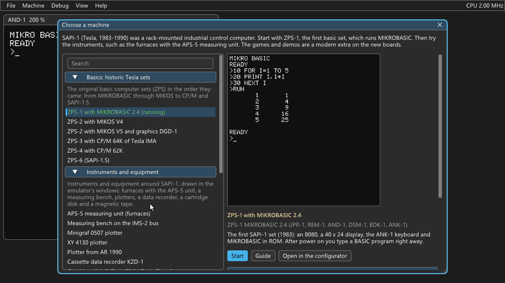</a>

  <a href="docs/img/readme/sapiemu-mikos-svetly.png">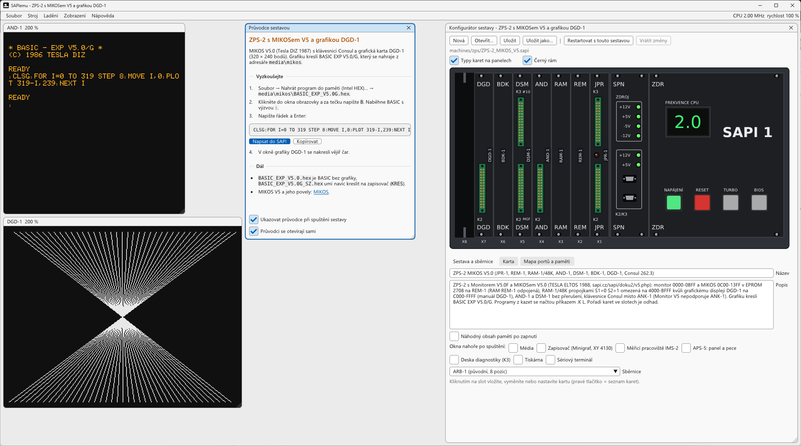</a>
  <a href="docs/img/readme/sapiemu-bombernet-tmavy.png">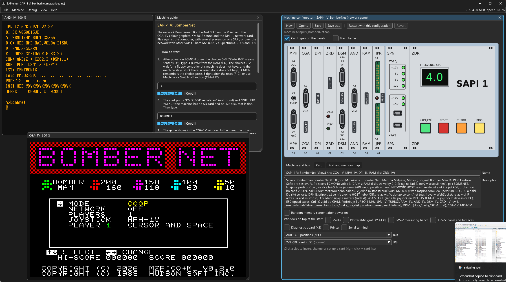</a>

*Left: ZPS-2 with MIKOS draws on the DGD-1 graphics. Right: the network game BomberNet on the SAPI-1 V machine. Next
to the screens are the machine guide and the configurator with the cards in the rack.*

## Why it was made

For some time I had been toying with the idea of writing my own emulator of the Tesla SAPI-1. But SAPI-1 is a very
complex computer: lots of configurations, lots of cards and endless ways to combine them, and new cards keep coming.
Writing software without an emulator is hard, so it is no wonder that almost none gets written for SAPI-1. A bright
exception is [Libor Lasota](https://www.pmd85.cz/), who develops his own hardware and writes his own software for it
too. Today, though, you can take an AI helper at your side, or two, three, ten, and developing software is much
easier. So I finally put together a SAPI-1 emulator that does what I had in mind. Even so, it took a lot of time and
tokens. Whether the result was worth it, judge for yourself.

I knew from the start what I wanted. The emulator should run on Windows and Linux, support nearly all the SAPI-1
cards that are available, and have timing as exact as possible, that is, behave as much like the real hardware as it
can. For developing software a debugger was a must, and for working with AI a command line and an MCP server.

The first version was done quickly, not only thanks to Claude Code, but mainly thanks to the excellent material that
Petr Všijanský (EC1045) collected on [sapi.cz](https://www.sapi.cz/), and to the enormous amount of work he put into
redrawing the schematics of the cards. That is why the emulator goes into such details as the original PROMs that
set the address mapping of the cards. Besides the original cards it also has the new boards of Libor Lasota, because
the emulator is most useful for developing and porting games. But there are a great many cards, and everything was
confusing and hard to set up, so the emulator has preset machines that you can change and save.

Just putting cards together is relatively simple, but not exactly fun. That is why you will also find in the
emulator, for example, the APS-5 measuring unit with its original firmware and emulated furnaces, the IMS-2
measuring bench with a voltmeter and a power supply, plotters and the data recorder KZD-1, a rarity today, the
cartridge disk RKD-1 or the magnetic tape RMP-1, and for most machines a guide on how to operate it all. Where I
could, I dusted off the original software, or added my own, so that all of it can be used. And I believe that if you
dig up real hardware somewhere, you have the software here to bring it back to life.

Paradoxically, the most work went into polishing the emulator: the menus and the controls, so that anyone can work
with it. It is still as complicated as a threshing machine, but that is SAPI-1 for you. Try it yourself.

## How it is developed: AI and measurements on a real SAPI-1 V

**With an AI assistant.** Without Claude Code (Anthropic), this emulator would not exist. Claude wrote most of the
code and I am not ashamed of it: the ideas, the architecture and leading the whole development were up to me, and it
was a lot of work. So I do not see the emulator as AI slop, but as my own work, in which I had helpers. I have been
developing it since October 2026. Claude writes the code and most of the notes in `docs/` to my brief and under my
review, which is why every commit has the line `Co-Authored-By: Claude`. I decide what is emulated and how, I build
and measure SAPI-1 boards, and I check the behaviour of the V boards on my own SAPI-1 V. The original Tesla boards are
based on the documentation, schematics and PROM and EPROM dumps from sapi.cz and from Libor Lasota. What has not been
checked on real hardware yet is listed in [docs/hw-otazky-priorita.md](docs/hw-otazky-priorita.md) (in Czech). If
you find a difference from a real SAPI-1, please report it in [Issues](https://github.com/mlukasek/SAPIemu/issues).

**Measurements.** To make the emulation accurate enough, I spent a lot of time measuring on a real SAPI-1 with
original and new cards. A PicoROM went into the CPU board and a Saleae Logic Pro 16 logic analyser onto the bus. It
measures both digital and analog signals, and its software Logic 2 can be automated and has its own MCP server.
Talking to the SAPI-1 went mostly over the serial line, and where that was not possible, the PicoROM helped: it has
a clever way of two-way communication, although it is "just" a ROM. So the agent wrote its own programs into the
ROM, controlled the SAPI-1, measured and recorded values, and then adjusted the emulator by them. At times I was
demoted to swapping cards and moving probes. I turned out to be quite good at it, though, and at least I know they
cannot do without us yet.

  <a href="docs/img/readme/sapi1v-mereni-1.jpg">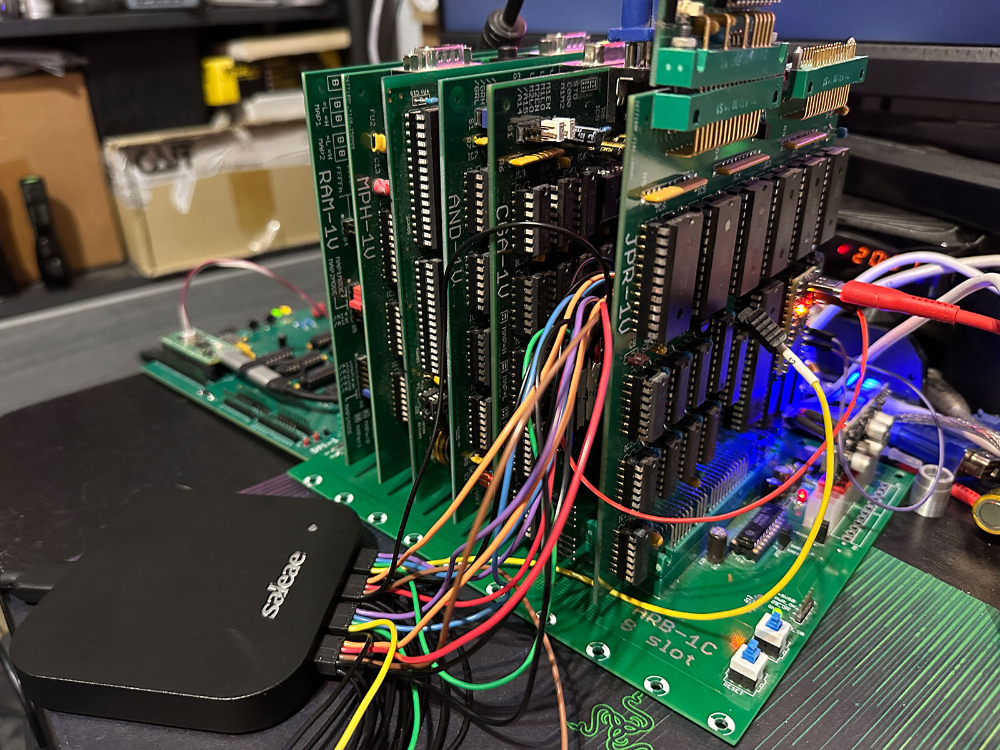</a>
  <a href="docs/img/readme/sapi1v-mereni-2.jpg">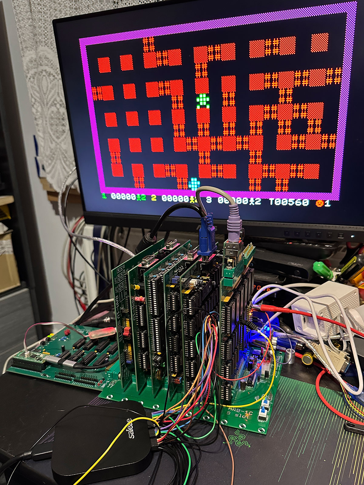</a>

What the measurements corrected in the emulator (details in [docs/zmeny-podle-hw.md](docs/zmeny-podle-hw.md), in
Czech; the measuring programs are in [tools/hwbench/](https://github.com/mlukasek/SAPIemu/tree/main/tools/hwbench)):

- **DSM-1V:** two writes of a character in quick succession send only one character on the board, because the UART
  takes the character only on an edge of its clock. The emulator sent "55 55 55", the board "55 55". Now it behaves
  like the board.
- **CGA-1V:** wait states from the probes on the bus. The copy loop of ZRDBENCH at 4 MHz takes 23.61 and 22.51 clock
  cycles per byte on the board, 23.61 and 22.50 in the emulator.
- **JPR-1V with CGA-1V or AND-1V:** an interrupt that comes while the program runs in video memory blocks the bus.
  That explained why the demo FXS4 froze, and the emulator now hangs the same way.

The CPU cores are [floooh/chips](https://github.com/floooh/chips) (Z80) and [superzazu/8080](https://github.com/superzazu/8080)
(8080, extended with the 8085), both adjusted by measurements and documentation. They are guarded by the tests ZEXDOC,
ZEXALL, 8080EXM and 8085EXM (with the checksum of a real 8085 chip) and by a check that every supplied machine boots.

## Download and run

1. Download the zip from [Releases](https://github.com/mlukasek/SAPIemu/releases) (Windows 10/11, 64 bit) and unpack
   it anywhere. Nothing is installed. Next to the zip is its SHA-256 checksum.
2. Run `sapiemu.exe`. For an unsigned program Windows shows SmartScreen: "More info" → "Run anyway".
3. The window **Choose a machine** opens. Pick a machine and press Start; the machine guide shows what to try.

This is a **beta version**, 0.7.0-beta (what is new: [docs/release-notes/v0.7.0-beta.md](docs/release-notes/v0.7.0-beta.md),
in Czech). The main things work, but expect bugs. Please report them through Help → Report a bug... (it copies the
diagnostics and the end of the log) in [Issues](https://github.com/mlukasek/SAPIemu/issues). On Linux the emulator is
built from source ([docs/build.md](docs/build.md), in Czech). In detail: [docs/getting-started.md](docs/getting-started.md).

## What to try

<a href="docs/img/readme/sapiemu-vybrat-sestavu.png">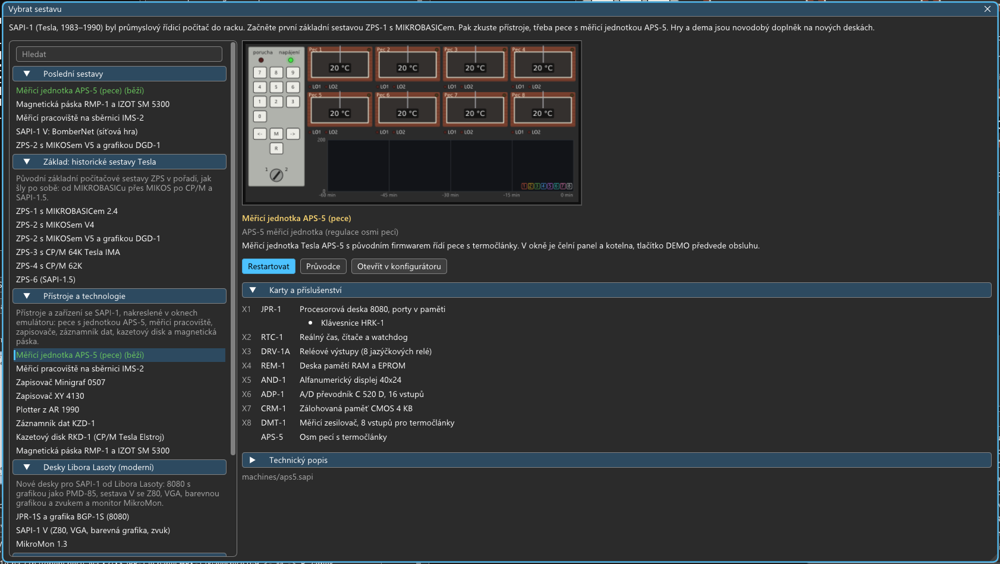</a>

- **Basics, historic Tesla sets:** ZPS-1 with MIKROBASIC (after power on you type a BASIC program right away), ZPS-2
  with MIKOS and the DGD-1 graphics, ZPS-3 with CP/M of Tesla IMA from an 8" floppy, ZPS-4 with CP/M and SAPI-1.5
  (ZPS-6) with colour semigraphics.
- **Instruments and equipment:** the APS-5 measuring unit with its original firmware controls eight furnaces (the
  DEMO button types the demonstration by itself), the IMS-2 measuring bench with a voltmeter and a power supply, the
  plotters Minigraf 0507 and XY 4130, the plotter from the magazine Amatérské radio 1990, the data recorder KZD-1, the
  cartridge disk RKD-1, the magnetic tape RMP-1 and the EPROM programmer DSE-1. The instruments are drawn in windows
  of the emulator and are operated with the mouse.
- **Boards by Libor Lasota:** SAPI-1 V with a Z80, VGA, colour graphics CGA-1V and YM3812 sound, JPR-1S with the
  BGP-1S graphics like a PMD 85, the MikroMon monitor.
- **Games and demos** (a modern extra, SAPI-1 was not a games machine): Flappy, Bad Apple!!, Prince of Persia,
  Manic Miner and the network game BomberNet, in which you can play with players on a Sharp MZ-800, ZX Spectrum,
  Amstrad CPC and PC.

  <a href="docs/img/aps5-pece.png">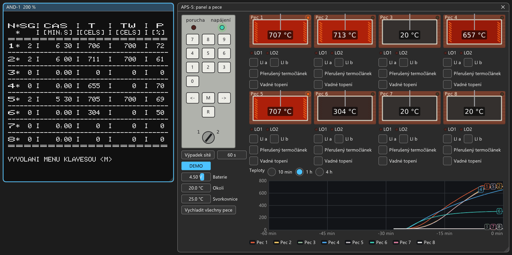</a>
  <a href="docs/img/dps1-ims2-mereni.png">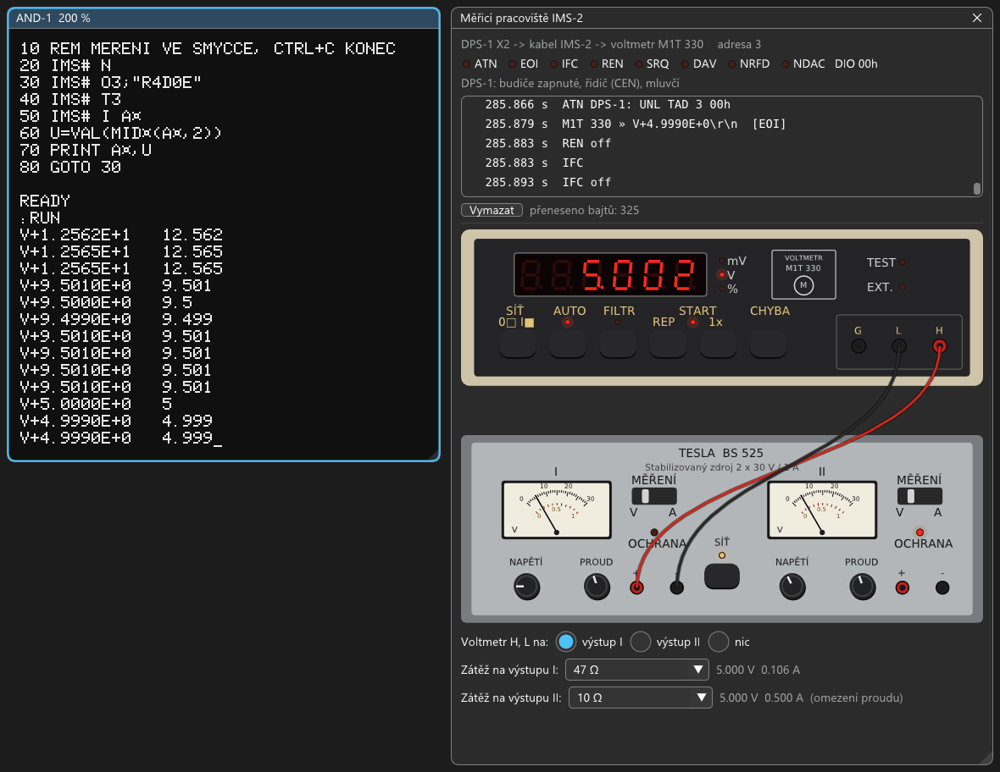</a>
  <a href="docs/img/minigraf-ukazka.png">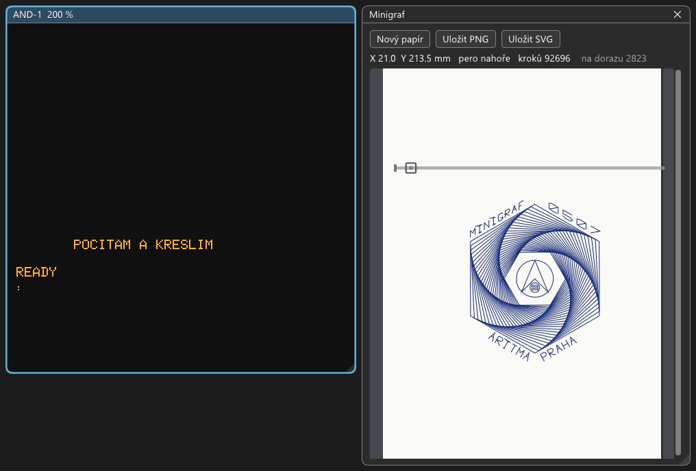</a>
  <a href="docs/img/sapi1v-cpm-cga.png">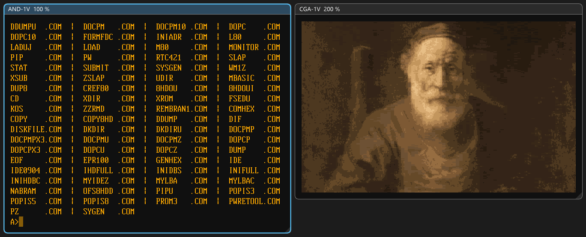</a>

*APS-5 controls the furnaces at 700 °C, BASIMS measures the voltage of the power supply with the voltmeter on the
IMS-2 bench, Minigraf draws a demonstration from the IQ 151 documentation, machine V with CP/M and a picture on the
CGA-1V graphics.*

## Features

- **Cards like the real ones:** 51 card types in the catalogue, 49 of them emulated. CPU cards with the 8080, 8085
  and Z80 including the BOOT logic and wait states, memories and RAM disks, displays, graphics, controllers of
  floppies, of the cartridge disk and of the magnetic tape, serial, parallel and IDE boards, real-time clocks and the
  cards of instruments. Jumpers as on the boards, address decoders from PROM dumps, the buses ARB-1, ARB-1A/Au,
  ARB-1B, ARB-1C and ImBUS.
- **Machine configurator:** the rack with the panels of the cards, cards dragged with the mouse, jumpers, a port and
  memory map with collisions, preset machines and your own copies (My machines).
- **Peripherals:** the keyboards EKL-1, Consul, ANK-1 and ANK-1M2, a tape recorder (WAV and MP3, a cassette made from
  a program), floppies `.img` and `.imd`, a printer, serial lines to the PC over TCP or a COM port, a joystick and a
  mouse, a network through the DPI-1L card.
- **Software:** MikroMon, MIKROBASIC, MIKOS V4 and V5, CP/M 2.2 by Tesla, R. Peřina, J. Bíba and EC1045, ELIS,
  SAPI-1.5 and the floppy library of J. Bíba (Turbo Pascal, MBASIC, FORTH, C, dBase II, WordStar...).
- **Comfort:** the window Choose a machine with previews, machine guides, help and a glossary right in the program,
  saving the state, screenshots to PNG, video with sound to MP4, full screen, light and dark appearance.

The full list by cards and instruments: [docs/funkce.md](docs/funkce.md) (in Czech).

<a href="docs/img/readme/sapiemu-konfigurator.png">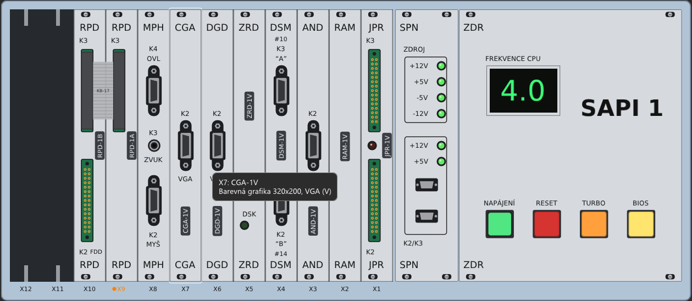</a>

## For developers

- **Debugger:** registers by CPU (8080, 8085, Z80), a disassembler, breakpoints and watchpoints, memory, an I/O log,
  a record of interrupts. Loading programs (Intel HEX, binary files), saving the state and quick checkpoints.
- **`sapiemu-cli`:** the emulator without a window, for scripts and tests (`--type`, `--wait-text`, `--print-screen`,
  `--screenshot`, `--save-state`...).
- **MCP server:** an AI assistant (Claude Code, for example) can control the emulator and write and debug programs
  for SAPI-1 ([docs/mcp.md](docs/mcp.md), in Czech). It is turned on in View → Settings → Advanced (for developers)
  and listens on `127.0.0.1` only.
- **`cpmrun`:** CP/M programs (M80, L80) on the PC over the Z80 core of the emulator. The sources of the ECMON + CP/M
  system build with it identical to the original EPROM ([docs/software/ECMON.md](docs/software/ECMON.md), in Czech).

  <a href="docs/img/readme/sapiemu-debugger.png">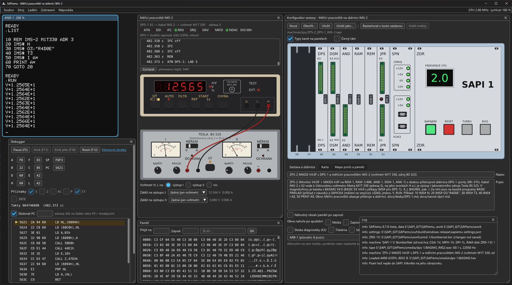</a>
  <a href="docs/img/readme/sapiemu-mcp.png">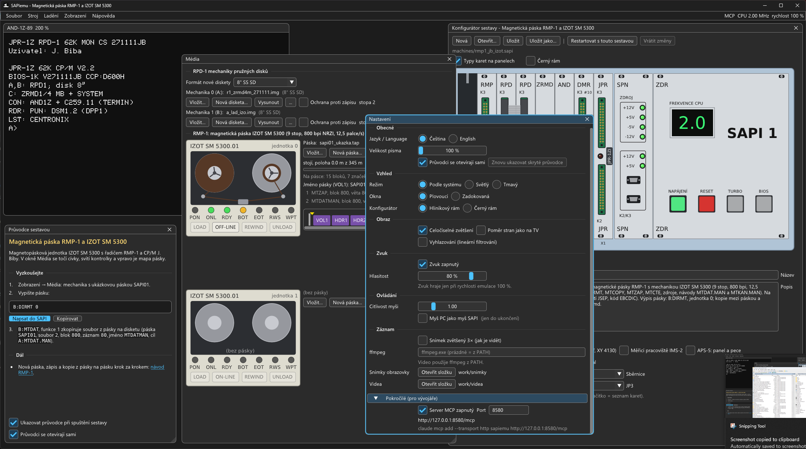</a>

**Building from source:**

- **Visual Studio 2022:** File → Open → Folder, the preset `Windows x64 Debug` or `Release`.
- **Command line:** `tools\build.cmd release test` (finds VS, builds and runs the tests).
- **Linux:** `cmake --preset linux-release && cmake --build --preset linux-release` (checked in WSL, details in
  [docs/build.md](docs/build.md), in Czech).
- **Release package:** `python tools\package.py` (the zip and its SHA-256 next to it).
- SDL3 is downloaded at the first configure (CMake FetchContent), the other libraries are in `third_party/`.

## Documentation

In English:

- [docs/getting-started.md](docs/getting-started.md): start, machines, keys, what to try. In the program Help → First
  steps.
- [docs/glossary.md](docs/glossary.md): the words of SAPI-1 and SAPIemu. In the program Help → Glossary.

The rest is in Czech:

- [docs/prvni-kroky.md](docs/prvni-kroky.md): the full first steps; [docs/slovnicek.md](docs/slovnicek.md): the
  glossary.
- [docs/funkce.md](docs/funkce.md): what the emulator can do, by cards and instruments.
- **User guides** step by step: [APS-5](docs/aps5-ukazka.md), [KZD-1](docs/navod-kzd1.md),
  [Minigraf 0507](docs/navod-minigraf.md), [XY 4130](docs/navod-xy4130.md), [plotter of AR 1990](docs/navod-ar1990.md),
  [DPS-1 and IMS-2](docs/navod-dps1.md), [RKD-1](docs/navod-rkd1.md), [RMP-1](docs/navod-rmp1.md),
  [DSE-1](docs/navod-dse1.md). In the program Help → User guides.
- [docs/sestavy.md](docs/sestavy.md): the configurator, the machines and the catalogue of cards.
- [docs/desky/](docs/desky/): notes on each board (ports, PROMs, jumpers, open questions),
  [docs/software/](docs/software/): software for SAPI-1.
- [docs/zmeny-podle-hw.md](docs/zmeny-podle-hw.md): changes after measurements on a real SAPI-1 V,
  [docs/hw-otazky-priorita.md](docs/hw-otazky-priorita.md): what is left to check on real hardware.
- For development: [docs/build.md](docs/build.md), [docs/mcp.md](docs/mcp.md), [docs/stav.md](docs/stav.md), the
  state of the project [docs/SOUHRN.md](https://github.com/mlukasek/SAPIemu/blob/main/docs/SOUHRN.md), all documents
  in the folder [docs/](docs/).

## Network and privacy

- The emulator sends nothing by itself: it has no telemetry and no update check.
- **The MCP server** listens on `127.0.0.1` only and is off in a new installation.
- **The serial line over TCP** (terminal, TeraTerm) listens on `127.0.0.1`; another address can be set in the
  configurator.
- **The DPI-1L card** (machine `sapi1v_BomberNet`) connects to the network only when a program on SAPI-1 asks for it:
  network games through the relay `api.mzpico.com` (WebSocket), TCP and DNS connections to the address the program
  gives.
- Links in the About window, in the help and in the guides open the web browser.
- **Where things are stored:** the settings, the window layout and the logs of the last two runs next to
  `sapiemu.exe`; working copies of floppies, disks and tapes, memories with a battery, printer output and your copies
  of machines in the folder `work/`. When the program folder cannot be written to (e.g. `Program Files`), the
  settings go to `%APPDATA%\SAPIemu\SAPIemu` and `work/` to `%LOCALAPPDATA%\SAPIemu\work` (Linux:
  `~/.local/share/SAPIemu`).

## Accessibility

- **Screen readers do not see the user interface:** the windows are drawn by the Dear ImGui library, which creates no
  tree of controls for the system. The text of the SAPI-1 screen can be had another way: View → Copy screen text
  (Ctrl+Shift+C), `sapiemu-cli --print-screen`, or through the serial terminal
  ([docs/seriova-linka.md](docs/seriova-linka.md), in Czech).
- **Keyboard:** Tab and the arrows move through the controls of the windows, Esc closes a dialog, Ctrl+Tab switches
  windows. In the window of the SAPI-1 screen and in the serial terminal the arrows, Space, Enter, Esc and Alt belong
  to SAPI-1.
- **State is not shown by colour only:** errors and warnings have a mark and a word, the tape recorder buttons a
  symbol, the lines in the APS-5 graph the numbers of the furnaces.
- **Text size** 100–200 % is in View → Settings → General. Some demos flash quickly (the machine guide warns about
  it).

## Licence and thanks

- **Licence:** the emulator is under GPLv3 ([LICENSE](LICENSE)), Copyright © 2026 Martin Lukášek. Third-party
  libraries have their own licences ([THIRD-PARTY-NOTICES.txt](THIRD-PARTY-NOTICES.txt),
  [third_party/README.md](third_party/README.md)).
- **ROMs, PROMs and programs** in `roms/` and `media/` belong to their authors and are here to preserve the history
  of SAPI-1. Their sources are in [roms/README.md](roms/README.md) and [media/README.md](media/README.md).
- **Prince of Persia** (machine `sapi1v_PoP`): a demonstration of historic technology, an unofficial non-commercial
  port of the game to a 40-year-old Czechoslovak computer. Prince of Persia © Jordan Mechner, graphics and music of
  the DOS version © Brøderbund Software, the rights to publish Prince of Persia games are held by Ubisoft. The
  SAPIemu licence (GPLv3) does not apply to the game data. At the request of the copyright holders I will change or
  remove anything.
- **Petr Všijanský (EC1045):** the website [sapi.cz](https://www.sapi.cz) with documentation, schematics, listings
  and dumps the emulation is based on, and the redrawn schematics of the boards.
- **Libor Lasota** ([pmd85.cz](https://www.pmd85.cz/)): the V boards, boards for the original machines (JPR-1S,
  JPR-1X, BGP-1S, AND-1B, ANK-1M2), the ImBUS bus, MikroMon, MIKROBIOS and programs for CGA-1V, MPH-1V and BGP-1S,
  used with his consent.
- **Ing. Jan Meloun (Melsoft):** a SAPI-1.5 set and the Melsoft CP/M 2.2 62K disks (1990).
- **Jiří Bíba (SAPIMAN):** monitors and CP/M BIOSes for SAPI-1 (RPD-1, FDC-1, MFC-1A, RAM disks, IDE) and the
  collection of floppies and sources in SAPI_DOKU; **EC1045** maintained them further (ECMON, PC floppies, CD and
  MOUNT for PMD32-SD).
- Software for SAPI-1 by Tesla ELTOS / DIZ, CP/M 2.2/P by R. Peřina and other programs that have survived.
