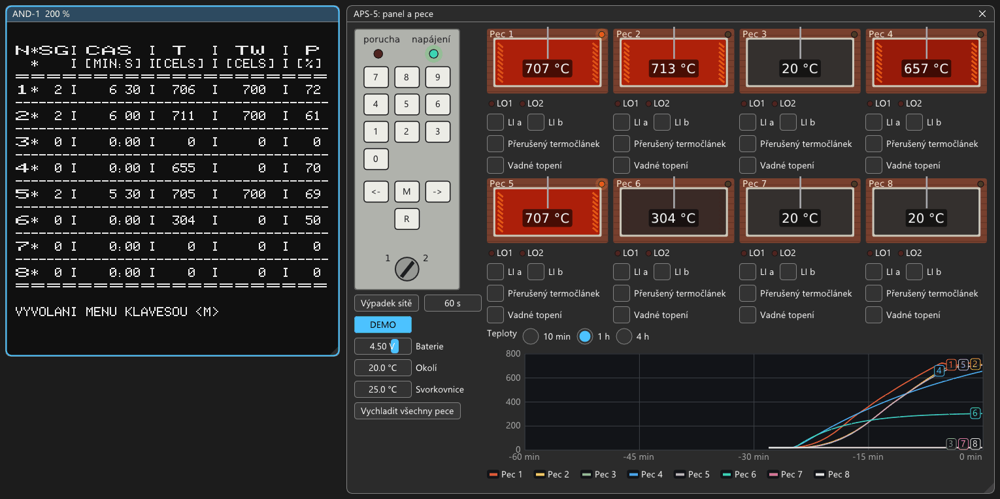
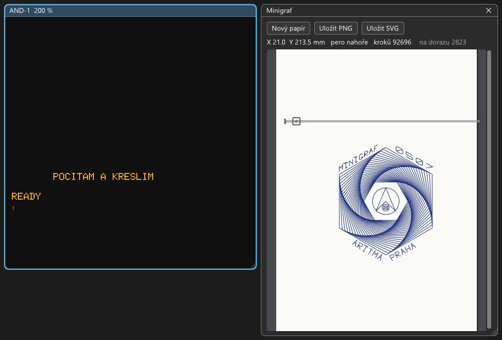
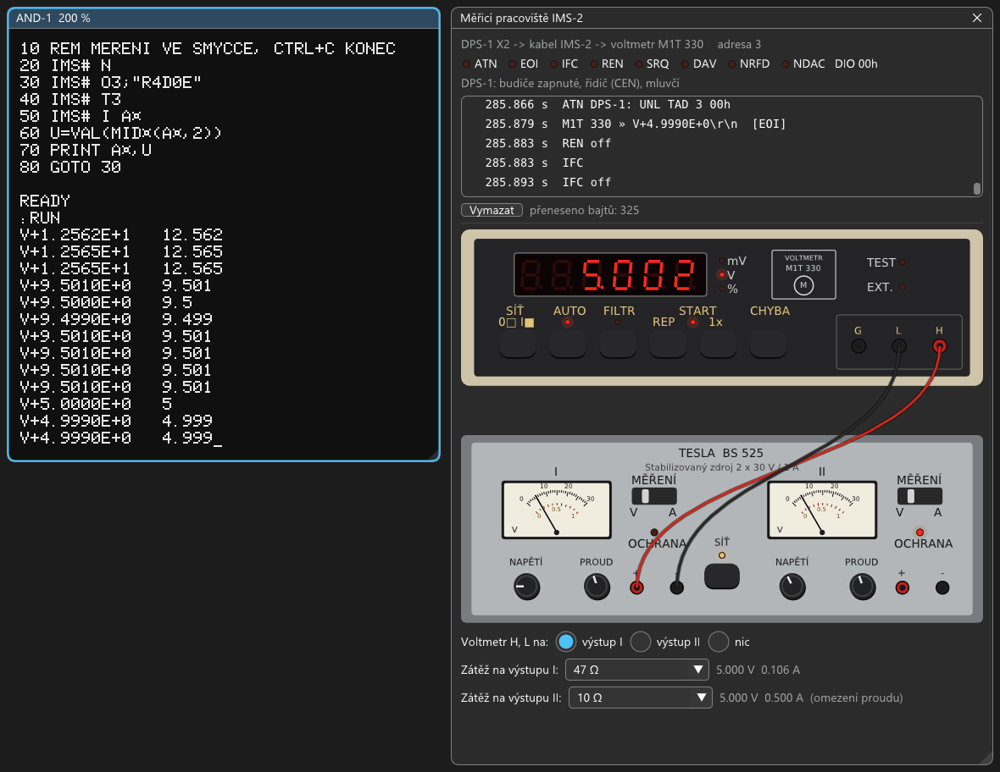

# SAPIemu

**Emulátor počítače Tesla SAPI-1.** SAPI-1 (1983–1990) byl československý průmyslový řídicí počítač, ne domácí
počítač: modulární karty s procesorem 8080 nebo Z80 v rámu na sběrnici ARB-1. Navrhl ho Ing. Eduard Smutný,
vyráběla ho Tesla Liberec. Hlavní jsou původní sestavy ZPS-1 až ZPS-4 a SAPI-1.5 (ZPS-6) s MIKROBASICem, MIKOSem
a CP/M. Karty se dají skládat a nastavovat jako skutečné (propojky, dekodéry podle PROM dumpů). K počítači patří
přístroje: měřicí jednotka APS-5 s regulací pecí, přístrojová sběrnice IMS-2 s voltmetrem a zdrojem, zapisovač
ARITMA Minigraf 0507, grafická jednotka XY 4130, plotter z Amatérského radia 1990, kazetopáskový záznamník dat KZD-1,
kazetový disk RKD-1 a magnetická páska RMP-1. Nové desky Libora Lasoty („V“, JPR-1S, JPR-1X s 8085, BGP-1S, AND-1B,
ANK-1M2) přidávají VGA, barevnou grafiku a zvuk. Hry a dema na nových deskách jsou novodobý doplněk, SAPI-1 nebyl
herní počítač. Chování desek V se ověřuje měřením na skutečném SAPI-1 V (logický analyzátor), odchylky od desky jdou
v konfigurátoru vypnout. Emulátor má vestavěný MCP server pro vývoj softwaru pro SAPI s Claude.

> *English: an emulator of the Czechoslovak Tesla SAPI-1 (1983-1990) for Windows. SAPI-1, designed by Ing. Eduard
> Smutný and made by Tesla Liberec, was an industrial control computer, not a home computer: modular cards with an
> 8080 or a Z80 in a rack on the ARB-1 bus. Cards are configured like the real boards (jumpers, address decoders
> from PROM dumps). First come the original ZPS-1 to ZPS-4 sets and SAPI-1.5 (ZPS-6) with MIKROBASIC, MIKOS and
> CP/M, then the instruments: the APS-5 furnace control unit, the IMS-2 instrument bus with a voltmeter and a power
> supply, the ARITMA Minigraf 0507 plotter, the XY 4130 graphics unit (Laboratorní přístroje Praha), the plotter from the magazine Amatérské radio (1990), the
> KZD-1 cassette data recorder, the RKD-1 cartridge disk and the RMP-1 magnetic tape. The new boards of Libor
> Lasota ("V" boards with VGA, colour graphics and YM3812 sound, JPR-1S, JPR-1X with an 8085, PMD-85 style graphics
> BGP-1S) run games and demos, a modern extra: SAPI-1 was not a games machine. Also cassette tapes made from
> programs, save states, a debugger and a built-in MCP server. The V boards are checked against a real SAPI-1 V with
> a logic analyzer.*
>
> *Getting started: download the zip from [Releases](https://github.com/mlukasek/SAPIemu/releases), unpack it
> and run `sapiemu.exe`, nothing is installed. The first start shows the window Choose a machine: the historic
> ZPS sets, instruments, the boards of Libor Lasota, games and demos, each with a preview and a short text; the
> machines of the first four groups have a guide in English (Help → Machine guide). The user interface is in Czech
> and English (View → Settings), the detailed documentation is in Czech. The emulator sends nothing anywhere by
> itself, see "Síť a soukromí" (network and privacy) below. Prince of Persia (machine `sapi1v_PoP`) is an
> unofficial, non-commercial port shown as a demonstration of historic technology; at the request of the copyright
> holders it will be changed or removed. Alpha version.*

## Stažení

Hotová verze pro Windows 10/11 (64 bit) je v [Releases](https://github.com/mlukasek/SAPIemu/releases). Rozbalit,
spustit `sapiemu.exe`, nic se neinstaluje. Jak začít: [docs/prvni-kroky.md](docs/prvni-kroky.md).

Jde o **alfa verzi** (poslední je 0.6.0-alpha, novinky v
[docs/release-notes/v0.6.0-alpha.md](docs/release-notes/v0.6.0-alpha.md)). Hlavní věci fungují, ale chyby čekejte.
Hlaste je v [Issues](https://github.com/mlukasek/SAPIemu/issues).

## Co umí

- **Procesorové karty:** JPR-1, JPR-1A a JPR-1S (8080), JPR-1X (8085: takty, RIM/SIM, nedokumentované instrukce,
  ověřeno testem 8085EXM s CRC skutečného čipu), JPR-1Z, JPR-1ZI a JPR-1V (Z80) a PKT-1 ze SAPI-1.5 (Z80, klávesnice
  a tiskárna na 8255), včetně BOOT logiky a čekacích stavů.
  Na K3 JPR-1S / JPR-1X deska diagnostiky (dvě sedmisegmentovky, tlačítka) s ukázkovým čítačem.
- **Paměti:** REM-1, RAM-1, RAM-1A, RAM-1Z, RAM-1V (mapování MAP1/MAP2), DMR-1, RSW-1 (SAPI-1.5: RAM, 8251, watchdog), CRM-1 (4 KB CMOS zálohovaná bateriemi). RAM disky RMD-1, ZRMD-1
  (s RTC) a ZRD-1V (rev 1.1 i 2.1 se softwarovým zámkem zápisu).
- **Obraz:** AND-1, AND-1A, AND-1Z, AND-1Z-89, AND-1V a AND-1B (VGA). Grafika DGD-1, DGD-1V, barevná CGA-1V
  (Bt476; kreslí se po řádcích s paprskem, takže přepnutí stránky nebo palety uprostřed snímku trhá obraz jako na
  monitoru; čekací stavy podle schématu, zpoždění změřená sondami a programem ZRDBENCH na skutečném SAPI-1 V) a BGP-1S (PMD-85, Colorace; běží na ní Manic Miner). Barevná semigrafika DBS-1A SAPI-1.5 (6845, znakový
  generátor z dumpu EPROM od EC1045).
- **Komunikace a disky:**
  - DSM-1 (sériový modem s magnetofonem: kazety WAV a MP3, program HEX/BIN se převede na kazetu MIKOS nebo
    MIKROBASIC a jde uložit jako WAV pro skutečné SAPI), DSM-1V;
  - řadiče disket RPD-1, FDC-1 a MFC-1A: 8" SS SD i diskety PC 3,5"/5,25" HD a DD (MFM, dvě strany), obrazy
    `.img` i ImageDisk `.imd` (libovolná geometrie, čtení i zápis, nová disketa `.imd` přijme jakýkoli formát),
    motory mechanik PC s rozběhem; formátování ověřené originálními programy J. Bíby a výpisy z reálných MFC-1A;
  - IDE-1 s IDE diskem a PMD32-SD, deska paralelních portů DPP-1 (PMD32-SD, tiskárna, KZD-1);
  - řadič kazetového disku RKD-1 s mechanikou CM 5403 (Zbrojovka Brno: kazeta a pevný disk, 2 × 2,4 MB) a
    původním CP/M 2.2 Tesla Elstroj 1987: boot EPROM, CBIOS, shell, formátovač; systémová kazeta vyrobená
    originálními programy, nová systémová kazeta tlačítkem Systém… (originální SYSGEN chybí); i bulharská
    mechanika CM 5400 s formátovačem FORMRKD J. Bíby a CP/M s disky D: až G: (BIOS vznikl v emulátoru, není
    dobový) ([docs/desky/RKD-1.md](docs/desky/RKD-1.md), návod k obsluze
    [docs/navod-rkd1.md](docs/navod-rkd1.md));
  - řadič magnetické pásky RMP-1 s mechanikou IZOT SM 5300 (9 stop, 800 bpi, cívky s 350 m pásky): okno Média
    s nakreslenou mechanikou, cívkami, kontrolkami a mapou pásky, obraz pásky SIMH `.tap`; běží na ní původní
    ovladač Tesly Elstroj a programy J. Bíby pro výměnu souborů s počítači JSEP (MTDAT, DIRMT, MTCOPY a jeho
    opravená kopie MTCOPYO), ukázková páska ([docs/desky/RMP-1.md](docs/desky/RMP-1.md), návod k obsluze
    [docs/navod-rmp1.md](docs/navod-rmp1.md));
  - zapisovač ARITMA Minigraf 0507 s původním ovladačem z EPROM: okno s papírem, vozíkem a perem, kresba do PNG
    a SVG, ukázka z IQ 151 vyjde stejně jako skutečná kresba ze SAPI-1 na sapi.cz; BASIC EXP V5.0/G+SZ s příkazem
    `KRES` kreslí v milimetrech (kružnice, šrafování, text);
  - grafická jednotka XY 4130 (Laboratorní přístroje Praha) na konektoru X3 desky JPR-1 s ovladačem TESLA DIZ
    z EPROM za MIKOSem V5: Monitor ho spustí sám, vozík najede na levý doraz (READY), výpisy na tiskárnu L: se
    kreslí písmem; logika READY a tlačítka PEN podle schématu XY 4140, krok 0,1 mm, i pro `KRES` na DPP-1
    ([docs/desky/XY4130.md](docs/desky/XY4130.md), návod [docs/navod-xy4130.md](docs/navod-xy4130.md));
  - deska přístrojové sběrnice DPS-1 (IMS-2, IEEE 488) s měřicím pracovištěm: voltmetr Metra M1T 330 a zdroj
    Tesla BS 525 nakreslené v okně, knoflíky zdroje se točí myší, zátěž s omezením proudu, monitor sběrnice;
    BASIMS V4.0 (BASIC s `IMS#`) z kazety měří napětí, na kazetě jsou za ním ukázkové programy `PRIKLAD`
    a `SMYCKA` (`LOAD`) ([docs/desky/DPS-1.md](docs/desky/DPS-1.md), návod [docs/navod-dps1.md](docs/navod-dps1.md));
  - plotter z Amatérského radia 1990: deska JPR-1 jako řadič zapisovače Minigraf s programem přepsaným z výpisu
    v AR, povely Sharp MZ-1P16 posílané z okna Minigraf (soubor, řádek povelů, ukázka), tlačítka STOP, TEST,
    READY a přepínače panelu ([docs/desky/AR1990.md](docs/desky/AR1990.md), návod
    [docs/navod-ar1990.md](docs/navod-ar1990.md));
  - kazetopáskový záznamník dat KZD-1 s MIKOSem/K V5.0: model mechaniky a dvou stop, kazety `.kzd` s oběma
    stranami a zoubky proti zápisu, kreslená kazeta s cívkami v okně Média, kopírovací program CKM magnetofon ↔
    KZD-1 v originále i v opravené kopii (`media/mikos/CKM_opraveny.hex`, originál po čtení z KZD-1 nastaví
    nulovou délku bloku). Návody k obsluze KZD-1 a Minigrafu:
    [docs/navod-kzd1.md](docs/navod-kzd1.md), [docs/navod-minigraf.md](docs/navod-minigraf.md),
    [docs/navod-xy4130.md](docs/navod-xy4130.md);
  - DSP-1 se dvěma sériovými kanály 8251 (programy XMODEM J. Bíby ověřené oběma směry);
  - deska reálného času RTC-1 (čítač ve dvousekundách podle hodin PC, 8253, přerušení, watchdog);
  - tiskárna Centronics na X3 procesorové karty nebo na DPP-1: soubor s bajty a okno s vytištěným textem;
  - okno Média: mechaniky podle jednotek řadiče s písmenem v CP/M (ze sestavy, nebo zjištěné za chodu); výměna
    média se zapíše do sestavy, média z `media/` se používají přes pracovní kopii, kterou jde vrátit („Obnovit
    z originálu“); zápisy se do souborů ukládají průběžně (pár sekund po posledním zápisu, při pauze a přepnutí
    do jiného okna) přes dočasný soubor, takže pád nenechá napůl zapsaný obraz;
  - sériové linky do PC přes TCP nebo COM port, okno terminálu s odesíláním a příjmem souborů (i XMODEM) a schránkou (výběr myší rovnou do schránky).
- **Měření a regulace: měřicí jednotka APS-5** s původním firmwarem Tesla (regulace osmi pecí adaptivním PSD):
  - desky A/D převodníku ADP-1, měřicího zesilovače DMT-1 a relé DRV-1A, panel HRK-1 s klávesnicí, zámkem
    a watchdogem;
  - simulace pecí s termočlánky (Fe-Ko, ch-a, ch-k, PtRh) a okno, kde pece žhnou podle teploty, s grafem
    a tlačítkem DEMO, které ukázku odťuká na panelu samo;
  - výpadek sítě s varováním, jak ho firmware čeká ([docs/desky/APS-5.md](docs/desky/APS-5.md), ukázka krok za
    krokem [docs/aps5-ukazka.md](docs/aps5-ukazka.md)).
- **Zvuk a hry:** MPH-1V (YM3812 přes Nuked-OPL3, 82C54, joystick a myš Atari ST/Amiga), bzučák klávesnice.
  Joystick z gamepadu nebo z klávesnice, myš PC.
- **Karta DPI-1L (Repository API na B0h/B1h), bajt po bajtu podle záznamů ze skutečné karty:**
  - síťové hry: příkazy NET A0h–A9h hrají přes relay `ws://api.mzpico.com/net` v jedné místnosti s MZ-800, ZX
    Spectrem, CPC a PC (BomberNet, sestava `sapi1v_BomberNet.sapi`);
  - SD karta nad složkou PC (`work/dpi-1l/sdcard`): soubory a adresáře, české názvy v KOI-8čs2, `DPI.COM` v CP/M
    funguje;
  - TCP a DNS do sítě PC, nastavení v `/DPI/DPI.INI`, RTC, BOOT;
  - verzi hlásí jako skutečná karta s firmwarem 0.5.3 (REV `DPI-1L v0.5.3`, REVD `00 05 44 01`)
    ([docs/desky/DPI-1L.md](docs/desky/DPI-1L.md)).
- **Klávesnice:** EKL-1, Consul 262.3, Consul 259.11, membránová ANK-1 a Liborova ANK-1M2 s konektorem
  joysticku (joystick z šipek a mezerníku nebo gamepadu, myš). Matice ANK-1 drží klávesu, dokud ji držíš na PC
  (bez fronty a autorepeatu), a má režim pro hry (Ctrl+F7: klávesy podle polohy, Shift = SHIFT). Text ze schránky
  se dá napsat na klávesnici SAPI (Ctrl+Shift+V), třeba program v BASICu.
- **Software:** MikroMon, MIKROBASIC, MIKOS V4/V5 a MIKOS/D, CP/M 2.2/P (R. Peřina) pro ZPS-3/4 s RPD-1
  i FDC-1, originální CP/M Tesla IMA 48K a 64K pro ZPS-3, ELIS, MikroBIOS, ECMON a CP/M 2.2 J. Bíby a EC1045 z RAM
  disku ZRMD-1, z 8" diskety (RPD-1, FDC-1, MFC-1A), z disket PC HD, z PMD32-SD a z IDE disku. MIKROBIOS
  a Falcon Monitor pro JPR-1S s BGP-1S a hry z PMD-85 (Manic Miner), nahrávané i příkazem BOOT po sériové lince. Knihovna disket J. Bíby (Turbo Pascal, MBASIC, FORTH,
  Pascal/MT+, C, dBase II, WordStar…) a soupis celé jeho sbírky. CP/M 2.2 62K pro SAPI-1.5 (ZPS-6, ROM PKT-1
  MON-V100690, diskety Melsoft 5,25" s M80, MBASIC, COBOL, Pascal MT+; [docs/software/SAPI-1.5.md](docs/software/SAPI-1.5.md)).
- **Zdrojáky systému ECMON + CP/M** se dají přeložit na PC: nástroj `cpmrun` spouští programy pro CP/M (M80,
  L80) nad Z80 jádrem emulátoru a překlad souhlasí s originální EPROM i RAM diskem
  ([docs/software/ECMON.md](docs/software/ECMON.md)).
- **Konfigurátor sestavy:**
  - panely karet podle modernizované skříně Libora Lasoty s popsanými panely (původní Tesla SAPI-1 měl holé karty
    za krycím panelem), LED podle emulace, konektory podle fotografií desek;
  - sběrnice ARB-1, ARB-1A/Au, ARB-1B, ARB-1C (14 i 8 pozic) a ImBUS9/ImBUS12 Libora Lasoty;
  - propojky, některé i za chodu; karty jde myší přetáhnout do jiného slotu;
  - změny, které běžící stroj ještě nemá, jsou oranžové („Restartovat s touto sestavou“, „Vrátit změny“);
  - mapa portů a paměti s kolizemi pro všechny stavy MAP1/MAP2.
- **Ladění:** debugger (registry, disassembler, paměť, breakpointy a watchpointy, I/O log), ukládání stavu (i
  rychlé checkpointy), záznam přerušení (MCP `int_log`, varování, když se vektor IM 2 čte z videopaměti),
  volba sestavy „náhodný obsah pamětí po zapnutí“ (RAM, videopaměti, palety jako na železe), počty zápisů do
  palety CGA-1V během zobrazování a přepnutí uprostřed snímku, nahrávání programů (Intel HEX i `.txt`, binární
  soubory), nahrávání zvuku do WAV,
  snímky obrazovek do PNG nebo schránky (Ctrl+F5, pravé tlačítko na obraz), video se zvukem do MP4 přes ffmpeg
  (Ctrl+Alt+F5).
- **Windows 11, sestaví se i na Linuxu** (ověřeno ve WSL, `docs/build.md`).
- **GUI česky i anglicky** (Zobrazení → Jazyk / Language, poprvé podle Windows).
- **Bez okna:** `sapiemu-cli` pro skripty a testy (`--type`, `--wait-text`, `--screenshot`, `--audio-wav`,
  `--joystick`, `--save-state` …).
- **MCP server** (`http://127.0.0.1:8580/mcp`, v GUI se zapíná v Zobrazení → Nastavení): Claude Code může emulátor
  ovládat, psát a ladit programy
  a nakonec ho i ukončit (`quit`, média se uloží) ([docs/mcp.md](docs/mcp.md)).

## Dokumentace

- [docs/prvni-kroky.md](docs/prvni-kroky.md): spuštění, sestavy, klávesy, co vyzkoušet.
- [docs/aps5-ukazka.md](docs/aps5-ukazka.md): měřicí jednotka APS-5 krok za krokem (nebo tlačítko DEMO).
- [docs/navod-kzd1.md](docs/navod-kzd1.md): návod k záznamníku dat KZD-1 (příprava kazety, ukládání z BASICu
  i monitoru, adresář, kopírování z magnetofonu a zpět programem CKM, i jeho opravenou kopií).
- [docs/navod-minigraf.md](docs/navod-minigraf.md): návod k zapisovači Minigraf 0507 (ovladač z EPROM, kreslení
  z BASICu přes `CALL`, příkaz `KRES` v milimetrech, s příklady).
- [docs/vydani/sestavy.md](docs/vydani/sestavy.md): sestavy ve vydání po skupinách (Základ, Přístroje
  a technologie, Desky Libora Lasoty, Hry a dema, Ostatní), okno Vybrat sestavu s náhledy a průvodci.
- [docs/navod-xy4130.md](docs/navod-xy4130.md): návod k grafické jednotce XY 4130 (tlačítko PEN, zkouška, výpis
  `LLIST`, ukázka kresby ze strojového kódu, nový papír).
- [docs/navod-dps1.md](docs/navod-dps1.md): návod k desce DPS-1 a měřicímu pracovišti IMS-2 (BASIMS z kazety,
  měření voltmetrem M1T 330, smyčka, okno s přístroji a monitorem sběrnice, příkazy).
- [docs/navod-ar1990.md](docs/navod-ar1990.md): návod k plotteru z AR 1990 (zapnutí, test, ukázka, povely
  grafického a textového režimu, přepínače).
- [docs/navod-rkd1.md](docs/navod-rkd1.md): návod ke kazetovému disku RKD-1 s CP/M Tesla Elstroj (start, shell SH
  a uživatelé, formátování pevného disku, kopírování, výměna kazet, ochrana proti zápisu).
- [docs/navod-rmp1.md](docs/navod-rmp1.md): návod k magnetické pásce RMP-1 (mechanika v okně Média, obsah pásky,
  kopírování mezi páskou a disketou programem MTDAT, nová páska a její inicializace, kopie z pásky na pásku
  programem MTCOPY krok za krokem a jeho opravená kopie MTCOPYO).
- [docs/sestavy.md](docs/sestavy.md): konfigurátor, sestavy a katalog karet.
- [docs/desky/](docs/desky/): poznatky o jednotlivých deskách (porty, PROM, propojky, nejasnosti).
- [docs/software/](docs/software/): software pro SAPI (ECMON, CP/M ZPS-3, systémy J. Bíby a EC1045
  v [CPM_SAPIMAN.md](docs/software/CPM_SAPIMAN.md), soupis a knihovna jeho disket
  v [SAPIMAN_diskety.md](docs/software/SAPIMAN_diskety.md), formát kazety MIKOS a MIKROBASIC a kazeta z programu
  v [kazeta.md](docs/software/kazeta.md)).
- [docs/8085.md](docs/8085.md): procesor 8085 (JPR-1X): takty, RIM/SIM, nedokumentované instrukce, příznaky.
- [docs/tiskarna.md](docs/tiskarna.md): tiskárna Centronics (X3 procesorové karty, DPP-1).
- [docs/desky/KZD-1.md](docs/desky/KZD-1.md): kazetopáskový záznamník dat KZD-1 a MIKOS/K.
- [docs/desky/Minigraf.md](docs/desky/Minigraf.md): zapisovač ARITMA Minigraf 0507 a jeho ovladač.
- [docs/desky/XY4130.md](docs/desky/XY4130.md): grafická jednotka XY 4130 (rozhraní řady XY 41x0, ovladač za MIKOSem V5,
  `KRES`).
- [docs/hw-otazky.md](docs/hw-otazky.md): všechny otevřené otázky k ověření na skutečném HW (generuje
  `tools/hw_otazky.py`), roztříděné podle důležitosti v [docs/hw-otazky-priorita.md](docs/hw-otazky-priorita.md).
- [docs/hw-otazky-priorita.md](docs/hw-otazky-priorita.md): otevřené otázky na HW podle důležitosti.
- [docs/zmeny-podle-hw.md](docs/zmeny-podle-hw.md): změny emulátoru podle měření na skutečném SAPI-1 V
  (pracoviště s PicoROM a logickým analyzátorem, programy v `tools/hwbench/`): UART DSM-1V, čekání CGA-1V
  a AND-1V, prázdná sběrnice JPR-1V, YM3812 na MPH-1V, zamrzání při přerušení v okně videokarty a co měření
  potvrdilo beze změny.
- [docs/stav.md](docs/stav.md): ukládání stavu. [docs/mcp.md](docs/mcp.md): MCP server.
  [docs/build.md](docs/build.md): sestavení a tipy pro vývoj.
- [docs/SOUHRN.md](docs/SOUHRN.md): stav projektu, plán, otázky k ověření na skutečném hardwaru.

## Sestavení ze zdrojů

- **Visual Studio 2022:** Soubor → Otevřít → Složka, preset `Windows x64 Debug` nebo `Release`.
- **Příkazová řádka:** `tools\build.cmd release test` (najde VS, sestaví a spustí testy).
- **Balík pro vydání:** `python tools\package.py`.
- SDL3 se stáhne při prvním configure (CMake FetchContent). Ostatní knihovny jsou v `third_party/`.

## Síť a soukromí

- Emulátor sám od sebe nic neodesílá: nemá telemetrii ani kontrolu aktualizací.
- **Server MCP** (vývoj s Claude) poslouchá jen na `127.0.0.1`. V nové instalaci je vypnutý, zapíná se
  v Zobrazení → Nastavení.
- **Sériová linka přes TCP** (terminál, TeraTerm) poslouchá na `127.0.0.1`, jinou adresu jde nastavit
  v konfigurátoru.
- **Karta DPI-1L** (sestava `sapi1v_BomberNet`) se připojí do sítě, až o to požádá program na SAPI:
  - síťové hry přes relay `api.mzpico.com` (WebSocket);
  - spojení TCP a DNS na adresu, kterou zadá program.
- Odkazy v okně O programu a v průvodcích otevřou webový prohlížeč.
- **Kam se co ukládá:**
  - nastavení, rozložení oken (`imgui.ini`) a log posledního spuštění (`sapiemu.log`) ukládá emulátor vedle
    `sapiemu.exe`;
  - pracovní kopie disket, disků a kazet, obsah pamětí s baterií a výstupy tiskáren jsou ve složce `work/`;
  - když do složky programu nejde zapisovat (např. `Program Files`), ukládá se nastavení do
    `%APPDATA%\SAPIemu\SAPIemu` a `work/` do `%LOCALAPPDATA%\SAPIemu\work` (Linux: `~/.local/share/SAPIemu`).

## Licence a poděkování

- **Licence:** emulátor je pod GPLv3 ([LICENSE](LICENSE)), Copyright © 2026 Martin Lukášek. Knihovny třetích stran
  mají vlastní licence ([THIRD-PARTY-NOTICES.txt](THIRD-PARTY-NOTICES.txt), [third_party/README.md](third_party/README.md)).
- **ROM, PROM a programy** v `roms/` a `media/` patří svým autorům a jsou tu pro zachování historie SAPI-1.
  Zdroje jsou v [roms/README.md](roms/README.md) a [media/README.md](media/README.md).
- **Prince of Persia** (sestava `sapi1v_PoP`): ukázka historické technologie: neoficiální nekomerční port hry na 40
  let starý československý počítač. Prince of Persia © Jordan Mechner, grafika a hudba DOS verze © Brøderbund
  Software, práva vydávat hry Prince of Persia má Ubisoft. Licence SAPIemu (GPLv3) se na data hry nevztahuje. Na
  žádost nositelů autorských práv cokoli upravím nebo odstraním.
- **Petr Všijanský (EC1045):** stránky [sapi.cz](https://www.sapi.cz) s dokumentací, schématy, výpisy a dumpy,
  ze kterých emulace vychází, a překreslená schémata desek.
- **Libor Lasota:** desky V, desky k původním sestavám (JPR-1S, JPR-1X, BGP-1S, AND-1B, ANK-1M2), sběrnice ImBUS, MikroMon, MIKROBIOS
  a programy pro CGA-1V, MPH-1V a BGP-1S, použité s jeho souhlasem.
- **Jiří Bíba (SAPIMAN):** monitory a BIOSy CP/M pro SAPI-1 (RPD-1, FDC-1, MFC-1A, RAM disky, IDE) a sbírka disket
  a zdrojáků v SAPI_DOKU; **EC1045** je dál udržoval (ECMON, diskety PC, CD a MOUNT pro PMD32-SD).
- Software pro SAPI-1 od Tesla ELTOS / DIZ, CP/M 2.2/P od R. Peřiny a další programy, které se zachovaly.
