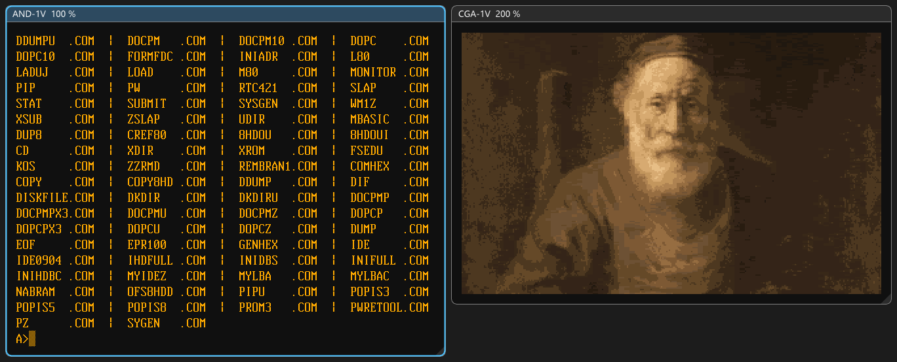
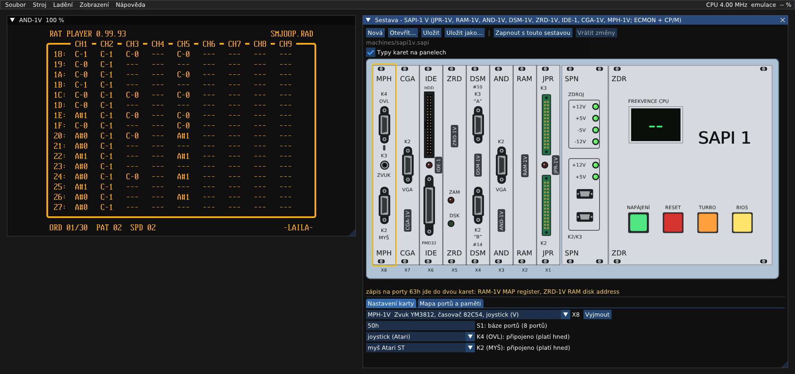
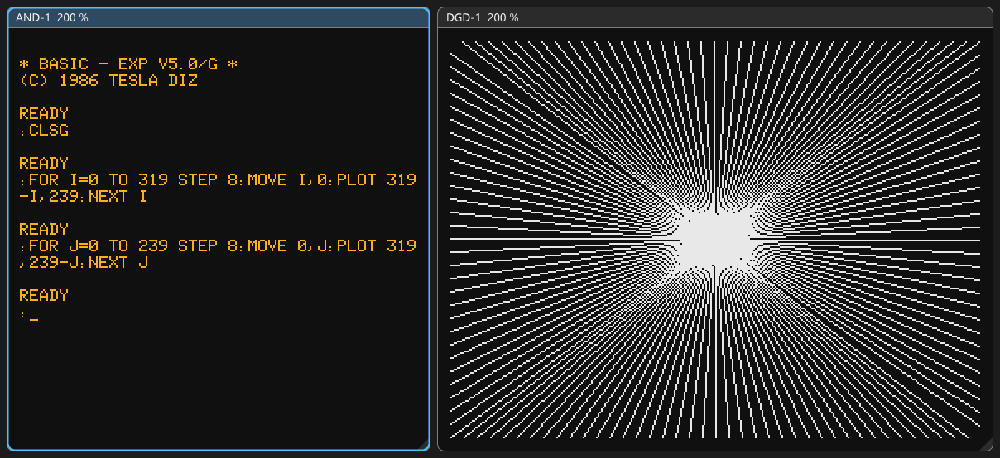

# SAPIemu

**Emulátor počítače Tesla SAPI-1**: Z80, 8080 a 8085, modulární karty na sběrnici ARB-1, od původních sestav ZPS-1
až ZPS-4 po nové desky Libora Lasoty („V“, JPR-1S, JPR-1X, BGP-1S, AND-1B, ANK-1M2). Karty se dají skládat a nastavovat jako skutečné (propojky, dekodéry podle
PROM dumpů). Emulátor má vestavěný MCP server pro vývoj softwaru pro SAPI s Claude.

> *English: an emulator of the Czechoslovak Tesla SAPI-1 modular computer (Z80/8080/8085, ARB-1 bus) for Windows.
> Cards are configured like the real boards (jumpers, address decoders from PROM dumps). Original ZPS-1 to ZPS-4
> machines with MIKROBASIC, MIKOS and CP/M, the new boards of Libor Lasota ("V" boards with VGA, colour graphics
> and YM3812 sound, JPR-1S/JPR-1X, PMD-85 style graphics BGP-1S), cassette tapes made from programs, save
> states, a debugger and a built-in MCP server. Alpha version, the documentation is in Czech.*

## Stažení

Hotová verze pro Windows 10/11 (64 bit) je v [Releases](https://github.com/mlukasek/SAPIemu/releases). Rozbalit,
spustit `sapiemu.exe`, nic se neinstaluje. Jak začít: [docs/prvni-kroky.md](docs/prvni-kroky.md).

Jde o **alfa verzi**. Hlavní věci fungují, ale chyby čekejte. Hlaste je v
[Issues](https://github.com/mlukasek/SAPIemu/issues).

## Co umí

- **Procesorové karty:** JPR-1, JPR-1A a JPR-1S (8080), JPR-1X (8085: takty, RIM/SIM, nedokumentované instrukce,
  ověřeno testem 8085EXM s CRC skutečného čipu), JPR-1Z, JPR-1ZI a JPR-1V (Z80), včetně BOOT logiky a čekacích stavů.
  Na K3 JPR-1S / JPR-1X deska diagnostiky (dvě sedmisegmentovky, tlačítka) s ukázkovým čítačem.
- **Paměti:** REM-1, RAM-1, RAM-1A, RAM-1Z, RAM-1V (mapování MAP1/MAP2), DMR-1. RAM disky RMD-1, ZRMD-1
  (s RTC) a ZRD-1V (rev 1.1 i 2.1 se softwarovým zámkem zápisu).
- **Obraz:** AND-1, AND-1A, AND-1Z, AND-1Z-89, AND-1V a AND-1B (VGA). Grafika DGD-1, DGD-1V, barevná CGA-1V
  (Bt476) a BGP-1S (PMD-85, Colorace; běží na ní Manic Miner).
- **Komunikace a disky:**
  - DSM-1 (sériový modem s magnetofonem: kazety WAV a MP3, program HEX/BIN se převede na kazetu MIKOS nebo
    MIKROBASIC a jde uložit jako WAV pro skutečné SAPI), DSM-1V;
  - řadiče disket RPD-1, FDC-1 a MFC-1A: 8" SS SD i diskety PC 3,5"/5,25" HD a DD (MFM, dvě strany), obrazy
    `.img` i ImageDisk `.imd` (libovolná geometrie, čtení i zápis, nová disketa `.imd` přijme jakýkoli formát),
    motory mechanik PC s rozběhem; formátování ověřené originálními programy J. Bíby a výpisy z reálných MFC-1A;
  - IDE-1 s IDE diskem a PMD32-SD, deska paralelních portů DPP-1 (PMD32-SD, tiskárna);
  - tiskárna Centronics na X3 procesorové karty nebo na DPP-1: soubor s bajty a okno s vytištěným textem;
  - okno Média: mechaniky podle jednotek řadiče s písmenem v CP/M (ze sestavy, nebo zjištěné za chodu);
  - sériové linky do PC přes TCP nebo COM port, okno terminálu s odesíláním a příjmem souborů (i XMODEM) a schránkou (výběr myší).
- **Zvuk a hry:** MPH-1V (YM3812 přes Nuked-OPL3, 82C54, joystick a myš Atari ST/Amiga), bzučák klávesnice.
  Joystick z gamepadu nebo z klávesnice, myš PC.
- **Klávesnice:** EKL-1, Consul 262.3, Consul 259.11, membránová ANK-1 a Liborova ANK-1M2 s konektorem
  joysticku (joystick z šipek a mezerníku nebo gamepadu, myš). Matice ANK-1 drží klávesu, dokud ji držíš na PC
  (bez fronty a autorepeatu), a má režim pro hry (Ctrl+F7: klávesy podle polohy, Shift = SHIFT).
- **Software:** MikroMon, MIKROBASIC, MIKOS V4/V5 a MIKOS/D, CP/M 2.2/P (R. Peřina) pro ZPS-3/4 s RPD-1
  i FDC-1, originální CP/M Tesla IMA 48K a 64K pro ZPS-3, ELIS, MikroBIOS, ECMON a CP/M 2.2 J. Bíby a EC1045 z RAM
  disku ZRMD-1, z 8" diskety (RPD-1, FDC-1, MFC-1A), z disket PC HD, z PMD32-SD a z IDE disku. MIKROBIOS
  a Falcon Monitor pro JPR-1S s BGP-1S a hry z PMD-85 (Manic Miner), nahrávané i příkazem BOOT po sériové lince. Knihovna disket J. Bíby (Turbo Pascal, MBASIC, FORTH,
  Pascal/MT+, C, dBase II, WordStar…) a soupis celé jeho sbírky.
- **Zdrojáky systému ECMON + CP/M** se dají přeložit na PC: nástroj `cpmrun` spouští programy pro CP/M (M80,
  L80) nad Z80 jádrem emulátoru a překlad souhlasí s originální EPROM i RAM diskem
  ([docs/software/ECMON.md](docs/software/ECMON.md)).
- **Konfigurátor sestavy:**
  - panely karet jako na skutečném stroji, LED podle emulace;
  - propojky, některé i za chodu; karty jde myší přetáhnout do jiného slotu;
  - změny, které běžící stroj ještě nemá, jsou oranžové („Restartovat s touto sestavou“, „Vrátit změny“);
  - mapa portů a paměti s kolizemi pro všechny stavy MAP1/MAP2.
- **Ladění:** debugger (registry, disassembler, paměť, breakpointy a watchpointy, I/O log), ukládání stavu (i
  rychlé checkpointy), nahrávání programů (Intel HEX i `.txt`, binární soubory), nahrávání zvuku do WAV.
- **Windows 11, sestaví se i na Linuxu** (ověřeno ve WSL, `docs/build.md`).
- **GUI česky i anglicky** (Zobrazení → Jazyk / Language, poprvé podle Windows).
- **Bez okna:** `sapiemu-cli` pro skripty a testy (`--type`, `--wait-text`, `--screenshot`, `--audio-wav`,
  `--save-state` …).
- **MCP server** (`http://127.0.0.1:8580/mcp`): Claude Code může emulátor ovládat, psát a ladit programy
  ([docs/mcp.md](docs/mcp.md)).

## Dokumentace

- [docs/prvni-kroky.md](docs/prvni-kroky.md): spuštění, sestavy, klávesy, co vyzkoušet.
- [docs/sestavy.md](docs/sestavy.md): konfigurátor, sestavy a katalog karet.
- [docs/desky/](docs/desky/): poznatky o jednotlivých deskách (porty, PROM, propojky, nejasnosti).
- [docs/software/](docs/software/): software pro SAPI (ECMON, CP/M ZPS-3, systémy J. Bíby a EC1045
  v [CPM_SAPIMAN.md](docs/software/CPM_SAPIMAN.md), soupis a knihovna jeho disket
  v [SAPIMAN_diskety.md](docs/software/SAPIMAN_diskety.md), formát kazety MIKOS a MIKROBASIC a kazeta z programu
  v [kazeta.md](docs/software/kazeta.md)).
- [docs/8085.md](docs/8085.md): procesor 8085 (JPR-1X): takty, RIM/SIM, nedokumentované instrukce, příznaky.
- [docs/tiskarna.md](docs/tiskarna.md): tiskárna Centronics (X3 procesorové karty, DPP-1).
- [docs/stav.md](docs/stav.md): ukládání stavu. [docs/mcp.md](docs/mcp.md): MCP server.
  [docs/build.md](docs/build.md): sestavení a tipy pro vývoj.
- [docs/SOUHRN.md](docs/SOUHRN.md): stav projektu, plán, otázky k ověření na skutečném hardwaru.

## Sestavení ze zdrojů

- **Visual Studio 2022:** Soubor → Otevřít → Složka, preset `Windows x64 Debug` nebo `Release`.
- **Příkazová řádka:** `tools\build.cmd release test` (najde VS, sestaví a spustí testy).
- **Balík pro vydání:** `python tools\package.py`.
- SDL3 se stáhne při prvním configure (CMake FetchContent). Ostatní knihovny jsou v `third_party/`.

## Licence a poděkování

- **Licence:** emulátor je pod GPLv3 ([LICENSE](LICENSE)). Knihovny třetích stran mají vlastní licence
  ([third_party/README.md](third_party/README.md)).
- **ROM, PROM a programy** v `roms/` a `media/` patří svým autorům a jsou tu pro zachování historie SAPI-1.
  Zdroje jsou v [roms/README.md](roms/README.md) a [media/README.md](media/README.md).
- **Petr Všijanský (EC1045):** stránky [sapi.cz](https://www.sapi.cz) s dokumentací, schématy, výpisy a dumpy,
  ze kterých emulace vychází, a překreslená schémata desek.
- **Libor Lasota:** desky V, desky k původním sestavám (JPR-1S, JPR-1X, BGP-1S, AND-1B, ANK-1M2), MikroMon, MIKROBIOS
  a programy pro CGA-1V, MPH-1V a BGP-1S, použité s jeho souhlasem.
- **Jiří Bíba (SAPIMAN):** monitory a BIOSy CP/M pro SAPI-1 (RPD-1, FDC-1, MFC-1A, RAM disky, IDE) a sbírka disket
  a zdrojáků v SAPI_DOKU; **EC1045** je dál udržoval (ECMON, diskety PC, CD a MOUNT pro PMD32-SD).
- Software pro SAPI-1 od Tesla ELTOS / DIZ, CP/M 2.2/P od R. Peřiny a další programy, které se zachovaly.
