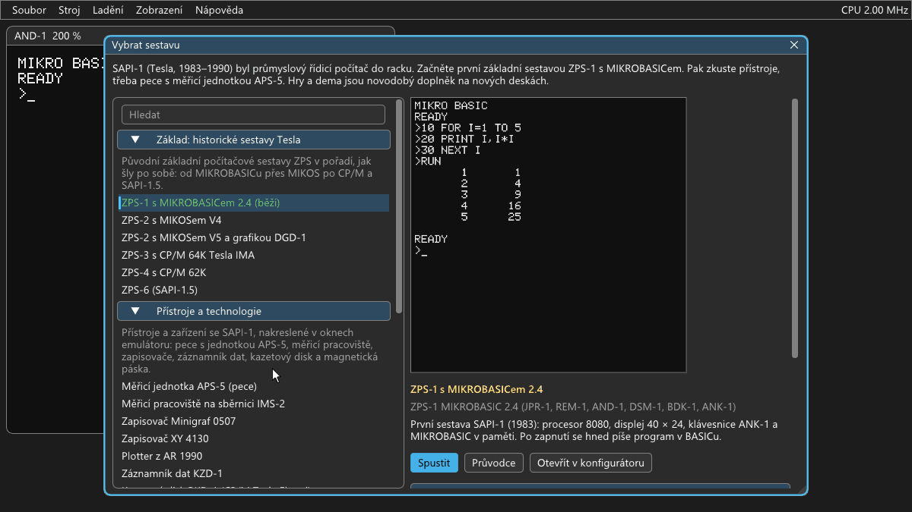
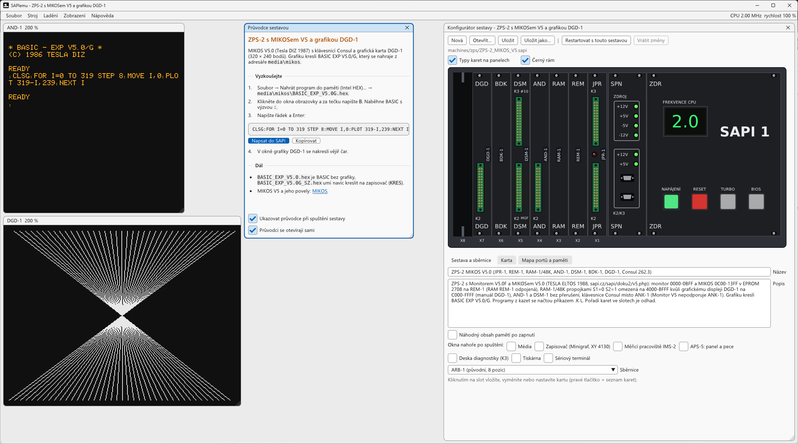
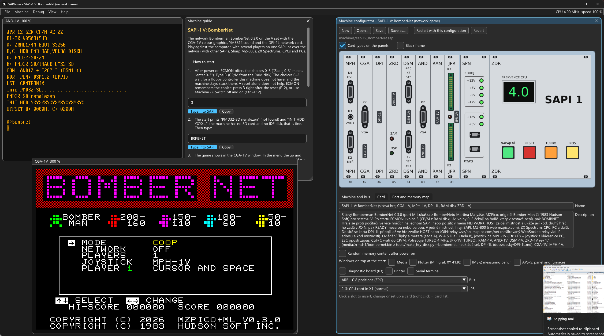
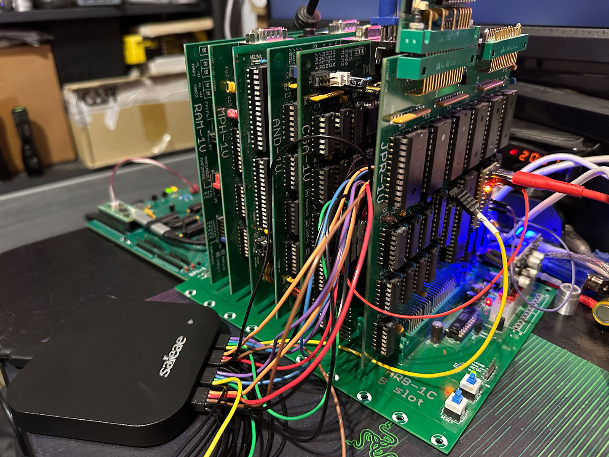
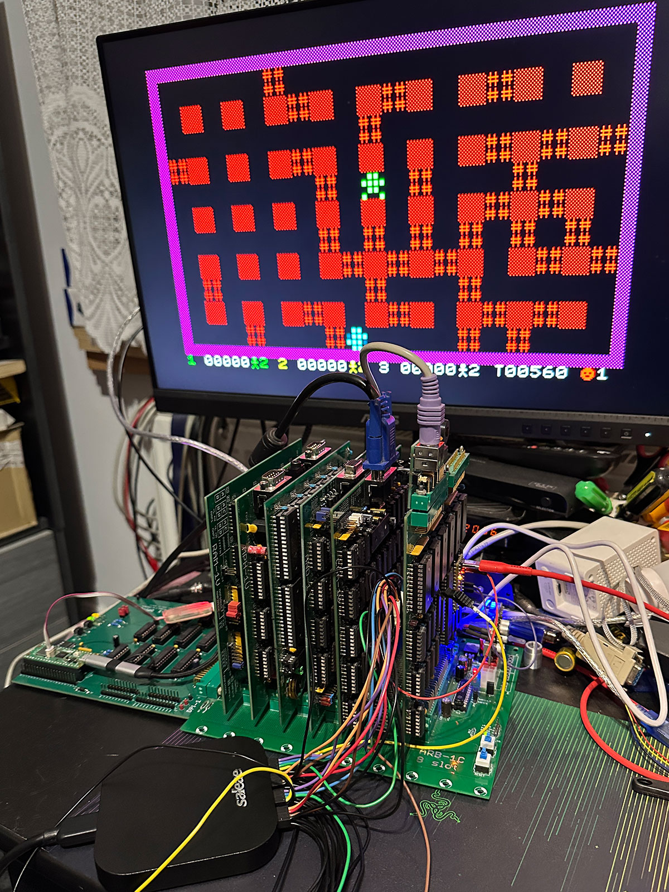
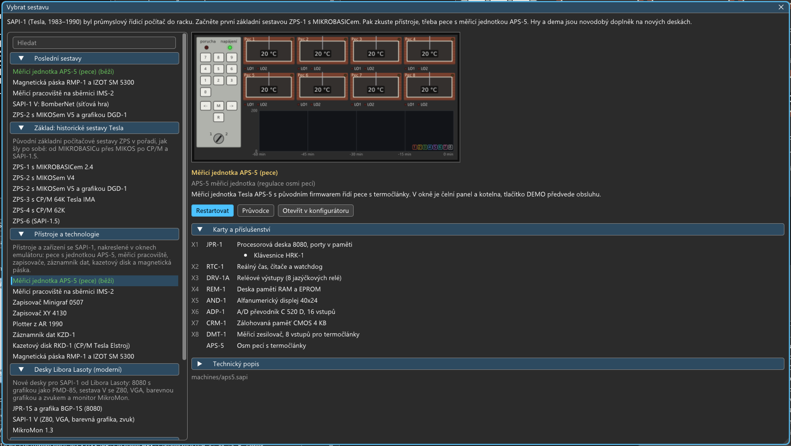
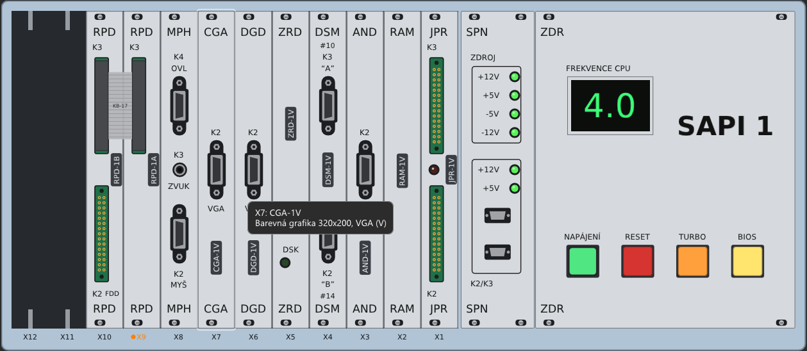
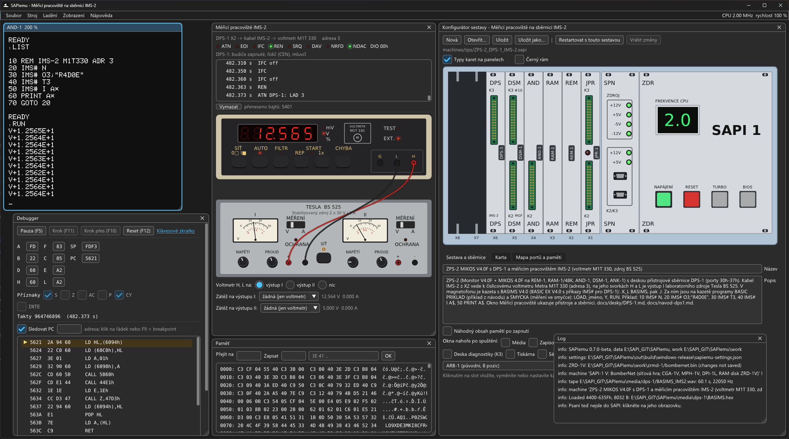
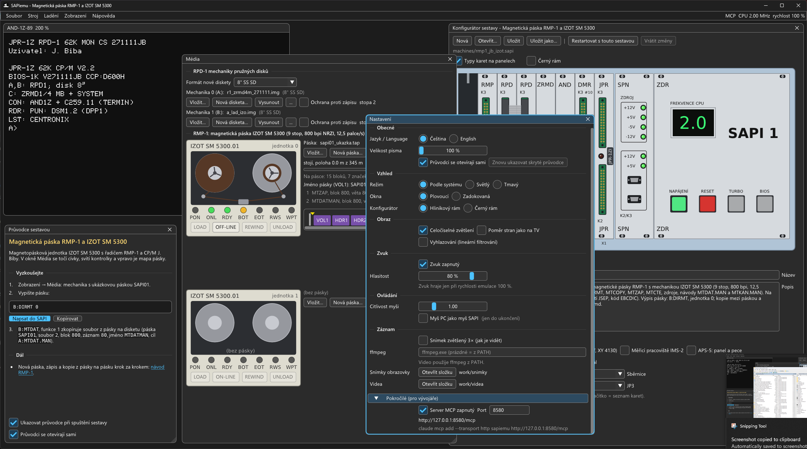

# SAPIemu: emulátor Tesla SAPI-1

**Emulátor československého modulárního počítače Tesla SAPI-1 (1983–1990).** Sestavíte ho z karet v rámu jako
skutečný, nastavíte propojky a spustíte MIKROBASIC, MIKOS nebo CP/M. K tomu přístroje, se kterými SAPI-1 pracoval
v průmyslu, a nové desky Libora Lasoty s grafikou a zvukem. Pro Windows 10/11, sestaví se i na Linuxu, rozhraní je
česky i anglicky. *In English: [README.en.md](README.en.md).*

  
  

*Vlevo ZPS-2 s MIKOSem kreslí na grafice DGD-1, vpravo síťová hra BomberNet na sestavě SAPI-1 V. Vedle obrazovek
průvodce sestavou a konfigurátor s kartami v rámu.*

## Proč vznikl

Už nějakou dobu mi vrtala hlavou myšlenka naprogramovat si vlastní emulátor SAPI-1. Jenže SAPI-1 je hodně složitý
počítač: spousta sestav, spousta karet a nekonečně možností, jak je zkombinovat, a k tomu přibývají karty nové.
Software se bez emulátoru píše špatně, a tak se nemůžeme divit, že pro SAPI skoro žádný nevzniká. Světlou výjimkou
je [Libor Lasota](https://www.pmd85.cz/), který si vyvíjí vlastní hardware a píše k němu i vlastní software. Dnes
si ale člověk může vzít k ruce AI pomocníka, nebo dva, tři, deset, a vývoj softwaru je výrazně jednodušší. Tak jsem
emulátor SAPI-1 konečně dal dohromady tak, aby splňoval moje představy. I tak to stálo hodně času i tokenů. Jestli
výsledek stojí za to, posuďte sami.

Představy jsem měl od začátku jasné. Emulátor má běžet pod Windows i Linuxem, podporovat téměř všechny karty SAPI,
které jsou k dispozici, a mít co nejpřesnější časování, tedy chovat se co nejvíc jako skutečný hardware. Pro vývoj
softwaru nesměl chybět debugger a pro práci s AI příkazová řádka a MCP server.

První verze byla hotová rychle nejen díky Claude Code, ale hlavně díky skvělým podkladům, které na
[sapi.cz](https://www.sapi.cz/) shromáždil Petr Všijanský (EC1045), a díky obrovskému množství práce, kterou
věnoval překreslování schémat karet. Emulátor proto
jde do takových detailů, jako jsou originální PROM, které nastavují mapování karet. Kromě původních karet umí
i nové desky Libora Lasoty, protože na vývoj a převádění her se emulátor hodí nejvíc. Karet je ale obrovské
množství a všechno bylo nepřehledné a složité na nastavení, proto má emulátor přednastavené sestavy, které jde
upravovat a ukládat.

Jen tak skládat karty k sobě je relativně jednoduché, ale ne úplně zábavné. Proto v emulátoru najdete třeba
i měřicí jednotku APS-5 s původním firmwarem a emulovanými pecemi, měřicí pracoviště IMS-2 s voltmetrem a zdrojem
napětí, zapisovače a dnes už raritní záznamník KZD-1, kazetový disk RKD-1 nebo magnetickou pásku RMP-1, u většiny
sestav s návodem, jak to všechno ovládat. Kde to šlo, oprášil jsem původní software, případně ho doplnil vlastním,
aby se to všechno dalo používat. A věřím, že když někde vyhrabete skutečný hardware, máte tu software, se kterým ho
oživíte.

Největší práce byla paradoxně emulátor vyleštit: menu a ovládání, aby s ním mohl pracovat kdokoli. Složité je to
pořád jako mlátička, ale to je vlastně SAPI. Zkuste sami.

## Jak se vyvíjí: AI a měření na skutečném SAPI-1 V

**S AI asistentem.** Nebýt Claude Code (Anthropic), tenhle emulátor by nevznikl. Většinu kódu napsal Claude a nestydím
se za to: nápady, architektura a vedení celého vývoje byly na mně a bylo to hodně práce. Emulátor proto neberu jako
AI slop, ale jako svoje dílo, na kterém jsem měl pomocníky. Vyvíjím ho od října 2026. Kód a většinu poznámek
v `docs/` píše Claude podle mého zadání a pod mou kontrolou, proto má každý commit řádek `Co-Authored-By: Claude`.
Já rozhoduji, co a jak se emuluje, stavím a měřím desky SAPI-1 a chování desek V ověřuji na svém SAPI-1 V. Původní
desky Tesla vycházejí z dokumentace, schémat a dumpů PROM a EPROM ze sapi.cz a od Libora Lasoty. Co ještě nebylo
ověřené na skutečném hardwaru, je v [docs/hw-otazky-priorita.md](docs/hw-otazky-priorita.md). Najdete-li rozdíl
proti skutečnému SAPI-1, napište do [Issues](https://github.com/mlukasek/SAPIemu/issues).

**Měření.** Aby byla emulace dostatečně přesná, věnoval jsem hodně času měření na skutečném SAPI s původními
i novými kartami. Do procesorové desky přišla PicoROM, na sběrnici logický analyzátor Saleae Logic Pro 16, který
měří digitálně i analogově a jeho software Logic 2 umí automatizaci a má vlastní MCP server. Se SAPI se komunikovalo
převážně po sériové lince, a kde to nešlo, pomohla PicoROM, která má chytrý způsob oboustranné komunikace, přestože
je to „jen“ ROM. Agent si tak sám psal program do ROM, ovládal SAPI, měřil a zapisoval hodnoty, podle kterých pak
upravoval emulátor. Já jsem byl chvílemi degradován na vyměňovače karet a přepichovače sond. V tom jsem se ale
celkem osvědčil a aspoň vím, že se bez nás zatím neobejdou.

  
  

Co měření v emulátoru opravilo (podrobně v [docs/zmeny-podle-hw.md](docs/zmeny-podle-hw.md), programy měření
v [tools/hwbench/](https://github.com/mlukasek/SAPIemu/tree/main/tools/hwbench)):

- **DSM-1V:** dva zápisy znaku rychle po sobě pošlou na desce jen jeden znak, protože UART převezme znak až na
  hraně svého taktu. Emulátor posílal „55 55 55“, deska „55 55“. Teď se chová jako deska.
- **CGA-1V:** čekací stavy podle sond na sběrnici. Kopírovací smyčka ZRDBENCH při 4 MHz trvá na desce 23,61 a 22,51
  taktu na bajt, v emulátoru 23,61 a 22,50.
- **JPR-1V s CGA-1V nebo AND-1V:** přerušení ve chvíli, kdy program běží ve videopaměti, zablokuje sběrnici. Tím se
  vysvětlilo zamrzání dema FXS4 a emulátor se teď zasekne stejně.

Jádra procesorů jsou [floooh/chips](https://github.com/floooh/chips) (Z80) a [superzazu/8080](https://github.com/superzazu/8080)
(8080, doplněné o 8085), obě upravená podle měření a dokumentace. Hlídají je testy ZEXDOC, ZEXALL, 8080EXM a 8085EXM
(s kontrolním součtem skutečného čipu 8085) a kontrola, že každá dodaná sestava naběhne.

## Stažení a spuštění

1. Stáhněte zip z [Releases](https://github.com/mlukasek/SAPIemu/releases) (Windows 10/11, 64 bit) a rozbalte ho
   kamkoli. Nic se neinstaluje. Vedle zipu je jeho kontrolní součet SHA-256.
2. Spusťte `sapiemu.exe`. Windows u nepodepsaného programu ukážou SmartScreen: „Další informace“ → „Přesto
   spustit“.
3. Otevře se okno **Vybrat sestavu**. Vyberte sestavu a stiskněte Spustit, průvodce sestavou ukáže, co vyzkoušet.

Jde o **betaverzi** 0.7.1-beta (novinky v [docs/release-notes/v0.7.1-beta.md](docs/release-notes/v0.7.1-beta.md)).
Hlavní věci fungují, ale chyby čekejte. Hlaste je přes Nápověda → Nahlásit chybu… (zkopíruje diagnostiku a konec
logu) do [Issues](https://github.com/mlukasek/SAPIemu/issues). Na Linuxu se emulátor sestaví ze zdrojů
([docs/build.md](docs/build.md)). Podrobně: [docs/prvni-kroky.md](docs/prvni-kroky.md).

## Co vyzkoušet

- **Základ, historické sestavy Tesla:** ZPS-1 s MIKROBASICem (po zapnutí rovnou píšete program v BASICu), ZPS-2
  s MIKOSem a grafikou DGD-1, ZPS-3 s CP/M Tesla IMA z 8" diskety, ZPS-4 s CP/M a SAPI-1.5 (ZPS-6) s barevnou
  semigrafikou.
- **Přístroje a technologie:** měřicí jednotka APS-5 s původním firmwarem reguluje osm pecí (tlačítko DEMO ukázku
  odťuká samo), měřicí pracoviště IMS-2 s voltmetrem a zdrojem, zapisovače Minigraf 0507 a XY 4130, plotter
  z Amatérského radia 1990, záznamník dat KZD-1, kazetový disk RKD-1, magnetická páska RMP-1 a programátor EPROM
  DSE-1. Přístroje jsou nakreslené v oknech emulátoru a ovládají se myší.
- **Desky Libora Lasoty:** SAPI-1 V se Z80, VGA, barevnou grafikou CGA-1V a zvukem YM3812, JPR-1S s grafikou
  BGP-1S jako PMD-85, monitor MikroMon.
- **Hry a dema** (novodobý doplněk, SAPI-1 herní počítač nebyl): Flappy, Bad Apple!!, Prince of Persia,
  Manic Miner a síťový BomberNet, ve kterém se dá hrát s hráči na Sharpu MZ-800, ZX Spectru, Amstradu CPC a PC.

  
  
  
  

*APS-5 reguluje pece na 700 °C, BASIMS měří voltmetrem napětí zdroje na pracovišti IMS-2, Minigraf kreslí ukázku
z dokumentace IQ 151, sestava V s CP/M a obrázkem na grafice CGA-1V.*

## Co umí

- **Karty jako skutečné:** 51 typů karet v katalogu, z nich 49 emulovaných. Procesorové karty s 8080, 8085 a Z80
  včetně BOOT logiky a čekacích stavů, paměti a RAM disky, displeje, grafiky, řadiče disket, kazetového disku
  a magnetické pásky, sériové, paralelní a IDE desky, hodiny reálného času a karty přístrojů. Propojky jako na
  deskách, dekodéry adres podle dumpů PROM, sběrnice ARB-1, ARB-1A/Au, ARB-1B, ARB-1C a ImBUS.
- **Konfigurátor sestavy:** rám s panely karet, karty se přetahují myší, propojky, mapa portů a paměti s kolizemi,
  přednastavené sestavy i vlastní kopie (Moje sestavy).
- **Periferie:** klávesnice EKL-1, Consul, ANK-1 a ANK-1M2, magnetofon (WAV a MP3, kazeta vyrobená z programu),
  diskety `.img` a `.imd`, tiskárna, sériové linky do PC přes TCP nebo COM port, joystick a myš, síť přes kartu
  DPI-1L.
- **Software:** MikroMon, MIKROBASIC, MIKOS V4 a V5, CP/M 2.2 od Tesly, R. Peřiny, J. Bíby a EC1045, ELIS, SAPI-1.5
  a knihovna disket J. Bíby (Turbo Pascal, MBASIC, FORTH, C, dBase II, WordStar…).
- **Pohodlí:** okno Vybrat sestavu s náhledy, průvodci, nápověda a slovníček přímo v programu, ukládání stavu,
  snímky obrazovky do PNG, video se zvukem do MP4, celá obrazovka, světlý i tmavý vzhled.

Úplný seznam po kartách a přístrojích: [docs/funkce.md](docs/funkce.md).

## Pro vývojáře

- **Debugger:** registry podle procesoru (8080, 8085, Z80), disassembler, breakpointy a watchpointy, paměť, I/O log,
  záznam přerušení. Nahrávání programů (Intel HEX, binární soubory), ukládání stavu a rychlé checkpointy.
- **`sapiemu-cli`:** emulátor bez okna pro skripty a testy (`--type`, `--wait-text`, `--print-screen`,
  `--screenshot`, `--save-state`…).
- **MCP server:** AI asistent (třeba Claude Code) může emulátor ovládat, psát a ladit programy pro SAPI
  ([docs/mcp.md](docs/mcp.md)). Zapíná se v Zobrazení → Nastavení → Pokročilé a poslouchá jen na `127.0.0.1`.
- **`cpmrun`:** programy pro CP/M (M80, L80) na PC nad jádrem Z80 emulátoru. Zdrojáky systému ECMON + CP/M se jím
  přeloží shodně s originální EPROM ([docs/software/ECMON.md](docs/software/ECMON.md)).

  
  

**Sestavení ze zdrojů:**

- **Visual Studio 2022:** Soubor → Otevřít → Složka, preset `Windows x64 Debug` nebo `Release`.
- **Příkazová řádka:** `tools\build.cmd release test` (najde VS, sestaví a spustí testy).
- **Linux:** `cmake --preset linux-release && cmake --build --preset linux-release` (ověřeno ve WSL, podrobnosti
  v [docs/build.md](docs/build.md)).
- **Balík pro vydání:** `python tools\package.py` (zip a vedle něj jeho SHA-256).
- SDL3 se stáhne při prvním configure (CMake FetchContent), ostatní knihovny jsou v `third_party/`.

## Dokumentace

- [docs/prvni-kroky.md](docs/prvni-kroky.md): spuštění, sestavy, klávesy, co vyzkoušet
  (anglicky [docs/getting-started.md](docs/getting-started.md)). V programu Nápověda → První kroky.
- [docs/slovnicek.md](docs/slovnicek.md) a [docs/glossary.md](docs/glossary.md): slovníček pojmů SAPI a SAPIemu.
- [docs/funkce.md](docs/funkce.md): co emulátor umí, po kartách a přístrojích.
- **Návody k obsluze** krok za krokem: [APS-5](docs/aps5-ukazka.md), [KZD-1](docs/navod-kzd1.md),
  [Minigraf 0507](docs/navod-minigraf.md), [XY 4130](docs/navod-xy4130.md), [plotter z AR 1990](docs/navod-ar1990.md),
  [DPS-1 a IMS-2](docs/navod-dps1.md), [RKD-1](docs/navod-rkd1.md), [RMP-1](docs/navod-rmp1.md),
  [DSE-1](docs/navod-dse1.md). V programu Nápověda → Návody k obsluze.
- [docs/sestavy.md](docs/sestavy.md): konfigurátor, sestavy a katalog karet.
- [docs/desky/](docs/desky/): poznatky o jednotlivých deskách (porty, PROM, propojky, nejasnosti),
  [docs/software/](docs/software/): software pro SAPI.
- [docs/zmeny-podle-hw.md](docs/zmeny-podle-hw.md): změny podle měření na skutečném SAPI-1 V,
  [docs/hw-otazky-priorita.md](docs/hw-otazky-priorita.md): co zbývá ověřit na skutečném hardwaru.
- Pro vývoj: [docs/build.md](docs/build.md), [docs/mcp.md](docs/mcp.md), [docs/stav.md](docs/stav.md), stav projektu
  [docs/SOUHRN.md](https://github.com/mlukasek/SAPIemu/blob/main/docs/SOUHRN.md), všechny dokumenty ve složce
  [docs/](docs/).

## Síť a soukromí

- Emulátor sám od sebe nic neodesílá: nemá telemetrii ani kontrolu aktualizací.
- **Server MCP** poslouchá jen na `127.0.0.1` a v nové instalaci je vypnutý.
- **Sériová linka přes TCP** (terminál, TeraTerm) poslouchá na `127.0.0.1`, jinou adresu jde nastavit
  v konfigurátoru.
- **Karta DPI-1L** (sestava `sapi1v_BomberNet`) se připojí do sítě, až o to požádá program na SAPI: síťové hry přes
  relay `api.mzpico.com` (WebSocket), spojení TCP a DNS na adresu, kterou zadá program.
- Odkazy v okně O programu, v nápovědě a v průvodcích otevřou webový prohlížeč.
- **Kam se co ukládá:** nastavení, rozložení oken a logy posledních dvou spuštění vedle `sapiemu.exe`; pracovní
  kopie disket, disků a kazet, paměti s baterií, výstupy tiskáren a vaše kopie sestav ve složce `work/`. Když do
  složky programu nejde zapisovat (např. `Program Files`), ukládá se nastavení do `%APPDATA%\SAPIemu\SAPIemu`
  a `work/` do `%LOCALAPPDATA%\SAPIemu\work` (Linux: `~/.local/share/SAPIemu`).

## Přístupnost

- **Čtečky obrazovky rozhraní nevidí:** okna kreslí knihovna Dear ImGui, která pro systém nevytváří strom ovládacích
  prvků. Text obrazovky SAPI jde získat jinak: Zobrazení → Kopírovat text obrazovky (Ctrl+Shift+C),
  `sapiemu-cli --print-screen`, nebo přes sériový terminál ([docs/seriova-linka.md](docs/seriova-linka.md)).
- **Klávesnice:** Tab a šipky procházejí ovládací prvky oken, Esc zavře dialog, Ctrl+Tab přepíná okna. V okně
  obrazovky SAPI a v sériovém terminálu patří šipky, mezerník, Enter, Esc a Alt počítači SAPI.
- **Stav není jen barvou:** chyby a varování mají značku a slovo, tlačítka magnetofonu symbol, čáry v grafu APS-5
  čísla pecí.
- **Velikost písma** 100–200 % je v Zobrazení → Nastavení → Obecné. Některá dema rychle blikají (upozornění je
  v průvodci sestavou).

## Licence a poděkování

- **Licence:** emulátor je pod GPLv3 ([LICENSE](LICENSE)), Copyright © 2026 Martin Lukášek. Knihovny třetích stran
  mají vlastní licence ([THIRD-PARTY-NOTICES.txt](THIRD-PARTY-NOTICES.txt), [third_party/README.md](third_party/README.md)).
- **ROM, PROM a programy** v `roms/` a `media/` patří svým autorům a jsou tu pro zachování historie SAPI-1.
  Zdroje jsou v [roms/README.md](roms/README.md) a [media/README.md](media/README.md).
- **Prince of Persia** (sestava `sapi1v_PoP`): ukázka historické technologie, neoficiální nekomerční port hry na 40
  let starý československý počítač. Prince of Persia © Jordan Mechner, grafika a hudba DOS verze © Brøderbund
  Software, práva vydávat hry Prince of Persia má Ubisoft. Licence SAPIemu (GPLv3) se na data hry nevztahuje. Na
  žádost nositelů autorských práv cokoli upravím nebo odstraním.
- **Petr Všijanský (EC1045):** stránky [sapi.cz](https://www.sapi.cz) s dokumentací, schématy, výpisy a dumpy,
  ze kterých emulace vychází, a překreslená schémata desek.
- **Libor Lasota** ([pmd85.cz](https://www.pmd85.cz/)): desky V, desky k původním sestavám (JPR-1S, JPR-1X, BGP-1S,
  AND-1B, ANK-1M2), sběrnice ImBUS, MikroMon, MIKROBIOS a programy pro CGA-1V, MPH-1V a BGP-1S, použité s jeho
  souhlasem.
- **Ing. Jan Meloun (Melsoft):** sestava SAPI-1.5 a diskety CP/M 2.2 62K Melsoft (1990).
- **Jiří Bíba (SAPIMAN):** monitory a BIOSy CP/M pro SAPI-1 (RPD-1, FDC-1, MFC-1A, RAM disky, IDE) a sbírka disket
  a zdrojáků v SAPI_DOKU; **EC1045** je dál udržoval (ECMON, diskety PC, CD a MOUNT pro PMD32-SD).
- Software pro SAPI-1 od Tesla ELTOS / DIZ, CP/M 2.2/P od R. Peřiny a další programy, které se zachovaly.

## English

SAPIemu emulates the Czechoslovak modular industrial computer **Tesla SAPI-1** (1983–1990): you build it from cards
in a rack like the real one and run MIKROBASIC, MIKOS or CP/M. The user interface is in Czech and English. The
English README, with why and how the emulator is made (with an AI assistant and measurements on a real SAPI-1 V), is
**[README.en.md](README.en.md)**.
