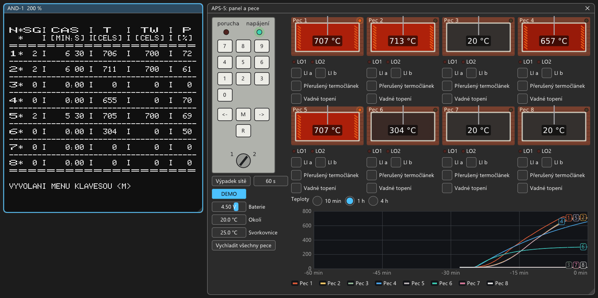

# APS-5: ukázka krok za krokem

Návod naplní jednotku tak, aby po půl hodině emulovaného času vypadala jako na obrázku:
- tři pece regulují podle programu na 700 °C;
- dvě pece hřejí ručně nastaveným příkonem;
- graf ukazuje náběh.

Postup je vyzkoušený od studeného startu (2026-10-08).

## Jak se ovládá

- Klávesy se mačkají myší na panelu v okně APS-5, nebo na PC:
  - číslice;
  - `M` (nebo Esc);
  - `R`;
  - Enter = **→** (potvrzení);
  - Backspace = **←** (smaže znak).
- Příkaz = číslo a →. Rezervované příkazy (v menu označené `.R.`) = číslo, `R` a →. Zámek na panelu musí být
  v poloze **2** (je tak po spuštění).
- Firmware odpovídá pomalu (asi sekundu, měření pecí má přednost). Po každém → je potřeba počkat, až se objeví
  výzva. `M` → kdykoli vrátí hlavní menu. Překlep se opraví ←.
- **RESET nepoužívat.** Jednotka by ohlásila „CHYBA 0 / INICIALIZACE“ a po M → smazala nastavení. Vypíná se
  vypínačem POWER.

V návodu znamená `8R →` stisknout 8, R a Enter.

## 1. Spuštění a kalibrace

1. Otevřít `machines/aps5.sapi`. Po asi 3 s testů se objeví menu 0–12. Okno „APS-5: panel a pece“ se otevře samo
   (jinak Zobrazení → APS-5).
2. Kalibrace převodníku (po prvním zapnutí je nulová a teploty by nedávaly smysl):
   `6R →`, na výzvu `U [MV] =` zadat `9990 →`.

## 2. Teplotní program 1

20 minut nárůst na 700 °C, 20 minut výdrž, 20 minut pokles na 300 °C:

| Klávesy | Co se stane |
|---|---|
| `2 →` | PROGRAMOVÁNÍ, výzva „ZADEJ ČÍSLO PROGRAMU (1-32)“ |
| `1 →` | menu editoru programu, řádek PROG SEG ČAS TEPLOTA REZERVA |
| `3R →`, `20 →`, `700 →` | 1. segment: 20 min, konec 700 °C |
| `3R →`, `20 →`, `700 →` | 2. segment: výdrž |
| `3R →`, `20 →`, `300 →` | 3. segment: pokles, řádek ukáže `1  3  20  300 P  509` |
| `M →` | zpět do hlavního menu |

## 3. Pece 1, 2 a 5 v regulaci

Pro každou z pecí 1, 2 a 5 zadat (místo `n` číslo pece, místo `t` periodu: pec 1 → 6, pec 2 → 9, pec 5 → 8):

| Klávesy | Význam |
|---|---|
| `0 →`, `n →` | volba aktuální pece |
| `8R →`, `3 →` | termočlánek ch-a |
| `4R →`, `t →` | vzorkovací perioda v desítkách sekund |
| `7R →`, `60 →` | přípustný výpadek napájení 60 min (regulace výpadek přežije) |
| `9R →`, `1 →` | přiřadit program 1 |
| `1 →`, `1 →` | zapnout programovou regulaci aktuální pece |

Kontrola: `10 →` ukáže tabulku parametrů (TERMOČLÁNEK 3, TVZ 6 9 8, PROGRAM 1, MAX.VÝP. 60). `M →` zpět.

## 4. Pece 4 a 6 ručně

| Klávesy | Význam |
|---|---|
| `0 →`, `4 →`, `8R →`, `4 →` | pec 4, termočlánek PtRh10-Pt |
| `3 →`, `70 →` | ruční příkon 70 % |
| `0 →`, `6 →`, `8R →`, `2 →` | pec 6, termočlánek ch-k |
| `3 →`, `50 →` | ruční příkon 50 % |

## 5. Sledovat

- `11 →` je tabulka stavu pecí:
  - SG = segment;
  - ČAS = čas v segmentu;
  - T = naměřená teplota;
  - TW = žádaná teplota;
  - P = příkon %.
- Hvězdička u pece bliká, když se reguluje.
- V okně APS-5 pece postupně žhnou, svítí lampa topení a graf (přepínač 1 h) ukazuje náběh.
- Zrychlit lze klávesou **F8** (200 %, 400 %, maximum). Po 25 minutách emulovaného času (na maximum asi
  půl minuty) drží pece 1, 2 a 5 kolem 700 °C s příkonem 60–75 %. Pec 4 je asi na 660 °C, pec 6 na 300 °C.

## Co ještě zkusit

- **Výpadek sítě** (tlačítko v okně, např. 60 s): jednotka si uloží stav a po návratu napájení vypíše
  „VÝPADEK NAPÁJENÍ“. Pece s regulací pokračují, protože výpadek je kratší než povolených 60 minut.
- **Přerušený termočlánek** u pece 1: dole se objeví PORUCHA, `12 →` ukáže u pece C, rozsvítí se LO1 a čas
  segmentu stojí. Po opravě měření pokračuje.
- **Vypnutí a zapnutí emulátoru** je pro jednotku výpadek sítě. Nastavení i programy zůstanou. Regulace ale
  pokračuje, jen když byl emulátor vypnutý kratší dobu, než je přípustný výpadek (60 min). Jinak se pece
  znovu zapnou `0 → n →`, `1 → 1 →`.
- **Vadné topení** u pece 2: regulátor marně zvyšuje příkon až na 100 %, teplota se nehne. Asi po 13 minutách
  `12 →` ukáže u pece E („PŘEKROČEN MAX. NÁRŮST“: požadovaný nárůst není dosažitelný).
- **Zámek** do polohy 1: R nefunguje, rezervované příkazy hlásí „PŘÍKAZ IGNOROVÁN“, prohlížet a zapínat jde.
- **Rychlý program** (např. 3 min na 900 °C): pec nestačí, porucha E „PŘEKROČEN MAX. NÁRŮST“.

Zapojení, starty a podrobnosti firmwaru jsou v `docs/desky/APS-5.md`.
