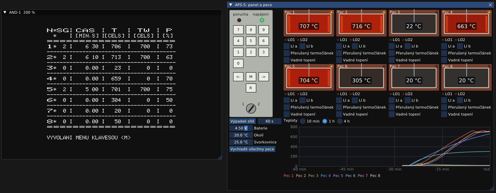

# APS-5 – měřicí jednotka (regulace osmi pecí)

Stav: **v emulátoru** od 2026-10-08 jako sestava `machines/aps5.sapi` s původním firmwarem, deskami ADP-1, DMT-1,
DRV-1A, panelem HRK-1 a simulací pecí (technologie). Test `test_aps5`. Autor jednotku nemá.

Tesla Liberec, návod 6XV 122 89: „převodník pro měření teploty“ v 19" rámu se zdrojem ZDR-1A a sběrnicí ARB-1
(8 pozic). Měří osm termočlánků a podle zadaných teplotních programů reguluje osm pecí adaptivním PSD
algoritmem. Obraz jde na monitor ZJS-1 (AND-1, 40 × 24), ovládá se 14 klávesami na čelním panelu se zámkem.



## Podklady

- **Návod s OCR, obrázky a výpisy EPROM:** `..\SAPI.CZ\sapi\doku\aps-5.php`, obrázky `..\SAPI.CZ\sapi\obrazky\APS-5_obr1–11.png`
  (obr. 3 čelní panel, obr. 4 pozice desek, obr. 5 schéma kabelových spojů), fotky `aps-5_*.jpg`.
- **Firmware:** 7 × 2716 v Intel HEX přímo na stránce (všechny kontrolní součty sedí). V repu jako
  `roms/aps-5/APS-5_REM-1.bin` (EPROM 0–6 za sebou: 0000–1FFF a 6000–77FF).
- Desky: `..\SAPI.CZ\sapi\adp-1.php`, `dmt-1.php`, `drv-1a.php`, `hrk-1.php` (HRK-1A, HRK-1B), překreslená schémata
  EC1045 v `..\SAPI.CZ\sapi\pdf\{adp-1,dmt-1,drv-1a,hrk-1a,hrk-1b}_cb.pdf`, repliky v EAGLE
  `..\SAPI_DOKU\sapi_eagle\REPLIKY\{ADP-1,DMT-1,DRV-1A}`. Skeny bez retuší `..\SAPI_DOKU\skeny_dokumentace_bez_retusi_Petr\APS-5`.
- Rozbor firmwaru (disassembler, tabulky): mimo repo, závěry jsou zde.

## Sestava

| Pozice | Deska | Nastavení |
|---|---|---|
| X1 | JPR-1 (8080, 2 MHz) | bez EPROM, bez RAM, bez propojky 10-11 (R7 je /PFAIL); na X2/X3 panel HRK-1 a svorkovnice |
| X2 | RTC-1 | F0h, XC2 kabelem k JPR-1: DD5 tiká z OUT2 DD6 |
| X3 | DRV-1A | 77h, kontakty spínají topení pecí (přes NOCONTA) |
| X4 | REM-1/00K | 2716: blok E 0000–1FFF (EPROM 0–3), blok F 6000–7FFF (EPROM 4–6, 8. patice prázdná), bez RAM |
| X5 | AND-1 | 3800h, bez propojky 49-50 (/INT1 je na JPR-1 zároveň P2-IN1 = kód klávesy) |
| X6 | ADP-1 | 00h, vstupy kabely APS-5 |
| X7 | CRM-1 | E000–EFFF, zálohovaná baterií v čelním panelu (zásobník EFFF) |
| X8 | DMT-1 | 80h, ±15 V ze ZDR-1A |

Pořadí v rámu (zleva DMT, CRM, ADP, AND, REM, DRV, RTC, JPR) je podle obr. 4 návodu.

### Mapa paměti a I/O (z firmwaru)

- Paměť: EPROM 0000–1FFF a 6000–77FF (na 7800h volitelná rozšiřující EPROM: firmware ji hledá podle C3h
  a jinak si do E250h dá RET), porty JPR-1 2400/2800/2C00, 3214 na 3000, AND-1 3800–3FFF, CRM-1 E000–EFFF.
- I/O: ADP-1 00h (data) a 01h (řízení/stav), DMT-1 80h, DRV-1A 77h, RTC-1 F0–FCh.

### Kabely na JPR-1 (X2, X3) – odvozeno z firmwaru a schématu kabelových spojů

| Signál JPR-1 | Funkce v APS-5 |
|---|---|
| P0-IN (2400h) | logické vstupy LI 1a–8a (bit n = kanál n + 1, s pull-up, rozpojeno = H) |
| P1-IN (2800h) | logické vstupy LI 1b–8b |
| P0-OUT | logické výstupy LO 11–81 (porucha měření kanálu = H) |
| P1-OUT | logické výstupy LO 12–82 (podle návodu trvale L) |
| P2-IN0–3 | Q1–Q4 HRK-1B (kód poslední klávesy); zároveň žádosti R0–R3 obvodu 3214 |
| P2-IN4 | OUT1 DD5 na RTC-1: 1 Hz (8253 mód 2, 5000 BCD z 5 kHz), krok měření pecí |
| P2-IN5 | OUT0 DD5: 50 Hz (100 BCD), takt PWM topení a watchdogu |
| P2-IN6 | /INT HRK-1B (asi 220 µs po stisku klávesy) |
| P2-IN7 | /PFAIL zdroje (výpadek sítě; R7 = RST 0) – předpoklad, viz Nejasnosti |
| P2-OUT7 | WD: pulzy watchdogu HRK-1B (50 Hz z přerušení) |

DD6 na RTC-1 dává 5 kHz (čítač 2, mód 3, 0400 BCD z Φ2 2 MHz), XC2/29 ho vede na CLK0 a CLK1 DD5. Všechna
přerušení jsou RST na 14C9h. Obsluha čte P2-IN, bity 4–6 negované, a úlohy rozdělí:
- 1B35h je klávesnice;
- 121Eh je takt 50 Hz (WD, test zásobníku, relé);
- 1005h je takt 1 Hz (měření jedné pece, každá jednou za 10 s).

### Klávesnice HRK-1

- MH 1KK1 kóduje 16 plošek do Q1–Q4. Kódy podle firmwaru (1B45h):
  - 0–9 číslice;
  - 0Bh R;
  - 0Dh ← (mazání);
  - 0Eh M;
  - 0Fh → (potvrzení);
  - ostatní (0Ah, 0Ch) firmware bere jako M.
- Plošky R1–R3 (spodní řada, R uprostřed) mají společný vodič přes zámek, takže R funguje jen v poloze 2.
- Na PC: číslice, Backspace nebo ← je ←, Enter nebo → je →, M nebo Esc je M, R je R. Klávesy jdou za sebou
  (80 ms stisk, 120 ms pauza).

### Watchdog, výpadek sítě, starty

- HRK-1B DD5A (74123, asi 51 ms) drží relé KA1 a zhasnutou LED „porucha“, dokud chodí WD. Po vypršení DD5B
  dá 17 ms /RTL a celá jednotka se resetuje.
- Firmware při chybě zapíše kód do E240h a zastaví se (HLT), watchdog pak resetuje. Studený start schválně
  nechá watchdog vypršet (test „chyby 6“).
- **Výpadek sítě:** /PFAIL dá žádost R7 (RST 0). Firmware vynuluje výstupy, zapíše E239h = 55h a vynuluje
  čítač RTC-1, aby po zapnutí změřil délku výpadku. Pak pulzuje WD, dokud nepřestane napájení.
- Po zapnutí:
  - E239h = 55h znamená teplý start: zpráva „VYPADEK NAPAJENI“ a regulace podle přípustné doby výpadku
    (příkaz 7R);
  - AAh bez /PFAIL (reset watchdogem) znamená „CHYBA n“ a „INICIALIZACE“, po M → studený start;
  - jiná hodnota znamená studený start.
- **Emulátor:** při vypnutí (tlačítko POWER, jiná sestava, konec programu) proběhne u této sestavy nejdřív
  varování /PFAIL a 100 ms běhu (`Machine::power_down`). Firmware si uloží stav a příště naběhne teplým
  startem. Okno APS-5 a MCP (`plant`, `outage_s`) umí výpadek dané délky: 100 ms varování, pak bez napájení
  (reset), pak start.

### Měření

- ADP-1: S1 = U1 DMT-1 (termočlánek po zesílení), S2 = U2 DMT-1 (teplota svorkovnice, 0 až −5 V na 0–50 °C),
  S5 = záložní baterie, S6 = 0 V, S7 = +9,99 V (svorka KAL). Vše se zesílením 1 (10 mV na digit).
- **Kalibrace (6R):** firmware změří S6 jako nulu a S7 jako referenci. Napětí KAL změřené voltmetrem
  (9728–10000 mV) vydělí rozdílem a získá mV na digit. Po studeném startu je kalibrace nulová a teploty nedávají
  smysl. Kalibrace je proto první krok.
- DMT-1: firmware zapíše 80h (relé vypnout), pak kanál + zesílení podle typu termočlánku a po 30 tikách
  (600 ms) měří. Zesílení v tabulce 18AFh: 100, 199, 498, 1000.
- Kompenzace srovnávacích konců lineárně: strmost (tabulka 18BBh) Fe-Ko 0,0526, ch-k 0,066, ch-a 0,040,
  PtRh10-Pt 0,0058, PtRh30-PtRh6 0 mV/°C.
- Čísla firmwaru jsou 3bajtová plovoucí: exponent E, mantisa M 16 bitů (LE, bit 15 = znaménko), hodnota
  = M · 2^(E − 4Fh).
- Typy termočlánků v příkazu 8R: 1 Fe-Ko, 2 ch-k, 3 ch-a, 4 PtRh10-Pt, 5 PtRh30-PtRh6, 0 = nezapojeno.
- Ověřeno v emulaci na pecích s „ustálenou“ teplotou: 500 °C (ch-a) ukáže 500, 1000 → 999, Fe-Ko 400 → 400,
  PtRh10-Pt 1200 → 1203, ch-a 100 → 101, ch-k 500 → 502, PtRh30-PtRh6 1500 → 1501. ch-a nad asi 1260 °C
  přetíká výstup DMT-1 (zesílení 199, ±10 V): firmware hlásí „B = PREKROCENI MERICIHO ROZSAHU“.

## Emulace

- **Desky:** `ADP-1.md`, `DMT-1.md`, `DRV-1A.md`. RTC-1 má parametr `xc2` = `aps5` (`RTC-1.md`).
- **Panel HRK-1** je „klávesnice“ JPR-1 (`"keyboard": { "type": "HRK-1" }`, `src/cards/hrk1.*`). Obsahuje vše, co
  vede kabely na X2/X3: klávesy, zámek, watchdog s /RTL, logické vstupy a výstupy, tiky z RTC-1 a /PFAIL.
  JPR-1 kvůli tomu předává zařízení i P2-IN, P1-OUT, P2-OUT a /RTL (`KeyboardDevice`).
- **Technologie** (`"plant": { "type": "APS-5" }`, `src/plant/`): pece, termočlánky, izotermická svorkovnice,
  baterie, logické vstupy. Karty ji najdou přes `Bus::plant`. Popis modelu:
  - každá pec má dvě tepelné kapacity (topné těleso a komora), termočlánek se zpožděním (8 s) a topení
    `power_w` spínané kontaktem DRV-1A;
  - ustálená teplota při plném příkonu je `t_max_c`, časová konstanta `tau_min`;
  - napětí termočlánku = E(T) − E(T svorkovnice), podle NIST (ch-a = K, PtRh10-Pt = S, PtRh30-PtRh6 = B),
    DIN 43710 (Fe-Ko = L) a GOST (ch-k = L/XK);
  - výchozích osm pecí je různých: 1,2–6 kW, 600–1700 °C, 5–30 min.
  Parametry v sestavě:

```json
"plant": {
    "type": "APS-5",
    "ambient_c": 20, "block_c": 25, "battery_v": 4.5,
    "furnaces": [ { "name": "Pec 1", "thermocouple": "ch-a", "power_w": 2000, "t_max_c": 1100,
                    "tau_min": 8, "heater_tau_s": 30, "tc_tau_s": 8, "connected": true,
                    "li_a": true, "li_b": true, "start_c": 20 }, ... ]
}
```

- **Okno APS-5** (Zobrazení → APS-5: panel a pece, samo se otevře se sestavou):
  - čelní panel: LED porucha a napájení, 14 kláves, zámek (kliknutím 1/2);
  - výpadek sítě zadané délky, baterie, okolí, teplota svorkovnice;
  - osm pecí: komora žhne podle teploty, spirály podle teploty tělesa, lampa topení (kontakt DRV-1A), LO1/LO2,
    přepínače LI a/b, přerušený termočlánek, vadné topení;
  - graf teplot za 10 min, 1 h nebo 4 h (ukládá se i ve stavu).
- **MCP:** nástroj `plant` (stav pecí a panelu, nastavení teplot, poruch, vstupů, zámku, výpadek), klávesy přes
  `type_text`.

## Jak začít (první zapnutí = studený start)

1. Spustit `machines/aps5.sapi`. Po testech (asi 3 s) se objeví menu. Okno APS-5 se otevře vedle obrazovky.
2. Kalibrace: `6R` →, `9990` → (KAL je v emulaci 9,99 V).
3. Typy termočlánků: `0` → číslo pece →, pak `8R` → typ → (výchozí pece: 1, 2, 5, 7 ch-a = 3; 3 Fe-Ko = 1;
   4 PtRh10-Pt = 4; 6 ch-k = 2; 8 PtRh30-PtRh6 = 5).
4. Program: `2` → číslo (1–32) →, `3R` → doba v minutách →, konečná teplota →, a další segmenty.
5. Pro pec: `4R` → vzorkovací perioda v desítkách sekund (pec 1: 6), `9R` → číslo programu, `7R` → přípustný
   výpadek v minutách, `1` → `1` → zapnout regulaci.
6. `11` → tabulka stavu pecí, `12` → tabulka poruch, `M` → zpět do menu.

Příklad, který pece 1, 2 a 5 zvládnou: 20 min na 700 °C, 20 min výdrž, 20 min pokles na 300 °C. Za 25 minut
drží 700 °C (±10 °C) s příkonem 60–75 %. Příliš rychlý program vede k poruše E (překročen max. nárůst).

## Nejasnosti k ověření na HW

- **P2-IN7 = /PFAIL ze zdroje ZDR-1A.**
  - Je odvozeno z firmwaru:
    - R7 = RST 0 vede přes 003Bh na uložení stavu;
    - po resetu firmware na 01FCh čeká na L, jinak hlásí CHYBA;
    - při povoleném přerušení musí být H.
  - Kudy signál vede (přes HRK-1B?), schéma kabelů neříká.
- **Kódy kláves:** překreslené schéma HRK-1B (EC1045) má na D11–D13 „<-“, „M“, „->“ a na D14–D16 R1–R3. Tak by
  ← = 0Ah, M = 0Bh, → = 0Ch. Firmware ale bere 0Dh jako ←, 0Fh jako → a 0Bh jako R. Emulace se řídí
  firmwarem, takže skupiny jsou prohozené (nebo MH 1KK1 kóduje jinak).
- Kabel RTC-1 XC2 na JPR-1 X3: OUT0 DD5 → P2-IN5, OUT1 → P2-IN4 (podle obsluh přerušení), CLK0/CLK1 DD5 =
  XC2/29 (podle frekvencí, které firmware předpokládá).
- /RTL z HRK-1B (XC2/20) vede asi na sběrnici, emulace resetuje celou jednotku.
- Doba převodu C 520 D (emulace 20 ms), bity 5 a 6 stavu ADP-1 (emulace 0), stav ADP-1 po /RES.
- Zesílení DMT-1 v emulaci odpovídá tabulce firmwaru (100, 199, 498, 1000). Skutečná deska se nastavuje trimrem RP3.
