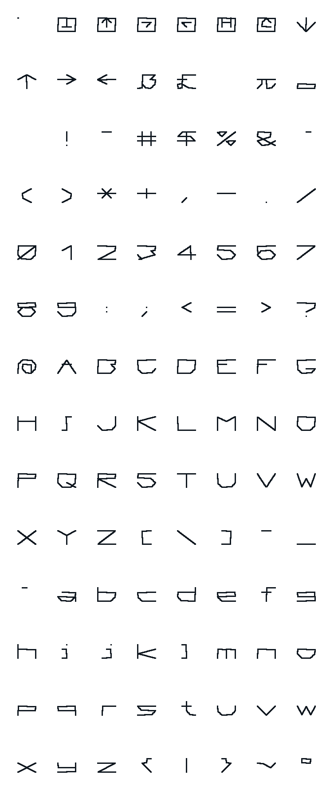

# Plotter z AR 1990 – souřadnicový zapisovač řízený JPR-1

Stav: **emulovaný** (2026-10-10). Zařízení `AR 1990` na konektorech K2 a K3 desky JPR-1 (`src/chips/ar1990.*`),
mechanika je model Minigrafu 0507 (`src/chips/minigraf.*`). Sestava `machines/plotter_ar1990.sapi`, firmware
`roms/ar1990/PLOTTER_AR1990.bin` z výpisu v AR (`roms/ar1990/PLOTTER.MAC`, `tools/ar1990_rom.py`), ukázka
`media/ar1990/ukazka.txt`, test `tests/test_ar1990.cpp`. Ovládání je v okně Minigraf. **Návod:** `docs/navod-ar1990.md`.

## Co to je

Vladimír Julius OK1IVJ, „Souřadnicový zapisovač řízený mikroprocesorem“, Amatérské radio 1990, příloha
(strany 22–35). Autor vyšel z plotterů Sharp MZ-1P16 k počítači Sharp MZ-800 (malý papír v roli, drahá pera)
a postavil zapisovač pro libovolný počítač: **deska JPR-1 je řadič plotteru**. Program v EPROM přijímá povely
MZ-1P16 přes rozhraní podobné Centronics, ukládá je do kruhového bufferu (256 znaků) a kreslí. Autor ho
používal se Sharp MZ-821 a ZX Spectrum+. Mechaniku nepopisuje. Výstup P0-OUT je „přímo slučitelný se vstupem
plotteru MINIGRAF 0507, se kterým byl také odzkoušen“, a právě tak je zapojený v emulátoru. Článek popisuje
i náhradu JPR-1 deskou se Z80 (U880, 2× 8255, Obr. 3), ta emulovaná není.

Podklady: `..\SAPI_DOKU\PLOTTER_JPR_PRILOHA_AR_1990\`. Je tam:
- `AR_priloha1990\strana0001-0014.jpg`: sken článku, tedy schémata, tabulka portů, výpis programu a manuál;
- `PLOTTER.ASM`, `Original_prepis_SW_AR_1990\PLOTTER.ASM`: přepis výpisu pro TASM;
- `JPR_CENT.ASM`: jiná verze.

## Zapojení (Tab. 1 a Obr. 1 článku)

| port JPR-1 | bity | význam |
|---|---|---|
| P0-OUT 2400h (MOTR) | D0–D2 X1 X2 X4, D3–D5 Y1 Y2 Y4, D7 pero | kabel Minigrafu (fázové kódy 0–7, pero H = dole) |
| P0-IN 2400h (RDSI) | D0 pravý doraz, D1 levý doraz, D2 COLOR, D3 STOP, D4 TEST, D5 READY, D6 RDP, D7 ASCII/MZ800 | spínače proti zemi (L = sepnuto); RDP H = data platná |
| P1-IN 2800h (DSHI) | D0–D7 | data z řídicího počítače |
| P1-OUT 2800h (RDSO) | D2 RDA, D3 STA, D4 krok 0,125/0,25, D5 reproduktor, D6 LED BUFF, D7 LED READY | RDA = data převzata |
| P2-IN 2C00h (RDSI1) | D0 JMP 1000H, D5 A4/ROLE, D6 LF (LF+CR), D7 CR (CR+LF) | přepínače na zadní stěně |

- EPROM 2× 2716 (0000–0FFF), RAM 2× 2114 (2000–23FF), krystal 18 MHz (8080 na 2 MHz).
- Přenos: počítač dá bajt na DSHI a RDP. Program ho přečte, nastaví RDA, počká na shození RDP a RDA shodí.
  Signály RDA, STA, RDP a IRT (reset JPR-1 od počítače) mají v článku hradla EX-OR pro volbu polarity
  (přepínače RDP/RDP a RDA/RDA). Emulace dává programu úrovně, které čte.
- Minigraf nemá koncové spínače, vývody pro ně „se nezapojí“ (H). Počátek X najede program na levý doraz.
- Výstup kroku 0,125/0,25 mm je pro dekodér MH74188 vlastní mechaniky (článek, Program 74188). Minigraf ho
  nepoužívá.

## Firmware

- **Přepis z výpisu v AR (2026-10-10):** strany 25–34 přepsané z obrázků a porovnané řádek po řádku
  s přepisem v archivu. Každý rozdíl je ověřený ve zvětšeném výřezu stránky.
- **Přepis v archivu má chyby,** některé funkční:
  - chybí `RET` na konci PRNI (po každém znaku by se strankovalo);
  - chybí `JMP GPRINT` (za každým znakem tečka);
  - chybí `XCHG` v BFI2 (čtení z bufferu) a `POP H` v CGRS1 (zásobník);
  - jsou v něm `RDSI` místo `RDSI1` (SYKORA, CR, LF), `LXI B,PITCH` místo `LHLD PITCH`, `LXI H` místo `LXI D`
    v PTES2, `CPI 08` místo `0B`, `CPI 0` místo `CPI 8`, `ANI 0FH` místo `0F8`, `MOV A,L` místo `MOV L,A`;
  - TCON (`0FF00`/`DAD D` místo `0FF80`/`DAD B`), HIGH ATB1 dělené 0FFh, tři bajty znakových tabulek
    (TB3, TB6, TB12) a číslo 74 bez H;
  - je „s mírnými zjednodušeními“: bez převodu kódů Sharp (PREVOD, TABPR), bez testu a inicializace
    generátoru po zapnutí.

  Ten přepis se proto nepoužívá.
- **`roms/ar1990/PLOTTER.MAC`** je výpis tak, jak je vytištěný: M80, `.RADIX 16`, `.PHASE`, adresy autorova
  vývojového systému. Komentáře ve výpisu uvádějí hodnoty pro JPR-1 (program od 0, RAM 2000h, porty 2400h,
  2800h, 2C00h). `tools/ar1990_rom.py` je dosadí a přeloží program `tools/asm8080.py` na 0000–0F72h (3955 B,
  dvě 2716). Ve výpisu je `INX HL` a `DCX HL`, přeloženo jako `INX H` a `DCX H`.
- Ve skenu je u FAST ručně dopsaná oprava (zachovat ostatní bity KR025). Program má tištěnou verzi, oprava
  na chování s Minigrafem nemá vliv.
- Souřadnice jsou v krocích 0,125 mm (jeden krok fázového kódu Minigrafu). Program rozdíl souřadnic zdvojuje
  (SMR, `DAD H`) a motor posouvá o půlkrok čítače (SMOT), stejně jako ovladač V.1-MGF. Krok 0,25 mm (povel F1)
  je jen pro vlastní mechaniku s dekodérem MH74188.

## Povely (manuál v AR, str. 34–35)

- **Textový režim** (po zapnutí): tisknutelné znaky se kreslí. Řídicí kódy:
  - 01H textový a 02H grafický režim;
  - 03H řádek zpět, 0AH řádek vpřed, 0DH CR, 08H krok zpět;
  - 04H zkouška per;
  - 05H + dvě číslice + 0DH předdefinovaný znak;
  - 07H normální tisk (80 znaků), 0BH zvětšený (40 znaků), 09H 09H 09H zmenšený (120 znaků),
    09H 09H 0BH zpět na 80;
  - 09H 09H číslo 0DH: počet řádků na stránku;
  - 0CH nová strana, 1DH další barva.

  Kódy Sharp (přepínač MZ800) se převádějí tabulkou TABPR.
- **Grafický režim:**
  - pero a pohyb:
    - `H` domů, `I` tady je počátek;
    - `Dx,y` čára, `Jx,y` čára relativně;
    - `Mx,y` přesun, `Rx,y` přesun relativně;
    - `Yx,y` bod, `Wx,y` bod relativně;
  - čára a písmo:
    - `Lp` typ čáry 0–15;
    - `Sn` velikost písma (a směr 0);
    - `Qn` směr písma 0–3;
    - `Zxx,xy,yx,yy` velikost a sklon písma;
    - `Ptext` + CR text;
  - ostatní:
    - `Xp,q,r` osa (p = 1 osa X, 0 osa Y; rozteč, počet dílků);
    - `Cn` barva;
    - `Tn` rychlost;
    - `Fn` krok;
    - `En,…` vlastní znak, `Gn` jeho tisk;
    - `Bn` diakritika.

  Parametry končí čárkou nebo CR.
- **Tlačítka:** STOP (pozastaví, pípá, čeká na READY), TEST (jako 04H; držené při zapnutí celá znaková sada),
  READY. **Po zapnutí plotter pípá a čeká na READY** (počáteční inicializace), teprve pak najede na počátek.

## Emulace

- Model zařízení: `Ar1990Plotter` je `KeyboardDevice` JPR-1 (jako HRK-1 u APS-5): porty P0–P2 dovnitř a ven,
  reproduktor (P1-OUT D5) jako zvuk klávesnice, Minigraf na P0-OUT.
- Řídicí počítač nahrazuje fronta bajtů: okno Minigraf (Poslat soubor…, Ukázka, řádek povelů s `\xNN` pro řídicí
  kódy), psaní na klávesnici PC jde také do fronty. Bajt se vystaví s RDP, po náběžné hraně RDA se RDP shodí a
  další bajt přijde po shození RDA.
- Bez okna: MCP `plotter` (`ar_button` ready / test / stop / whole_test, `demo`, `send`, `send_file`; vrací
  kontrolky `lamp_rdy`, `lamp_buff` a bajty `bytes_waiting`, `bytes_taken`) a `sapiemu-cli --plotter ready|test|stop|
  whole-test|demo|send TEXT|send-file SOUBOR`, `--print-plotter`, `--plotter-png` (`docs/build.md`). Okno, MCP i cli
  volají stejný kód `src/core/plotter_ctl.cpp`. Test `test_ar1990` a scénář `plotter_ar1990` v
  `tools/check_machines.py` tak mačkají READY a TEST.
- Přepínače v sestavě (`keyboard`): `paper` (`roll` / `a4`), `color`, `code` (`ascii` / `mz800`), `cr_lf`,
  `lf_cr`. V okně Minigraf se dají měnit za chodu.
- JPR-1 v sestavě má propojku INT (10-11) rozpojenou: P1-IN7 jsou data a přes ni by šla na P2-IN7 (přepínač CR).

## Nejasnosti

- **Manuál a program se rozcházejí:** manuál uvádí zrušení zmenšeného tisku 09H 09H **08H**, program porovnává
  s **0BH** (komentář „tentokrat $0B“). Emulace dělá to, co program. Přepis v archivu má 08H.
- **Doraz:** DRZ při pohybu vpravo testuje bit 1 (podle Tab. 1 levý doraz) a vlevo bit 0 (pravý). Buď je tabulka,
  nebo program obráceně. S Minigrafem (bez spínačů) se to neprojeví.
- **LED BUFF a READY:** komentář v BUFE říká „rozsviť diodu READY“ u bitu D6, Tab. 1 a manuál mají D6 = BUFF
  (svítí trvale = prázdný buffer) a D7 = READY. Emulace se drží tabulky a manuálu.
- Polarita RDP a RDA na straně počítače se volí přepínači. V emulaci je jen úroveň, kterou vidí program.
- Ruční oprava FAST ve skenu: kdo ji dopsal a jestli se dostala do nějaké EPROM.
