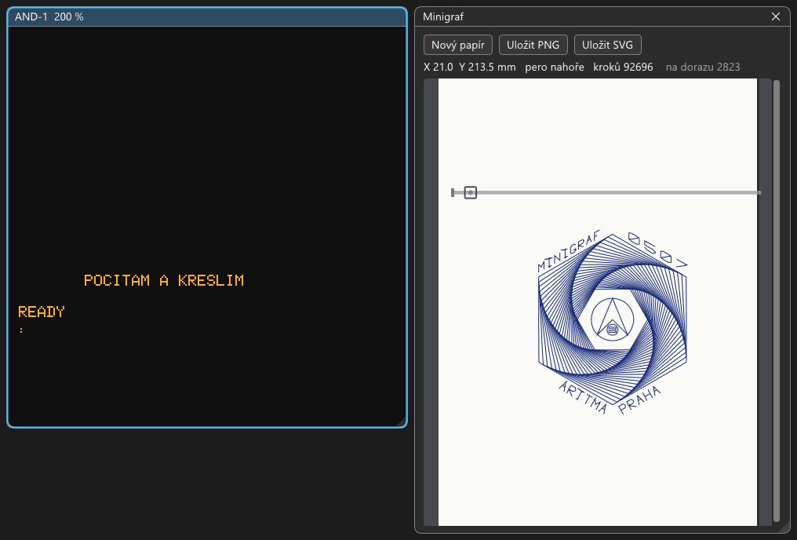
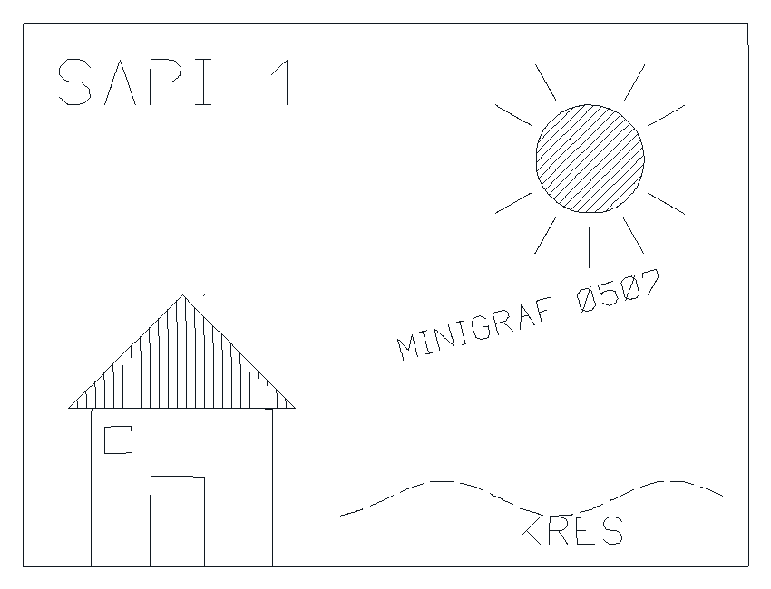

# ARITMA Minigraf 0507 – souřadnicový zapisovač (plotter)

Stav: **emulovaný** od 2026-10-09 (`src/chips/minigraf.*`, připojený k DPP-1 parametrem `minigraf`), sestava
`machines/zps/ZPS-2_MIKOS_V5_Minigraf.sapi` s ovladačem V.1-MGF v EPROM, okno Minigraf, MCP `plotter`, test
`test_minigraf`. **Návod k obsluze s příklady:** `docs/navod-minigraf.md`.

Malý stolní zapisovač A4 podniku ARITMA Praha (0507 se síťovým zdrojem, stavebnice Amagraf 0517 na 24 V). Uvnitř
jsou jen dekodéry fází a budiče krokových motorů, všechno ostatní dělá počítač. K SAPI-1 se připojoval na DPP-1,
k PMD 85 a IQ 151 přes jejich rozhraní.

## Podklady

- Leták ARITMA a popis rozhraní: `..\SAPI.CZ\sapi\prislusenstvi\0507.php` (parametry, tabulka kódů, konektor).
- Stránka SAPI: `..\SAPI.CZ\sapi\doku2\0507.php`:
  - návod k ovladači V.1-MGF (15. 2. 1989), nastavení DPP-1, kabel;
  - ukázkový program v BASICu (převzatý z dokumentace k IQ 151);
  - výpisy tří verzí (`data/eplotr_*` EPROM 1800h, `rplotr_*` RAM F800h, `uplotr_*` s komentáři podle AR 1990);
  - **skutečné výstupy ze SAPI-1** `obrazky/0507_1.png` až `0507_4.png`: kopie obrazovky, výpis programu, ukázka
    a znaková sada.
- PMD 85: `..\SAPI.CZ\sapi\prislusenstvi\doku\0507_pmd85.php` (pracovní plocha 187,5 × 262,5 mm).
- Ostatní zapisovače u SAPI: XY 4130 v `docs/desky/XY4130.md` (zatím neemulovaný). Plotter z AR 1990 (V. Julius
  OK1IVJ) je zapisovač s JPR-1 jako řadičem (povely SHARP MZ-1P16), který kreslí právě Minigrafem: emulovaný od
  2026-10-10, `docs/desky/AR1990.md` (stejný model mechaniky, kabel z P0-OUT desky JPR-1, `Minigraf::set_lines`).

## Zapojení (leták a stránka SAPI)

- Jednosměrné TTL rozhraní, 8 vodičů: 3bitový fázový kód pro každou osu (X4 X2 X1, Y4 Y2 Y1), pero, zem. Nic se
  nečte zpět.
- **Kód stoupá = kladný směr** (pero zleva doprava, papír zezadu dopředu, tedy pero po papíru nahoru), změna kódu
  o jedna = jeden krok **0,125 mm**. Pero úrovní: **H = dole**. Nejvýš 50 mm/s, tj. **400 kroků/s**, pero 50 ms.
  Modely od roku 1986 kreslí o 40 % rychleji.
- Bez koncových spínačů: vozík najede na doraz a kroky se ztratí. Počátek se tak nastavuje jízdou doleva na doraz.
- **DPP-1** na 30h–37h, kabel na X2 (kanál 1), **port B 31h**, řídicí slovo 99h (PA a PC vstup, PB výstup):

| Signál | 8255 | DPP-1 X2 |
|---|---|---|
| X1 / X2 / X4 | PB0 / PB1 / PB2 | 28 / 26 / 23 |
| Y1 / Y2 / Y4 | PB3 / PB4 / PB5 | 27 / 29 / 25 |
| PERO | PB7 | 30 |
| zem | | 17, 19 |

  Stránka píše „budiče u brány 2PB nastavit na výstup“, kabel i program ale používají kanál 1 (1PB, přepínač 1S3).

## Ovladač V.1-MGF (EPROM 1800–1FFF)

- `roms/mikos/MONITOR_V5.0F_MIKOS_V5.0_MINIGRAF.bin` (8 KB):
  - Monitor V5.0F a MIKOS V5.0 (0000–13FF);
  - FFh;
  - `eplotr` ze sapi.cz na 1800h („původní verze“, HEX souhlasí s výpisem bajt po bajtu; součet je 9Ah, hlavička
    výpisu uvádí KS=9C).
  
  Na 1800h je 00h, takže Monitor V5 ovladač nespouští sám.
- **Monitor:**
  - `.G=1800` inicializace: RAMTOP FFCF, řídicí slovo 99h, pero na počátek;
  - `.G=1809` test (celá znaková sada);
  - `.G=180F` kopie obrazovky AND-1 s rámečkem;
  - `.G=1815` Minigraf jako systémová tiskárna (vše pro L:, např. `LIST`, se kreslí písmem).
- **BASIC EXP V5.0:** `A=CALL(6171)` SYST, `CALL(6177,Y,X)` ORG, `CALL(6183)` COPY, `CALL(6189,Y,X)` MOVA,
  `CALL(6195,Y,X)` VECTA, `6201` POINTA, `6207` MOVR, `6213` VECTR, `6219` POINTR, `6222` SPEED, `CALL(6225,délka,adresa)`
  WRITE, `6228` ZNAK, `6231` SIZE XX YY, `6234` SIZE YX XY, `6237` WIDE, `6240` NARROW. Jednotka je jeden krok
  (0,125 mm), Y je kladné nahoru.
- Zápisník ovladače je na FFD0–FFFF, proto sestava nemá DGD-1 a RAM-1 sahá do FFFF. `.G=1800` nastaví RAMTOP
  před spuštěním BASICu.
- Počátek: ovladač zvedne pero, popojede o 8 kroků, předstírá X = 1700 a Y = −1700, jede na (0, 0). Vozík najede
  na levý doraz a zbytek kroků se ztratí, papír se posune o 1700 kroků (212 mm). Pak popojede o 80 kroků doprava,
  tam je X = 0. TEST nastavuje počátek znovu (jako po založení papíru) a před kreslením posune papír o 3500 kroků
  (437 mm). Na jeden list A4 by se to nevešlo.
- **Rychlost:** při nastavení počátku krokuje asi 390 kroků/s na osu, těsně pod limitem letáku. Při kreslení
  zrychlí rampu (P185 = 0Ah) a krokuje až asi 780 kroků/s (Nejasnosti).

## BASIC EXP V5.0/G+SZ a příkaz KRES

- Zdroj: sapi.cz `doku2/bexpgsz.php` (návod) a `data/bexpgsz_hex.php` (4400–8BC7). Kreslení je v assembleru
  zařazené do BASICu EXP V5.0/G a ovládá Minigraf i XY 4130. Klíčové slovo `KRES` a za ním příkazy:
  - `#I` inicializace, s `X,Y,,` nejdřív posun pera;
  - `#N` posun pera klávesami, `#H` hranice kreslení, `#R` rychlost;
  - `#P` počátek, `#M` měřítka, `#U` natočení os;
  - `#C` typ čáry (plná, čárkovaná…), `;` přesun, souřadnice = čára, `#V` přírůstky;
  - `#T` text, `#K` kružnice a oblouky, `#S` šrafování.

  **Všechno v milimetrech.**
- Konfigurační bajt 7D1Ch: bity 0–1 zapisovač (00 Minigraf, 01 XY 4130), bit 2 deska (DPP-1), bit 3 klávesnice
  (Zbrojovka = Consul). Původní byl 0Dh (XY 4130), kopie na sapi.cz („JiM“) má 0Ch (Minigraf) a porty F3h/F1h.
  DPP-1 je ale jen v 00–3Fh.
- **`media/mikos/BASIC_EXP_V5.0G_SZ.hex`** je tato kopie se šesti bajty vrácenými na **33h/31h** podle tabulky
  úprav v návodu: 7951 OUT 33h (řídicí slovo 80h), 7AB5, 7B03, 7C23, 7CC2, 7CC6 OUT 31h. Kontrolní součty záznamů
  jsou přepočítané. Nic se nečte zpět (návod píše „DB31 vstup“, v kódu je OUT).
- Postup:
  1. sestava se zapisovačem;
  2. Soubor → Nahrát program → `media\mikos\BASIC_EXP_V5.0G_SZ.hex`, `.B` (`* BASIC - EXP V5.0/G *`);
  3. Nový papír;
  4. obsah `media\mikos\KRES_DEMO.bas` vložit přes Stroj → Klávesnice → Vložit text, `RUN`.

  `.G=1800` není potřeba, port nastaví `KRES #I`. `KRES` o dorazech neví a počítá od místa, kde pero stojí (po
  zapnutí 60 mm od levého dorazu, po `.G=1800` 10 mm). Ukázka proto začíná `KRES #I -220,0,, #I 90,0,,`: pero
  dojede na levý doraz (zbytek kroků se ztratí na dorazu, jako u ovladače z EPROM) a odtud 90 mm doprava. Rámeček
  široký 160 mm se tak vejde mezi dorazy, ať pero předtím stálo kdekoli. Původní `#I 40,0,,` po `.G=1800` narazil
  rámečkem 30 mm na doraz (2026-10-09).
- Ověřeno: kružnice `KRES #K 0,0,30,36` má 60,00 × 60,00 mm (`test_minigraf`). Ukázka po zapnutí i po `.G=1800`
  má kroky na dorazu jen z úvodního dojetí (1280, popřípadě 1680) a končí v počátku 90 mm od dorazu.
- Při `KRES #I` a `CALL(6177)` (nové nastavení portu 8255) zapisovač ohlásí 2–4 ztracené kroky. Zápis řídicího
  slova vynuluje výstupy a kód fáze skočí z posledního stavu na 0. Motor doskočí do nejbližší fáze, na skutečném
  zapisovači stejně. Hned potom ovladač nastavuje počátek, takže to kresbě nevadí.

## Emulace

- **Model** (`Minigraf`):
  - **Signály:** sleduje port B kanálu (výstupní západka 8255; port jako vstup = linky v H). Změna kódu osy o
    ±1 = krok. Přeskočení o 2 nebo 3 fáze motor dožene nejkratší cestou a započítá se jako ztracený krok. O 4
    (protifáze) se nehne vůbec.
  - **Vozík:** dorazy na obou koncích (dráha 200 mm). Kroky proti dorazu se počítají zvlášť, ovladač na nich
    staví počátek.
  - **Papír:** pás široký jako A4 a dlouhý, jak kresba potřebuje (originální ovladač posouvá papír víc než o A4).
    Nový papír se založí pod pero (Y = 0).
  - **Kresba:** tahy pera dole v krocích. Body na přímce (do jednoho kroku od úsečky) se slučují, takže úsečka má
    dva body a kružnice pár set.
  - **Rychlost:** kroky rychlejší než 400/s se jen počítají (MCP `steps_over_400_per_s`), neztrácejí se.
  - **Po zapnutí:** je port B vstupem, linky jsou v H a **pero je dole**. Než program nastaví port, udělá tečku
    (Nejasnosti).
- **Parametry DPP-1:** sekce `minigraf` (bez dalších voleb) a `minigraf_channel` (1 = X2, 31h při základu 30h; 2 =
  X3). Kanál se nesmí krýt s PMD32-SD ani s KZD-1.
- **Okno Minigraf** (Zobrazení → Zapisovač Minigraf, sestava se zapisovačem ho otevře sama):
  - papír s kresbou, kolejnice vozíku s dorazem a perem (červené = dole), poloha, počet kroků a kroků na dorazu;
  - tlačítka Nový papír, Uložit PNG a Uložit SVG (`work/minigraf/kresba_<datum-čas>`). Export má šířku A4 a
    výšku kresby s okraji, nejméně A4.
- **MCP `plotter`:** stav (poloha v mm, pero, tahy, rozsah kresby, kroky), `new_sheet`, `png`, `svg`, `px_per_mm`,
  `crop` (jen kresba s okrajem 5 mm).
- **Ověřeno:**
  - TEST nakreslí stejnou znakovou sadu jako skutečný Minigraf na sapi.cz (`0507_4.png`, 12 řádků po 8 znacích,
    83,75 × 184,75 mm);
  - ukázka z IQ 151 vyjde stejně jako `0507_3.png` (spirála šestiúhelníků, nápisy, logo ARITMA);
  - test `test_minigraf` (kódy, pero, dorazy, nastavení počátku, TEST, PNG, SVG).

## Ukázka krok za krokem

1. Sestava `zps\ZPS-2_MIKOS_V5_Minigraf.sapi`, otevře se okno Minigraf.
2. `.G=1800` (Enter): pero jede doleva na doraz a papír se posune (počátek).
3. Soubor → Nahrát program → `media\mikos\BASIC_EXP_V5.0.hex`, pak `.B` (BASIC EXP V5.0).
4. V okně Minigraf Nový papír.
5. Otevřít `media\mikos\MINIGRAF_DEMO.bas` v Poznámkovém bloku, zkopírovat vše a vložit **Stroj → Klávesnice →
   Vložit text** (Ctrl+Shift+V na obrazovce). Program se napíše jako z klávesnice.
6. `RUN`: na obrazovce „POCITAM A KRESLIM“ a zapisovač kreslí asi tři minuty (Stroj → Rychlost emulace →
   Maximum to zkrátí na pár sekund).
7. Uložit PNG nebo SVG.

Ukázka je převzatá ze stránky SAPI (`0507.php`). Řádek 450 tam čte 29 dat, ale řádek 440 jich má 23, takže BASIC
EXP skončí chybou dat. V `MINIGRAF_DEMO.bas` je opraveno na `TO 17302`. Výpis nakreslený skutečným zapisovačem
(`0507_2.png`) má čísla řádků od 7001 a v řádku 7080 `832` místo `836`.

Další nápady: `.G=1809` (znaková sada) a `.G=1815` + `LIST` (výpis programu písmem zapisovače).

## Nejasnosti k ověření na HW

- Ovladač po nastavení počátku krokuje až asi 780 kroků/s, leták uvádí nejvýš 400 kroků/s (u modelů od roku 1986
  o 40 % víc). Stačil skutečný Minigraf, nebo ztrácel kroky? (Kresby na sapi.cz vypadají v pořádku.)
- Pero po zapnutí: port B DPP-1 je po resetu vstup a budiče 3216 (nastavené na výstup) pak dávají H. Spustí se
  pero, dokud program nezapíše řídicí slovo?
- Originální ovladač posouvá papír při nastavení počátku o 212 mm a TEST o 437 mm. Kreslilo se na A4, nebo
  na pás papíru? Jak se papír zakládal?
- Přepínače DPP-1 pro Minigraf: stránka píše „2PB“, kabel je na X2 (1PB).
