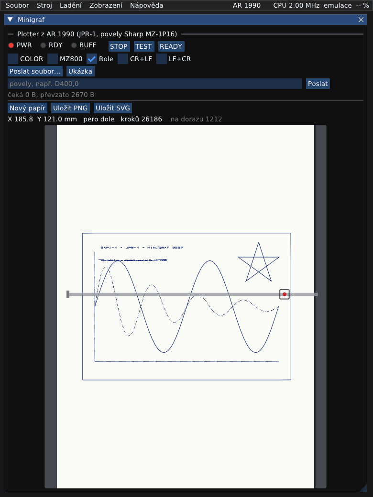
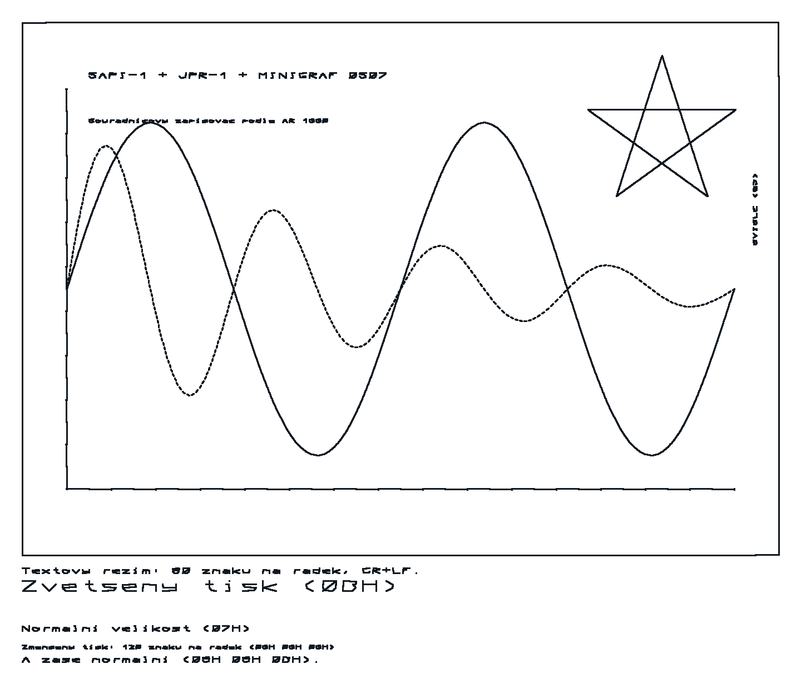

# Plotter z AR 1990: návod k obsluze

V roce 1990 otiskla příloha Amatérského radia stavební návod Vladimíra Juliuse OK1IVJ: **souřadnicový zapisovač
řízený deskou JPR-1**. Deska SAPI-1 tu není počítač, ale řadič plotteru. Program v EPROM přijímá povely
tiskárny-plotteru Sharp MZ-1P16 od libovolného počítače (autor měl Sharp MZ-821 a ZX Spectrum+) a kreslí jimi
na zapisovači Minigraf 0507. Umí čáry, osy, přerušované čáry, texty v libovolné velikosti a čtyřech směrech,
vlastní znaky a textový režim jako tiskárna.

V emulátoru běží program přeložený z výpisu otištěného v AR. Řídicí počítač nahrazuje okno Minigraf, které
do plotteru posílá soubory nebo řádky povelů. Všechny kroky jsou vyzkoušené v emulátoru (2026-10-10) a
obrázky nakreslil emulátor. Jak je plotter zapojený a co je odhad, popisuje `docs/desky/AR1990.md`.



## 1. Zapnutí

1. Soubor → Vybrat sestavu… → `plotter_ar1990.sapi`. Sestava je jen deska JPR-1, obrazovka zůstane prázdná.
2. Otevře se okno **Minigraf** s panelem plotteru: kontrolky PWR, RDY, BUFF, tlačítka STOP, TEST, READY a
   přepínače. Sestava ho má v „Oknech nahoře po spuštění“, takže je nad ostatními okny, i nad oknem Sestava.
3. Plotter po zapnutí **pípá a čeká**. Stiskněte **READY**: vozík najede na levý doraz (Minigraf nemá koncové
   spínače, chvíli drnčí o doraz) a popojede o 10 mm. To je počátek. Kontrolka BUFF svítí, buffer je prázdný.

Kdykoli plotter pípá (STOP, výměna pera, doraz), pokračuje se tlačítkem READY.

## 2. Zkouška

- Tlačítko **TEST**: napíše „*** MZ-821 ***“ a čtyřikrát ho podtrhne (zkouška per, jako kód 04H).
- **Celý test:** TEST držený při zapnutí nakreslí celou znakovou sadu 10H–7FH. V emulátoru to udělá tlačítko
  **Celý test** (reset JPR-1 s drženým TEST). Po nakreslení plotter pípá, pokračuje se READY. Výsledek je obrázek
  v `docs/desky/AR1990.md`. Reset vynuluje výstupy JPR-1, motory Minigrafu skočí do fáze 0 a pár kroků
  se ztratí (okno je ukáže jako „ztraceno“). Na skutečném plotteru by to bylo stejné.

## 3. Ukázka

Tlačítko **Ukázka** pošle `media/ar1990/ukazka.txt`: rámeček 170 × 120 mm, osy s dílky, sinusovku, tlumenou
sinusovku přerušovanou čarou, hvězdu, texty ve dvou velikostech a svisle. Pak přepne do textového režimu a
napíše několik řádků v různých velikostech. Kreslení trvá v emulovaném čase asi dvě a půl minuty.



## 4. Vlastní povely

Do řádku pod tlačítky se píší povely, Enter nebo **Poslat** je odešle a přidá CR. Řídicí kódy se píší jako
`\x02` (dvě šestnáctkové číslice). **Poslat soubor…** odešle libovolný soubor tak, jak je.

Po zapnutí je plotter v **textovém režimu**: co přijde, to napíše (80 znaků na řádek). Do grafického režimu se
přepne kódem 02H:

```
\x02
I
D400,0
D400,400
D0,400
D0,0
```

Vznikne čtverec 50 × 50 mm. `I` určí, že místo, kde pero stojí, je počátek (0,0). Souřadnice jsou v krocích
0,125 mm (8 kroků na milimetr), X doprava, Y nahoru, rozsah −9999 až 9999.

| povel | význam |
|---|---|
| `H` | pero zvednout a domů (0,0) |
| `I` | tady je počátek |
| `Dx,y` / `Jx,y` | čára do bodu / o kus (relativně) |
| `Mx,y` / `Rx,y` | přesun bez kreslení / relativně |
| `Yx,y` / `Wx,y` | bod / relativně |
| `Lp` | typ čáry: 0 plná, 1–15 různě přerušovaná |
| `Sn` | velikost písma 0–63 (a směr zpět na 0) |
| `Qn` | směr písma: 0 vpravo, 1 dolů, 2 vlevo, 3 nahoru (zadává se až po `S`) |
| `Ptext` | napiš text (do CR) |
| `Xp,q,r` | osa: p = 1 vodorovná, 0 svislá; q rozteč dílků, r počet |
| `Zxx,xy,yx,yy` | šířka, sklon a výška písma |
| `Cn` | barva 0–3 (s přepínačem COLOR plotter zastaví a pípáním žádá výměnu pera) |
| `Tn` | rychlost −10 (nejrychleji) až 30 |
| `En,…` / `Gn` | vlastní znak 1–15 (body v rastru 5 × 8) / jeho tisk |

Jednoznakové povely se dají psát za sebou (`HD100,200`), za dvouznakovými (`L0,S1,Q0`) se píše čárka.
Číselné parametry končí čárkou nebo CR. Zpět do textového režimu přepne kód 01H.

**Textový režim**, řídicí kódy:
- 0DH CR a 0AH LF (podle přepínačů CR+LF a LF+CR), 08H krok zpět, 03H řádek zpět;
- 0CH nová strana: na roli vynechá pár řádků, s papírem A4 pípne a čeká na nový list;
- 07H normální písmo (80 znaků na řádek), 0BH zvětšené (40 znaků), 09H 09H 09H zmenšené (120 znaků),
  09H 09H 0BH zpět na 80. Změna velikosti dělá i CR, proto patří na začátek řádku.

## 5. Přepínače

| přepínač | význam |
|---|---|
| COLOR | povel barvy zastaví plotter a pípáním (1 až 4 tečky) žádá pero té barvy |
| MZ800 | znaky ze Sharp MZ-800 se převádějí na ASCII (malá písmena Sharp mají jiné kódy) |
| Role | papír v roli (nová strana jen vynechá místo); bez zaškrtnutí list A4 |
| CR+LF, LF+CR | na CR přidá LF, na LF přidá CR |

## 6. Uložení kresby

**Uložit PNG** a **Uložit SVG** uloží celý papír do `work/minigraf`. **Nový papír** smaže kresbu (pero zůstane,
kde je).
