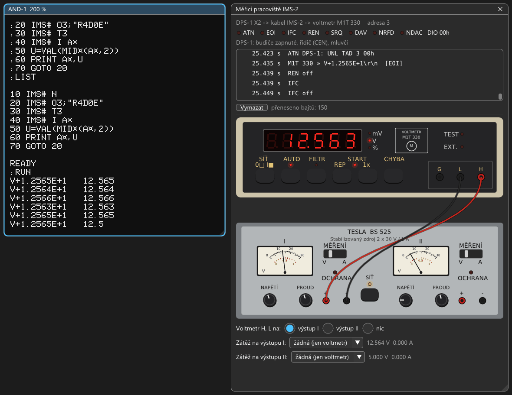
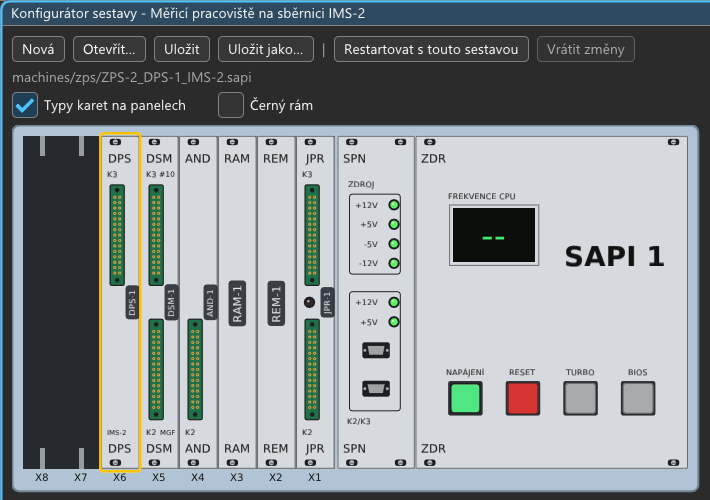

# DPS-1: návod k obsluze měřicího pracoviště IMS-2

Deska **DPS-1** připojuje SAPI-1 jako řidiče (controller) k přístrojové sběrnici **IMS-2**, československé verzi
IEEE 488 (HP-IB, IEC 625). Po ní SAPI adresuje měřicí přístroje, posílá jim příkazy a čte naměřené hodnoty.
Software je **BASIMS V4.0**, BASIC EX V4.0 rozšířený o příkaz `IMS#`.

V emulátoru je na sběrnici **číslicový voltmetr Metra M1T 330** (adresa 3) a na jeho svorkách výstup
**laboratorního zdroje Tesla BS 525**, který se nastavuje myší. Všechny kroky jsou vyzkoušené v emulátoru
(2026-10-10), výpisy obrazovky jsou opsané z něj. Jak deska funguje a co je v emulaci odhad, je
v `docs/desky/DPS-1.md`.



Deska DPS-1 je v sestavě ve slotu X6. Kabel IMS-2 k přístrojům vede z jejího jediného konektoru (FRB 30, K3 = X2),
v konfigurátoru (Stroj → Sestava) je na panelu vidět:



## 1. Zapnutí

1. Soubor → Vybrat sestavu… → `zps/ZPS-2_DPS-1_IMS-2.sapi`. Naběhne MIKOS:

   ```
   MIKOS-1 V4.0F +
   SAPI-1 V4.0
   .
   ```
2. Nad ostatní okna se otevře **Měřicí pracoviště IMS-2** (sestava ho má v „Oknech nahoře po spuštění“).
3. Voltmetr po zapnutí sám měří (svítí START REP a AUTO) a ukazuje napětí výstupu I zdroje: asi `12.564 V`.

## 2. BASIMS z kazety

V magnetofonu je kazeta (`media/dps-1/BASIMS_IMS2.wav`, chráněná proti zápisu) se třemi soubory:

| soubor | co to je | nahrává se |
|---|---|---|
| `BASIMS` | BASIMS V4.0 (4400h–635Fh) | z monitoru: `.K_L BASIMS`, `.J` |
| `PRIKLAD` | příklad z kapitoly 3 | v BASICu: `LOAD`, `PRIKLAD` |
| `SMYCKA` | měření ve smyčce z kapitoly 4 | v BASICu: `LOAD`, `SMYCKA` |

Za tečku napište `K` a `L` (na obrazovce `.K_L`), jméno a Enter:

```
.K_L
 NAME
:BASIMS
PLAY  DONE?
```

V okně **Média** u magnetofonu DSM-1 stiskněte **PŘEHRÁT** a na otázku odpovězte `Y`. Čtení trvá asi minutu, na
prvním řádku obrazovky běží jméno a číslo bloku. Pak za tečku `J`:

```
* BASIC - EX  V4.0 *
READY
:
```

**Rychleji:** Soubor → Nahrát program do paměti (Intel HEX)… → `media\dps-1\BASIMS.hex`, pak za tečku `G4400`
a Enter.

### Program z kazety

Hned za BASIMS jsou na kazetě oba programy. Magnetofon pořád hraje (PŘEHRÁT), stačí:

```
LOAD
 NAME
:PRIKLAD
PLAY  DONE?
Y
READY
RUN
V+1.2564E+1
READY
```

`LOAD` starý program nemaže, jen přepíše řádky se stejnými čísly. Před nahráním jiného programu napište `NEW`.
`SMYCKA` leží za `PRIKLAD`em, nahraje se stejně (magnetofon soubor `PRIKLAD` přeskočí). Kazeta se po vysunutí a
novém vložení přetočí na začátek, `LOAD` pak hledá celou kazetu od začátku.

### Uložení vlastního programu

Kazeta sestavy je chráněná proti zápisu. Pro vlastní programy:

1. V okně **Média** **Nová kazeta…** (soubor WAV ve `work\`), pak **NAHRÁT**.
2. `BYE` (zpátky do MIKOSu), `.K_A`, na `RECORD  DONE?` `Y`, jméno souboru a Enter. Motor chvíli běží (zavaděč
   souboru).
3. `.G4403` a Enter: **teplý start BASIMS, program zůstane.** Pozor: `.B` a `.G4400` jsou studený start a program
   smažou.
4. `SAVE`. Motor běží, pak `READY`.

Další program za ním stejně (`BYE`, `.K_A`…). Nahrávku uloží Média → Uložit jako WAV… Celou kazetu sestavy
(BASIMS i oba programy) nahrává skript `tools/dps1_kazeta.py` přímo v emulátoru, s originálním MIKOSem a BASIMS.

## 3. První měření (příklad z návodu BASIMS)

Na kazetě je jako `PRIKLAD` (s řádkem `10 REM` na začátku, ostatní řádky o 10 dál). Napsaný ručně:

```
10 IMS# N
20 IMS# O3;"R4D0E"
30 IMS# T3
40 IMS# I A$
50 PRINT A$
RUN
V+1.2562E+1
READY
```

Znak `$` ukazuje AND-1 jako `¤` (znaková sada MHB 2501). **Pozor na O a nulu**, na obrazovce vypadají skoro
stejně: za `IMS#` je písmeno O (output), v `R4D0E` je nula (D0 = bez filtru). S nulou za `IMS#` skončí program
hlášením `ERROR SN IN LINE 20`.

- `IMS# N` vynuluje sběrnici (IFC).
- `IMS# O3;"R4D0E"` adresuje voltmetr (adresa 3) jako posluchače a pošle mu `R4D0E`: R4 automatická volba
  rozsahu, D0 bez filtru, E jedno měření.
- `IMS# T3` adresuje voltmetr jako mluvčího, deska se přepne na posluchače.
- `IMS# I A$` přečte odpověď do řetězce.

Odpověď `V+1.2562E+1` znamená 12,562 V. Zdroj je nastavený na 12,564 V, poslední číslice se mění podle šumu
převodníku. Během měření svítí na voltmetru **EXT** (dálkové ovládání), na konci ho BASIMS vrátí do místního režimu.

## 4. Měření ve smyčce

Číslo z odpovědi dá `VAL(MID$(A$,2))`:

```
50 U=VAL(MID$(A$,2))
60 PRINT A$,U
70 GOTO 20
RUN
V+1.2563E+1   12.563
V+1.2563E+1   12.563
V+1.2565E+1   12.565
V+1.2564E+1   12.564
```

Na kazetě je jako `SMYCKA` (s `REM` na začátku). Za běhu otáčejte knoflíkem **NAPĚTÍ** výstupu I zdroje: hodnoty se mění. Pod 3 V přepne voltmetr na rozsah 3 V
(odpověď s `E+0`), pod 0,3 V na 300 mV (třeba `V+1.2343E-1`, displej v mV). Smyčku zastaví Ctrl+C
(`BREAK IN LINE 10`).

## 5. Okno Měřicí pracoviště

**Nahoře** jsou kontrolky vodičů sběrnice (ATN, EOI, IFC, REN, SRQ, DAV, NRFD, NDAC), data DIO a stav desky
(budiče, řidič, posluchač nebo mluvčí). Pod nimi je **monitor**:

```
DPS-1 » R4D0E\r\n\n  [EOI]
ATN DPS-1: UNL TAD 3 00h
M1T 330 » V+1.2563E+1\r\n  [EOI]
REN off
IFC
IFC off
```

Řádky s ATN jsou příkazy rozhraní (LAD 3 = posluchač 3, TAD 3 = mluvčí 3, UNL = všichni přestanou poslouchat),
ostatní řádky jsou texty jednoho mluvčího. `[EOI]` značí poslední bajt. Bajt `00h` za `TAD 3` vysílá sama deska při
přepnutí na posluchače, přístroje ho ignorují (popis v `docs/desky/DPS-1.md`).

**Voltmetr M1T 330:**

| prvek | význam |
|---|---|
| displej, mV / V / % | naměřená hodnota; % když ukazuje chybu |
| SÍŤ | vypínač |
| AUTO | automatická volba rozsahu (R4) |
| FILTR | číslicový filtr (D1), měří čtyřikrát déle s menším šumem |
| START REP / 1x | měřit stále / jednou |
| CHYBA | displej ukáže chybu hodnoty v % |
| EXT | dálkové ovládání ze sběrnice (tlačítka pak nefungují) |
| G, L, H | svorky: stínění, nízká, vysoká |

**Zdroj BS 525**, dva stejné výstupy I a II:
- měřidlo (horní stupnice volty, dolní ampéry) a přepínač **MĚŘENÍ** V / A;
- knoflíky **NAPĚTÍ** (0–30 V) a **PROUD** (omezení 0,05–1,1 A): táhnout myší nebo kolečko, se Shiftem jemně;
- kontrolka **OCHRANA** svítí, když zátěž chce víc proudu, než je omezení. Výstup pak drží proud a napětí klesne;
- **SÍŤ** uprostřed vypne oba výstupy.

**Pod zdrojem:**
- **Voltmetr H, L na:** výstup I, výstup II, nic;
- **Zátěž na výstupu:** žádná (jen voltmetr, 10 MΩ), 1 kΩ, 220, 100, 47, 22, 10 Ω. Napětí a proud výstupu jsou
  vedle.

Příklad omezení proudu: výstup I 20 V, PROUD 0,1 A, zátěž 100 Ω. Rozsvítí se OCHRANA a voltmetr změří 10 V
(`V+1.0000E+1`).

## 6. Příkazy

**BASIMS** (místo `EDIT` je `IMS#`, editace zůstala na `@`):

| příkaz | význam |
|---|---|
| `IMS# N` | nulování sběrnice (IFC) |
| `IMS# O adr;seznam` | přístroj `adr` (0–30) jako posluchač, pošle seznam jako PRINT (na konci LF s EOI) |
| `IMS# T adr` | přístroj `adr` jako mluvčí, SAPI poslouchá |
| `IMS# I A$` | čte odpověď do řetězců (do čárky nebo EOI); jen v programu |

**Voltmetr M1T 330** (řetězec v `IMS# O`):

| příkaz | význam |
|---|---|
| `R0` `R1` `R2` `R3` | rozsah 300 mV / 3 V / 30 V / 300 V |
| `R4` | automatická volba rozsahu |
| `D1` `D0` | filtr zapnout / vypnout |
| `E` | změřit |
| `W0`, `W1`–`W99` | měřit hned / po x × 10 ms od `E` |
| `C` | kalibrace |
| `K1` `K0` | autokalibrace zapnout / vypnout |
| `Q` | další odpověď je chyba hodnoty v % (`%+…`) |

## Chyby a pozor

| co se stane | proč |
|---|---|
| program stojí na `IMS# I` | čte se víc odpovědí, než se měřilo: voltmetr pošle hodnotu jen po `E` (návod BASIMS: počet čtení musí odpovídat) |
| po `IMS# O` naběhne znovu MIKOS | na sběrnici nikdo neposlouchá (vypnutý voltmetr). Chyba BASIMS: jeho obsluha chyby se zacyklí a přeteče zásobník |
| odpověď `V+9.9999E+9`, displej `OL` | napětí je nad rozsahem a automatika je vypnutá (R0–R3) |
| tlačítka voltmetru nereagují | svítí EXT, voltmetr je v dálkovém ovládání |
| `ERROR SN IN LINE …` u `IMS#` | za `IMS#` je nula místo písmene O (nebo jiné písmeno než N, O, T, I) |
| po `BYE` a `.B` je program pryč | `.B` je u BASIMS studený start. Do BASICu s programem `.G4403` |
