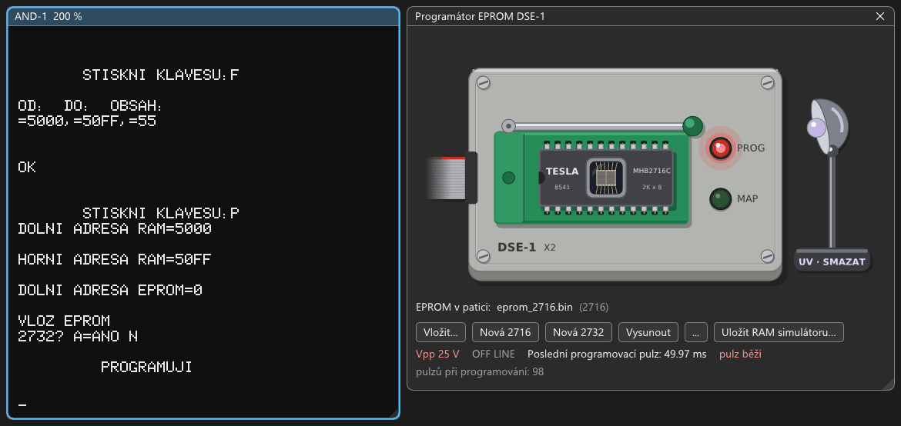

# DSE-1: návod k obsluze simulátoru a programátoru EPROM

Deska **DSE-1** (Tesla, popsaná v AR B 6/1985) udělá ze SAPI-1 vývojový systém pro programy v EPROM. Má dvě části:
- **programátor EPROM 2716 a 2732:** kabel X2 s paticí, do které se zasune EPROM;
- **simulátor EPROM:** 4 KB RAM na desce. Kabel X3 se sondou se zasune do patice cílového zařízení místo EPROM
  a zařízení pak čte program z RAM desky. Program jde opravovat bez mazání a vypalování.

Ovládá ji program **DSE** od Ing. Petra Navrátila (Tesla Elstroj, „NAP051186“). Je v EPROM od 1000h a potřebuje
MONITOR V4. Všechny kroky jsou vyzkoušené v emulátoru (2026-10-30), výpisy obrazovky jsou opsané z něj. Jak deska
funguje a co je v emulaci odhad, je v `docs/desky/DSE-1.md`.



## 1. Zapnutí a nabídka

1. Soubor → Vybrat sestavu… → Přístroje a technologie → **Programátor EPROM DSE-1**
   (`zps/ZPS-2_DSE-1.sapi`). Naběhne MIKOS a vedle obrazovky se otevře okno **Programátor EPROM DSE-1**:

   ```
   MIKOS-1 V4.0F +
   SAPI-1 V4.0
   .
   ```
2. Za tečku napište `G1000` a Enter. Program DSE vypíše nabídku:

   ```
        ******  D S E  ******

   ______________________________NAP051186


           NABIZIM TYTO VARIANTY:

   T ... TRANSFER  OBJIMKA --> RAM
   P ... PROGRAM   RAM --> OBJIMKA
   D ... DUMP      VYPIS RAM + HLAVICKA
   S ... SIMULATE  RAM --> DSE
   R ... RECALL    DSE --> RAM
   C ... COMPARE   RAM X OBJIMKA
   A ... ALTERNATE ZMENA RAM
   M ... MENU      ZOBRAZENI NABIDKY
   F ... FILL      KONSTANTA DO USEKU RAM
   E ... EXIT      NAVRAT DO MONITORU
   Z ... ZKOUSKA DESKY
   K ... KONTROLA EPROM


          STISKNI KLAVESU:
   ```

**Jak se ovládá:**
- Příkaz je jedno písmeno, **bez Enteru**.
- Adresy se píšou šestnáctkově a potvrzují Enterem (`0`, `7FF`, `5000`). „OBJIMKA“ je patice programátoru.
- Na `VLOZ EPROM` stačí libovolná klávesa (EPROM už v patici je).
- Na `2732? A=ANO` znamená `A` EPROM 2732, jiná klávesa (třeba `N`) 2716.
- Po `OK` a `STISKNI KLAVESU:` se píše další příkaz. `M` vypíše nabídku znovu.

## 2. Okno Programátor EPROM DSE-1

Okno ukazuje shora krabičku na konci programovacího kabelu X2: zelenou patici s pákou (patice s nulovou zasouvací
silou, podobná 3M TEXTOOL), EPROM v ní a dvě LED. Vpravo stojí UV lampa na mazání. Jak krabička Tesla vypadala,
nevíme (fotka chybí), kresba je volná. Pod kresbou jsou tlačítka a stav desky.

| Prvek | Význam |
|---|---|
| Patice s pákou | Prázdná patice má páku zvednutou, s EPROM je páka sklopená. Páka se neovládá, EPROM se vkládá tlačítky pod kresbou. Bublina nad paticí řekne, jak je kabel zapojený (pro 2716, pro 2732, dvě patice). |
| EPROM | Keramické pouzdro s křemenným okénkem: 2716 je TESLA MHB2716C, 2732 Intel D2732 (Tesla 2732 nevyráběla). Prázdná EPROM (všechny bajty FFh) ukáže okénkem čip. Naprogramovaná má přes okénko papírový štítek s názvem souboru, jak se lepil na vypálené EPROM. Štítek se přilepí, až programování skončí; během něj je okénko vidět. |
| LED PROG (červená), MAP (zelená) | LED1 „indikace progr.“ a LED2 „indikace map.“ v krabičce kabelu. Program DSE rozsvítí PROG při programování. Barvy vybral autor, skutečné nejsou známé. |
| UV lampa (na podstavci „UV · SMAZAT“) | Smaže EPROM v patici (kapitola 4). Pohodlí emulátoru: skutečná EPROM jde z patice pod UV lampu na 15–20 minut. Vypnutá lampa nemá paprsky, pod myší ukáže slabé (jde na ni kliknout). |
| Karta | Jen v sestavě s víc deskami DSE-1: vybere desku, jejíž kabel okno ukazuje (i pro soubor přetažený na okno). |
| EPROM v patici | Soubor EPROM v patici a její typ (2716, 2732). |
| Vložit… | Vloží jinou EPROM: soubor `.bin` s 2048 B (2716) nebo 4096 B (2732). Soubor jde také přetáhnout myší na okno. |
| Nová 2716, Nová 2732 | Vloží novou prázdnou EPROM (všechny bity 1, jako po smazání UV světlem) `work\dse-1\eprom_N.bin`. |
| Vysunout | EPROM vytáhne z patice. |
| … → Obnovit z originálu | Pracovní kopii přepíše originálem. |
| Uložit RAM simulátoru… | 4 KB RAM simulátoru do souboru `.bin`. Pomoc emulátoru, skutečná deska to neumí. |
| Vpp 0 / 5 / 25 V | Napětí na vývodu Vpp patice: 5 V pro čtení, 25 V (červeně) pro programování. |
| ON LINE / OFF LINE | ON LINE: RAM simulátoru patří sondě X3. OFF LINE: zapisuje a čte ji počítač. |
| Poslední programovací pulz | Délka posledního pulzu v ms. Během programování „pulz běží“ a počet pulzů. |

Vpp, ON LINE a délka pulzu jsou údaje emulátoru, krabička sama má jen dvě LED.

V sestavě je prázdná 2716. Emulátor pracuje s její pracovní kopií `work\dse-1\eprom_2716.bin`, originál
v `media\dse-1` se nemění. Naprogramované bajty se do kopie ukládají průběžně, jako u ostatních médií. Štítek
naprogramované EPROM nese jméno souboru (`eprom_2716`, u Nové 2716 `eprom_1` a dál).

## 3. Kontrola smazání: K

Před programováním se vyplatí ověřit, že je EPROM prázdná (všechny bajty FFh):

1. `K`, na `VLOZ EPROM` libovolná klávesa, na `2732? A=ANO` klávesa `N`.
2. `DOLNI ADRESA EPROM=` `0` a Enter, `HORNI ADRESA EPROM=` `7FF` a Enter (celá 2716).

```
       STISKNI KLAVESU:K
VLOZ EPROM
2732? A=ANO N
DOLNI ADRESA EPROM=0

HORNI ADRESA EPROM=7FF

CISTA  0000 - 07FF


OK
```

U naprogramované EPROM vypíše program každý bajt, který není FFh (adresa a obsah), a na konci `NECISTA`.

## 4. Data do RAM a programování: F, D, P

Program DSE programuje z RAM počítače. Na zkoušku naplníme 256 bajtů hodnotou 55h:

1. `F` a `5000,50FF,55` a Enter (od, do, obsah):

   ```
          STISKNI KLAVESU:F

   OD:  DO:  OBSAH:
   =5000,=50FF,=55


   OK
   ```
2. `D` a `5000,501F` a Enter vypíše kus RAM:

   ```
          *  MEMORY DUMP  *
   _______________________________DSE-NAP

   OD:  DO:
   =5000,=501F

   5000 55 55 55 55 55 55 55 55  UUUUUUUU
   5008 55 55 55 55 55 55 55 55  UUUUUUUU
   5010 55 55 55 55 55 55 55 55  UUUUUUUU
   5018 55 55 55 55 55 55 55 55  UUUUUUUU

   OK
   ```
3. `P`, `DOLNI ADRESA RAM=` `5000` Enter, `HORNI ADRESA RAM=` `50FF` Enter, `DOLNI ADRESA EPROM=` `0` Enter,
   libovolná klávesa a `N`. Program vypíše `PROGRAMUJI`:
   - v okně programátoru svítí červená **PROG**, Vpp je **25 V**, poslední pulz **49.97 ms** (obrázek nahoře);
   - každý bajt dostane jeden pulz 50 ms, 256 bajtů tedy trvá asi 13 s;
   - okénkem EPROM je během programování vidět čip;
   - pak program celý rozsah porovná a na okénko se přilepí štítek se jménem souboru (EPROM už není prázdná):

   ```
          STISKNI KLAVESU:P
   DOLNI ADRESA RAM=5000

   HORNI ADRESA RAM=50FF

   DOLNI ADRESA EPROM=0

   VLOZ EPROM
   2732? A=ANO N

            PROGRAMUJI

   SHODNY OBSAH  0000 - 00FF


   OK
   ```

V okně Log (Ladění → Log) je shrnutí programování:
`DSE-1: programming: 256 bytes, 1.00 pulses per byte, pulses 49.97-49.97 ms`.

- **Celá 2716** (2048 bajtů) trvá asi 100 s. Čekání zkrátí F8 (Stroj → Rychlost emulace → Maximum). Délka pulzu se
  měří v čase emulovaného počítače, takže zůstane 50 ms.
- **Programování mění bity jen z 1 na 0.** Do naprogramovaného bajtu jde dopsat jen to, co z něj ubírá jedničky.
  Jinak je potřeba EPROM smazat (UV lampa níže) nebo vzít novou.

**Smazání UV lampou:** klik na lampu „UV · SMAZAT“ vpravo v okně programátoru. Naprogramovaná EPROM se nejdřív zeptá
(celý obsah se ztratí), prázdná se maže hned. Všechny bajty jsou hned FFh, štítek zmizí a okénko asi 1,5 s svítí
fialově. Smazaný obsah se uloží do souboru EPROM jako programování (u EPROM z `media\` nebo `roms\` do pracovní kopie,
originál zůstane a „…“ → Obnovit z originálu ho vrátí). `K` pak vypíše `CISTA`. Skutečná EPROM by šla z patice pod UV lampu na
15–20 minut, v emulátoru je to pohodlí. Když je na patici napětí (Vpp 5 nebo 25 V, program právě čte nebo programuje),
lampa nesvítí a okno řekne, ať program nejdřív skončí.

## 5. Porovnání a změna RAM: C, A

`C` porovná EPROM s RAM: `DOLNI ADRESA EPROM=` `0`, `HORNI ADRESA EPROM=` `FF`, `DOLNI ADRESA RAM=` `5000`,
klávesa a `N`. Vypíše `SHODNY OBSAH  0000 - 00FF`.

Teď změníme v RAM dva bajty. `A` a `5010` a mezerník: program ukáže obsah `55-`. Napište `12` a mezerník (další
bajt), `34` a Enter (konec):

```
       STISKNI KLAVESU:A
OD: =5010 55-12 55-34
OK
```

Znovu `C` se stejnými adresami vypíše rozdíly (adresa a bajt v RAM, adresa a bajt v EPROM):

```
2732? A=ANO N
5010 12   0010 55
5011 34   0011 55
ROZDILNY OBSAH  0000 - 00FF


OK
```

## 6. EPROM do RAM: T

`T` přenese obsah EPROM do RAM: `DOLNI ADRESA EPROM=` `0`, `HORNI ADRESA EPROM=` `FF`, `DOLNI ADRESA RAM=`
`6000`, klávesa a `N`. Každý bajt hned zkontroluje a vypíše jen `OK`. `D` a `6000,601F` ukáže samé 55h.

Takhle se načte cizí EPROM: vložit ji do patice (Vložit… v okně programátoru, nebo soubor přetáhnout na okno), `T`
celý rozsah (`0`, `7FF`) do RAM, v RAM upravit a naprogramovat do nové EPROM (Nová 2716).

## 7. Simulátor: S a R

`S` zkopíruje 2 KB z RAM počítače do RAM simulátoru a přepne desku do **ON LINE**:

1. `S`, `DOLNI ADRESA RAM=` `5000` a Enter.
2. Na `EPROM 4K- A=ANO` klávesa `N` (simulovat 2716).

```
       STISKNI KLAVESU:S
DOLNI ADRESA RAM=5000

EPROM 4K- A=ANO  N

OK
```

- Okno programátoru ukáže **ON LINE**. Na skutečné desce by teď zařízení se sondou X3 v patici četlo místo EPROM
  obsah 5000–57FF. **V emulátoru sonda není nikam zasunutá**, ON LINE je jen vidět.
- 2716 leží v RAM simulátoru na **800–FFFh** (tak je zapojený kabel X3 z výroby), 2732 (`A`) na 000–FFFh.
- Obsah RAM simulátoru uloží do souboru tlačítko **Uložit RAM simulátoru…** v okně programátoru. Soubor má 4 KB,
  2716 je v něm od 800h. Jde ho vložit do jiné sestavy jako obsah EPROM (pomoc emulátoru).

`R` přenese RAM simulátoru zpět do RAM počítače: `DOLNI ADRESA DSE=` `800`, `HORNI ADRESA DSE=` `8FF`,
`DOLNI ADRESA RAM=` `7000`. Program každý bajt zkontroluje:

```
       STISKNI KLAVESU:R
DOLNI ADRESA DSE=800

HORNI ADRESA DSE=8FF

DOLNI ADRESA RAM=7000

SHODNY OBSAH  0800 - 08FF


OK
```

`D` a `7000,701F` ukáže data z kroku 5 i se změněnými bajty `12 34` na 7010h.

Původní návod DSE.DOC radí mít při `S` a `R` patici programátoru prázdnou. V emulátoru `S` a `R` projdou i s EPROM
v patici, do logu ale jde jednou varování („…DSE.DOC asks for an empty socket during S and R…“). Skutečná deska by
mohla číst špatně (`docs/desky/DSE-1.md`, Nejasnost 3). Prázdnou patici dá Vysunout v okně programátoru (páka se
zvedne).

## 8. Zkouška desky a návrat: Z, E

- `Z` vypíše `TEST DESKY`, zkopíruje ROM počítače 0000–0FFF do RAM simulátoru a zkontroluje ji. Vypíše jen `OK`.
  RAM simulátoru se tím přepíše.
- `E` se vrátí do monitoru (`SAPI-1 V4.0` a tečka). Program DSE zase spustí `G1000`.

## 9. EPROM 2732

**Kabel X2 se dodával zapojený pro 2716.** Pro 2732 se v jeho konektoru přepojovaly tři vodiče (DSE.DOC). V emulátoru:

1. Zobrazení → Konfigurátor sestavy…, karta DSE-1 ve slotu X6, **Programovací kabel X2** → „pro 2732, upravený
   podle DSE.DOC“. Pohodlnější je „dvě patice 2716 + 2732 (replika)“: EPROM si podle typu vybere svou patici.
2. **Restartovat s touto sestavou.** Obsah RAM se ztratí, pracovní kopie EPROM zůstanou.
3. V okně programátoru **Nová 2732** (na pouzdře je Intel D2732).
4. `G1000`, `K`, klávesa, `A` (2732), `0` a `FFF`:

   ```
   2732? A=ANO A
   DOLNI ADRESA EPROM=0

   HORNI ADRESA EPROM=FFF

   CISTA  0000 - 0FFF
   ```
5. `F` `5000,50FF,AA`, pak `P` z `5000`–`50FF` do EPROM od `900`, klávesa a `A`:

   ```
   DOLNI ADRESA EPROM=900

   VLOZ EPROM
   2732? A=ANO A

            PROGRAMUJI

   SHODNY OBSAH  0900 - 09FF
   ```

V logu je u 2732 navíc `1 pulse shorter than 1 ms did not program`. To je krátký pulz s daty FFh těsně před
programováním (program Tesla zapne 25 V dřív než řídicí slovo), nic nezmění.

**Pozor na 2732 v kabelu pro 2716.** Okno programátoru upozorní „2732 v patici zapojené pro 2716 (kabel X2): nečte
se ani neprogramuje, jak má“. `K` sice vypíše `CISTA`, ale `P` nic nenaprogramuje a kontrola vypíše samé rozdíly
a `ROZDILNY OBSAH`. Na vývod A11 přitom jde 25 V. Log to hlásí („25 V on A11 (pin 21) of the 2732…“), skutečnou EPROM
by to mohlo poškodit.

## 10. Vlastní program do EPROM

1. Program do RAM počítače: Soubor → Nahrát program do paměti (Intel HEX)…, nebo Nahrát binární soubor do
   paměti…. Data patří od 4400h výš, jako programy pro MIKOS: pod tím jsou proměnné monitoru a programu DSE (4100h).
2. `G1000`, `K` (prázdná?), `P` s adresami programu, `C` pro kontrolu.
3. Soubor EPROM je pracovní kopie ve `work\dse-1\` (název je v okně programátoru a na štítku EPROM). Je to
   obyčejný obraz 2 nebo 4 KB, jde použít jinde, třeba jako EPROM jiné karty.

MCP nabízí totéž bez okna: nástroj `dse1` (stav, `insert`, `new`, `eject`, `erase`, `sim_read`, `sim_save`;
`docs/mcp.md`).
