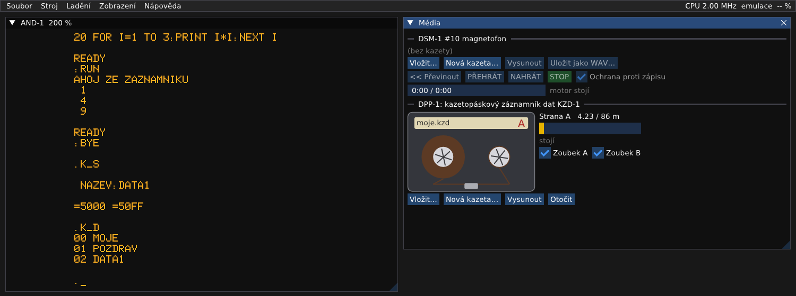

# KZD-1: návod k obsluze

Kazetopáskový záznamník dat KZD-1 (ZPA Košíře, k SAPI-1 od roku 1988) ukládá programy a data na datovou kazetu.
Je rychlejší a spolehlivější než magnetofon: asi 10 000 bitů za sekundu, adresář kazety, vyhledávání souborů. Na
SAPI-1 je připojený přes desku DPP-1 a ovládá ho operační systém **MIKOS/K V5.0** v EPROM. Kazety se zapisují
jinak než u magnetofonu a nejsou s ním přenosné.

Všechny kroky jsou vyzkoušené v emulátoru (2026-10-09), výpisy obrazovky jsou opsané z něj. Zapojení a podrobnosti
o emulaci jsou v `docs/desky/KZD-1.md`, původní návod k MIKOSu/K v `..\SAPI_DOKU\MIKOS5_K\MIKOS5K.DOC`.



## Co je potřeba

1. Soubor → Vybrat sestavu… → `zps\ZPS-2_MIKOS_K.sapi`. Po startu je na obrazovce `MIKOS/K V5.0 (C) TESLA DIZ 1987`,
   `MONITOR V5.0` a tečka, výzva monitoru.
2. Zobrazení → **Média**. Dole je část „DPP-1: kazetopáskový záznamník dat KZD-1“ s kazetou.

Sestava má vloženou kazetu `work\kzd-1\kazeta.kzd`. Když soubor neexistuje, vznikne prázdný.

## Okno Média

| Prvek | Význam |
|---|---|
| kazeta | Na štítku je jméno souboru a strana (A, B). Cívky ukazují, kolik pásky je na které straně, a při pohybu se točí. Hlava zčervená při záznamu. |
| Strana A 4.23 / 86 m | Kde páska stojí (metry od začátku strany) a pruh s polohou. Pásky je 86 m na stranu. |
| stojí / vpřed / převíjení… | Co záznamník právě dělá, s rychlostí. Konec pásky ohlásí „Konec pásky: přetížení motoru“. |
| Zoubek A, Zoubek B | Ochranné zoubky kazety. Bez zoubku MIKOS/K na stranu nezapíše (níže). |
| Vložit… | Vloží jinou kazetu (`.kzd`), nebo program z PC (`.hex`, `.bin`), ze kterého vyrobí novou kazetu (níže). |
| Nová kazeta… | Založí novou prázdnou kazetu pod zvoleným jménem a vloží ji. |
| Vysunout | Kazetu vysune a uloží. |
| Otočit | Kazeta se otočí na druhou stranu. |

Kazeta je obyčejný soubor `.kzd`. Emulátor ho zapíše pár sekund po posledním zápisu (během záznamu až po jeho
konci), při pauze a při přepnutí do jiného okna Windows, při vysunutí kazety, při ukončení a při uložení stavu.
Soubor, který nejde přečíst, se nevloží a v mechanice zůstane původní kazeta.

## Jak se píší příkazy

- Příkazy MIKOSu/K začínají klávesou **`K`**. Na obrazovce se objeví `.K_` a za ním se stiskne písmeno příkazu:
  `I`, `S`, `L`, `D`, `Z`… **Enter se nemačká.** V návodu se příkaz píše tak, jak je vidět na obrazovce:
  `.K_I`, `.K_S`.
- Když příkaz chce jméno souboru, vypíše `NAZEV:`. Jméno (nejvýš 11 znaků) se potvrdí Enterem.
- MIKOS/K při práci ukazuje v prvním řádku obrazovky, co právě čte (jméno souboru, číslo souboru a bloku).
- Záznamník jede skutečnou rychlostí. Na čekání pomůže F8 (Stroj → Rychlost emulace → Maximum).

## 1. Příprava kazety: `.K_I`

Každou novou kazetu je nutné nejdřív připravit (předznačit a pojmenovat). Na nepřipravené kazetě se MIKOS/K
nezorientuje.

**Pozor:** `.K_I` kazetu celou přepíše. Na pokusy si proto nejdřív založte vlastní kazetu: v okně Média tlačítko
**Nová kazeta…** a jméno, např. `pokus.kzd`.

1. Stiskněte `K` a `I`. Záznamník převine na začátek a asi 20 sekund zapisuje úvodní předznačení.
2. Objeví se `ZADEJ NAZEV:`. Napište název pásky, např. `MOJE`, a Enter.
3. Po dvou sekundách je zpět tečka. Kazeta je připravená a prázdná.

```
.K_I
 ZADEJ
 NAZEV:MOJE
.
```

## 2. Program v BASICu na kazetu a zpět

BASIC EXP V5.0 ukládá přes MIKOS/K, takže programy v BASICu jdou na KZD-1 stejně jako na magnetofon.

1. Soubor → Nahrát program do paměti (Intel HEX)… → `media\mikos\BASIC_EXP_V5.0.hex`.
2. Za tečku napište `B`: naběhne `* BASIC - EXP V5.0 *` a výzva `:`.
3. Napište program, třeba:
   ```
   10 PRINT "AHOJ ZE ZAZNAMNIKU"
   20 FOR I=1 TO 3:PRINT I*I:NEXT I
   ```
   Delší program se nemusí opisovat: zkopírujte ho do schránky a vložte přes Stroj → Klávesnice → **Vložit
   text** (Ctrl+Shift+V na obrazovce).
4. `SAVE "POZDRAV"` a Enter. Záznamník najede za poslední soubor, zapíše program a za pár sekund vypíše `READY`.
5. Zkouška: `NEW` (program v paměti se smaže) a `LOAD ".POZDRAV"`. Tečka před jménem znamená „převinout na začátek
   a pak hledat“. Na obrazovce se ukáže název pásky a nalezený soubor:
   ```
   :LOAD ".POZDRAV"
   MOJE
   POZDRAV
   READY
   ```
6. `RUN` program spustí. `BYE` vrátí řízení monitoru (tečka).

Podle návodu BASICu ukládá `SAVE B "JMENO"` program v binárním tvaru a `LOAD B "JMENO"` ho načte (v emulátoru
jsme zkoušeli jen `SAVE` a `LOAD`).

## 3. Strojový kód a data: `.K_S` a `.K_L`

Uložení úseku paměti, třeba programu v assembleru:

1. Stiskněte `K` a `S`, za `NAZEV:` napište jméno (`DATA1`) a Enter.
2. Záznamník najede za poslední soubor (několik sekund) a vypíše `=`.
3. Napište počáteční adresu, mezeru, koncovou adresu a Enter. Na obrazovce je to vidět jako `=5000 =50FF`.
4. Po zápisu je zpět tečka.

Načtení:

1. Stiskněte `K` a `L`, za `NAZEV:` napište `.DATA1` (s tečkou = od začátku pásky) a Enter.
2. Soubor se načte na stejné adresy, ze kterých se ukládal. Příkaz `U` ukáže, kam (`5000 50FF`).
3. Program se spustí příkazem `J`.

```
.K_S
 NAZEV:DATA1
=5000 =50FF
.K_L
 NAZEV:.DATA1
MOJE
DATA1
.U
5000 50FF
```

## 4. Adresář kazety: `.K_D`

Stiskněte `K` a `D`. Záznamník převine na začátek a vypíše všechny soubory s čísly. Soubor 00 je vždy název pásky.

```
.K_D
00 MOJE
01 POZDRAV
02 DATA1
.
```

## 5. Jak zadat jméno souboru

Při čtení (`.K_L`, `LOAD`):

| Zápis | Význam |
|---|---|
| `JMENO` | Hledá soubor od místa, kde páska právě stojí. |
| `.JMENO` | Převine na začátek a pak hledá. **Nejjistější volba.** |
| `*` | Vezme první soubor od místa, kde páska stojí. Ukáže jeho jméno a zeptá se `--(A/N)?`: `A` = tento, `N` = hledat další. |
| `.*` | Totéž od začátku pásky. Hodí se, když si nepamatujete jméno. |
| Enter | První soubor od místa, kde páska stojí, bez ptaní. |

Při zápisu (`.K_S`, `SAVE`):

| Zápis | Význam |
|---|---|
| `JMENO` | Zapíše za poslední soubor. **Běžný postup.** |
| `.JMENO` | Převine na začátek, postupně nabízí soubory (`--(A/N)?`) a zapíše za ten, u kterého odpovíte `A`. |
| `@JMENO` | Zapíše hned tam, kde páska stojí (třeba za soubor nalezený příkazem `.K_N`). |

**Pozor:** za každým zápisem MIKOS/K označí konec záznamu. Když zapíšete jinam než na konec (`.JMENO`, `@JMENO`),
soubory za tím místem se ztratí.

## 6. Pohyb po pásce

- `.K_Z` převine na začátek a nastaví pásku před název pásky. **Pro návrat na začátek používejte `.K_Z`, ne `.K_R`.**
  Po `.K_R` (jen převinutí) a předchozím `.K_D` totiž `.K_L JMENO` skončí chybou `CHYBA - NENI KONEC SOUBORU`.
  Jde o vlastnost MIKOSu/K, kterou emulátor zachovává (`docs/desky/KZD-1.md`). Jméno s tečkou (`.JMENO`) funguje
  vždy.
- `.K_E` najede na konec záznamu (za poslední soubor).
- `.K_N` a číslo souboru (z adresáře) najde soubor podle čísla.
- `.K_>` a `.K_<` přeskočí o soubor vpřed a vzad, `.K_B` o blok vpřed.

## 7. Ochrana proti zápisu

Skutečná kazeta má na každé straně vylamovací zoubek. V okně Média ho představuje zaškrtávátko **Zoubek A** (B).
Bez zoubku MIKOS/K zápis odmítne:

```
.K_S
 NAZEV:DATA2
CHYBA - ZAZNAM NENI POVOLEN
```

Druhá strana kazety se použije tlačítkem **Otočit** (každá strana se připravuje `.K_I` zvlášť).

## 8. Program z PC rovnou na kazetu

Program v souboru `.hex` nebo `.bin` není potřeba nahrávat do paměti a ukládat. Emulátor z něj vyrobí kazetu
přesně takovou, jakou by zapsal MIKOS/K:

1. V okně Média u KZD-1 **Vložit…** a vyberte soubor `.hex` nebo `.bin`, třeba `media\mikos\BASIC_EXP_V5.0.hex`.
2. V okně „Program na kazetu“ vyplňte **Jméno na kazetě** (např. `BASIC`). U `.bin` ještě adresu, kam program
   patří. Start se vyplní jen tehdy, když program nezačíná na nejnižší adrese. Potvrďte tlačítkem **Vložit**.
3. Vznikne a vloží se nová kazeta `work\kzd-1\BASIC.kzd`. Předchozí kazeta se vysune a uloží.
4. `.K_D` ukáže `00 BASIC` (název pásky) a `01 BASIC` (program). Pak `.K_Z`, `.K_L` s `BASIC` a `J`: naběhne
   `* BASIC - EXP V5.0 *`.

## 9. Kopírování z magnetofonu: program CKM

Programy na kazetách magnetofonu (nahrávky WAV, MP3, nebo `.hex` převedený na kazetu MIKOS) zkopíruje na KZD-1
originální kopírovací program CKM od TESLY DIZ:

1. Kazetu KZD-1 připravte `.K_I` (třeba název `PROGRAMY`).
2. V okně Média u magnetofonu (DSM-1) **Vložit…** nahrávku nebo program (u `.hex` zvolte formát MIKOS) a stiskněte
   **PŘEHRÁT**.
3. Soubor → Nahrát program do paměti → `media\mikos\CKM_opraveny.hex` (doporučeno, viz Pozor níže) nebo originál
   `media\mikos\CKM.hex` a za tečku `G4400` Enter (na obrazovce `.G=4400`). Objeví se menu (opravená kopie má
   v prvním řádku `OPRAVENY KOPIR. PROGRAM MGF-KZD-1`, jinak je stejné):
   ```
   KOPIROVACI PROGRAM  MGF - KZD-1
   * M...MGF CTENI, KZD ZAPIS
     K...KZD CTENI, MGF ZAPIS
     L...CTI SOUBOR
     B...ZAPIS BINARNI SOUBOR
     A...ZAPIS ZNAKOVY SOUBOR
     Q...UKONCENI PROGRAMU
   PRO MAGNETOFON:
     I...INIT KAZETY
     D...ADRESAR KAZETY
     X...PREPINANI K-10/SP-210
     R...PREVINUTI KAZETY (SP)
   <,>...RYCHLOPOSUVY (SP)
   ```
4. `X` přepne na magnetofon K-10 (výzva se změní z `:` na `_`). Emulovaný magnetofon nemá dálkové ovládání SP-210.
5. `L`, za `NAZEV:` napište `*` a Enter. Na otázku `CTENI  HOTOVO ?` (je zmáčknuté přehrávání?) odpovězte `A`.
   Až se ukáže jméno souboru s `--(A/N)?`, odpovězte `A`. Program se načte do paměti.
6. `B` (program) nebo `A` (textový soubor) a jméno na KZD-1. Program se zapíše na záznamník.
7. `Q` vrátí monitor. `.K_D` ukáže zkopírovaný soubor, `.K_Z`, `.K_L` a jméno ho načte, `J` spustí.

CKM má v paměti místo asi pro 44 KB.

Opačně, z KZD-1 na magnetofon:

1. V okně Média u DSM-1 **Nová kazeta…** (nahrávka WAV) a zrušte **Ochranu proti zápisu**.
2. V CKM `X` (K-10) a `K`: hvězdička se přesune na `K...KZD CTENI, MGF ZAPIS`.
3. `L` a jméno souboru na KZD-1 (s tečkou, např. `.BASIC`). Soubor se načte.
4. Stiskněte v okně Média **NAHRÁT**, pak v CKM `B` a za `NAZEV:` jméno se zavináčem, `@BASIC`, a Enter. Zavináč
   znamená „zapsat hned“: CKM se na nic neptá a začne zapisovat, proto musí být NAHRÁT zmáčknuté předem. Bez
   zavináče by CKM nejdřív hledal konec záznamu na kazetě, a na prázdné nahrávce by ho hledal donekonečna.
5. Až se vrátí menu, **STOP**. Nahrávku jde uložit tlačítkem **Uložit jako WAV…** a přehrát do skutečného SAPI.

**Pozor, chyba v originálním CKM:** po čtení ze záznamníku (`K` a `L`) nastaví CKM MIKOSu/K délku bloku 0 místo
255 (ve zdrojáku chybí jedna instrukce). Každý další zápis na KZD-1, z CKM i příkazem `.K_S`, pak dělá bloky po
jednom bajtu: 10 KB by potřebovalo přes 600 m pásky a skončí `CHYBA - KONEC PASKY`.

- **Opravená kopie** `media\mikos\CKM_opraveny.hex` tuto chybu nemá. Liší se od originálu jen jedním bajtem
  instrukce a prvním řádkem menu, ovládá se stejně.
- **S originálem** před dalším zápisem na KZD-1 zadejte `.K_X` a `FF` (délka bloku 255), nebo stiskněte reset
  (F12). Soubor načtený do CKM po resetu v paměti zůstává: `.G=4400` a `B` ho zapíše znovu.

## Hlášení MIKOSu/K

| Hlášení | Význam |
|---|---|
| `CHYBA - ZAZNAM NENI POVOLEN` | Strana kazety nemá zoubek (zaškrtněte Zoubek A, B). |
| `CHYBA - NENI KONEC SOUBORU` | Chybí značka konce souboru, nebo páska přejela konec záznamu. Viz `.K_R` výše. |
| `CHYBA CTENI DAT`, `CHYBA OZNACENI BLOKU` | Poškozený záznam. |
| `KONEC PASKY` | Při hledání došla páska. |
| `NENI BINARNI FORMAT` | `.K_L` na textovém souboru. |
| `SOUBOR NEEXISTUJE` | Soubor zadaného jména se nenašel. |
| `CHYBA CTENI: I/D/N/A=ZNOVA ?` | Blok nejde přečíst ani napodruhé: `A` = číst znovu, `N` = pokračovat s chybou, `I` / `D` = číst z následující / předchozí kopie souboru. |
| `#`, `%` za jménem | Při kontrole: špatný kontrolní součet bloku (`#`), vynechaný blok (`%`). |

Texty kromě prvních dvou jsou podle původního návodu, v emulátoru jsme je nevyvolávali.

## Přehled příkazů MIKOSu/K

| Příkaz | Co dělá |
|---|---|
| `.K_I` | Příprava (inicializace) kazety s názvem pásky. Smaže celou kazetu. |
| `.K_S` | Uložení úseku paměti (jméno, pak `od mezera do`). |
| `.K_L` | Načtení souboru (na adresy, odkud se ukládal). `J` ho spustí, `U` ukáže adresy. |
| `.K_D` | Adresář kazety. |
| `.K_Z` | Na začátek záznamu (před název pásky). |
| `.K_R` | Převinutí na úplný začátek pásky. |
| `.K_E` | Na konec záznamu. |
| `.K_N` | Soubor podle čísla. |
| `.K_>`, `.K_<`, `.K_B` | O soubor vpřed, vzad, o blok vpřed. |
| `.K_V` | Zapne a vypne kontrolu zápisu (místo `K_` se pak ukazuje `K*`). Uložený soubor se hned přečte a zkontroluje. |
| `.K_P` | Kontrola jednoho souboru, před kterým páska stojí. |
| `.K_F`, `.K_O`, `.K_C` | Otevření souboru pro čtení, pro zápis a jeho uzavření (pro programy, které čtou a zapisují data). |
| `.K_K` | Dopíše chybějící značku konce záznamu (jen po poškození). |
| `.K_X` | Kratší délka bloku pro zápis (výchozí 255 bajtů). |
