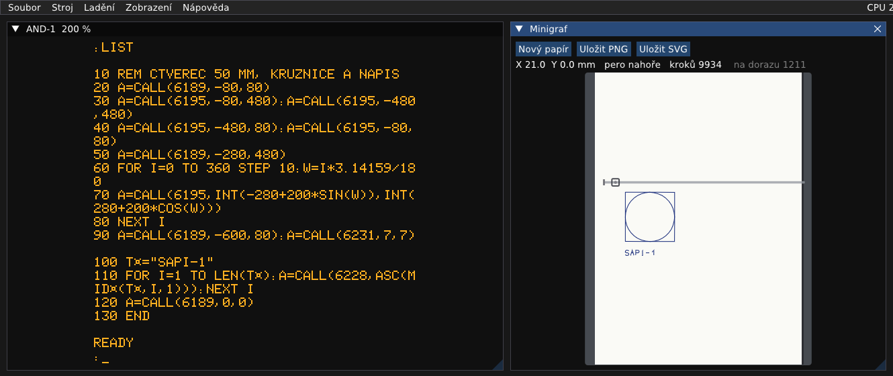
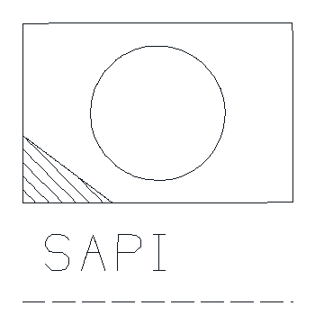

# Minigraf 0507: návod k obsluze

ARITMA Minigraf 0507 je malý souřadnicový zapisovač (plotter) na papír šířky A4. Kreslí perem po krocích 0,125 mm.
K SAPI-1 je připojený přes desku DPP-1 a ovládá ho program v počítači: buď ovladač V.1-MGF v EPROM (povely
z monitoru a `CALL` z BASICu), nebo BASIC EXP V5.0/G+SZ s příkazem `KRES`, který kreslí v milimetrech.

Všechny kroky jsou vyzkoušené v emulátoru (2026-10-09). Zapojení, ovladač a podrobnosti o emulaci jsou
v `docs/desky/Minigraf.md`.



## Co je potřeba

1. Soubor → Vybrat sestavu… → `zps\ZPS-2_MIKOS_V5_Minigraf.sapi`. Naběhne `MIKOS V5.0`, `MONITOR V5.0` a tečka.
2. Vpravo se samo otevře okno **Minigraf** (jinak Zobrazení → Zapisovač (Minigraf, XY 4130)).

Po zapnutí je pero dole a udělá na papíře tečku, dokud program nenastaví port. Skutečný Minigraf se chová stejně.
Tečku smaže tlačítko Nový papír.

## Okno Minigraf

- **Papír** je pás široký jako A4 a dlouhý, jak kresba potřebuje. Původní ovladač posouvá papír víc, než měří
  list A4, proto se nekreslí na jednotlivé listy. Papír vyplní šířku okna, delší kresba se posouvá svisle
  (posuvník, kolečko myši). Když pero kreslí mimo viditelnou část, pohled za ním popojede.
- **Kolejnice s vozíkem:** vlevo je doraz, čtvereček je pero. Pero dole je červené.
- **Řádek pod tlačítky:** poloha pera X a Y v milimetrech, pero nahoře nebo dole a počet kroků. Dál:
  - **na dorazu:** kroky, kdy vozík tlačil do dorazu. Při nastavení počátku je to normální, ovladač ho tak hledá.
    Když číslo roste během kreslení, kresba se nevešla mezi dorazy a je oříznutá.
  - **ztracených** (oranžově, jen když nějaké jsou): program přeskočil fázi motoru. Pár kroků po novém nastavení
    portu (`CALL(6177)`, `KRES #I`) je normální, motor doskočí do nové fáze. Hodně ztracených kroků znamená chybu
    v programu.
- **Nový papír** založí čistý papír pod pero. Ovladač o tom neví, kreslí dál ve stejných souřadnicích.
- **Uložit PNG** a **Uložit SVG** uloží kresbu do `work\minigraf\kresba_<datum-čas>`. Obrázek má šířku A4 a výšku
  kresby s okraji, nejméně A4. SVG se dá zvětšovat bez ztráty kvality a otevřít třeba v Inkscape.

Zapisovač kreslí skutečnou rychlostí (desítky milimetrů za sekundu, písmo pomaleji). Delší kresbu zrychlí F8
(Stroj → Rychlost emulace → Maximum).

## 1. Počátek: `.G=1800`

Za tečku napište `G1800` a Enter (na obrazovce `.G=1800`). Pero se zvedne, vozík dojede na levý doraz a papír se
posune asi o 21 cm. Počátek je pak 10 mm od levého dorazu. Trvá to asi 5 sekund. Tímto povelem se po zapnutí začíná
vždy, když se kreslí ovladačem z EPROM.

## 2. Zkouška: `.G=1809`

V okně Minigraf **Nový papír** a za tečku `G1809` Enter. Ovladač znovu nastaví počátek, posune papír a nakreslí
celou svou znakovou sadu: 12 řádků po 8 znacích, asi 84 × 185 mm, za necelé 2 minuty. Kresba vyjde stejně jako
skutečná zkouška ze SAPI-1 na sapi.cz.

## 3. Ukázka z IQ 151

Původní ukázkový program ARITMA (šestiúhelníková spirála, nápisy, logo):

1. `.G=1800`.
2. Soubor → Nahrát program do paměti (Intel HEX)… → `media\mikos\BASIC_EXP_V5.0.hex`, za tečku `B`: naběhne
   `* BASIC - EXP V5.0 *` a výzva `:`.
3. V okně Minigraf **Nový papír**.
4. Otevřete `media\mikos\MINIGRAF_DEMO.bas` v Poznámkovém bloku, zkopírujte celý text (Ctrl+A, Ctrl+C) a v emulátoru
   ho vložte přes Stroj → Klávesnice → **Vložit text** (nebo Ctrl+Shift+V na obrazovce). Program se napíše jako
   z klávesnice.
5. `RUN`. Na obrazovce je `POCITAM A KRESLIM`, zapisovač kreslí asi tři minuty.
6. **Uložit PNG** nebo **Uložit SVG**.

## 4. Vlastní kresba z BASICu (`CALL`)

Ovladač v EPROM se z BASICu EXP V5.0 volá funkcí `CALL` s adresou podprogramu. Platí:

- Jednotka je **jeden krok, 0,125 mm** (8 kroků = 1 mm).
- **Napřed Y, potom X:** `A=CALL(6189,Y,X)`.
- X roste doprava. Y roste k horní hraně papíru, kresba pod počátkem má tedy **záporné Y**.
- `CALL` je funkce, výsledek se musí někam přiřadit (`A=CALL(…)`).
- Na začátku `.G=1800` (počátek a nastavení portu).

| Volání | Co dělá |
|---|---|
| `A=CALL(6189,Y,X)` | MOVA: přesun zvednutého pera na Y, X. |
| `A=CALL(6195,Y,X)` | VECTA: čára z místa, kde pero stojí, na Y, X. Pero zůstane dole. |
| `A=CALL(6201,Y,X)` | POINTA: tečka na Y, X. |
| `A=CALL(6207,Y,X)`, `6213`, `6219` | MOVR, VECTR, POINTR: totéž o Y, X od místa, kde pero stojí. |
| `A=CALL(6231,YY,XX)` | Velikost písma. Písmeno je 6 × YY kroků vysoké: `7,7` dá písmena 5,25 mm. |
| `A=CALL(6234,YX,XY)` | Sklon a natočení písma (ukázka z IQ 151 tak píše šikmo). |
| `A=CALL(6228,kód)` | Jeden znak tam, kde pero stojí, např. `A=CALL(6228,ASC("A"))`. |
| `A=CALL(6225,délka,adresa)` | Text z paměti (ASCII od adresy). Nehlídá okraj papíru. |
| `A=CALL(6237)`, `A=CALL(6240)` | Široké a úzké mezery mezi znaky. |
| `A=CALL(6222,S)` | Rychlost kreslení, S = 1 až 5 (o ±10 %). |
| `A=CALL(6177)` | Znovu nastaví počátek jako `.G=1800` (papír se posune o 21 cm). |
| `A=CALL(6183)` | Kopie obrazovky (jako `.G=180F`). |
| `A=CALL(6171)` | Minigraf jako systémová tiskárna (jako `.G=1815`). |

Volání jsme v emulátoru zkoušeli `6189`, `6195`, `6228`, `6231` a `6177` (a celou ukázku z IQ 151), ostatní jsou
podle původního návodu.

Příklad: čtverec 50 × 50 mm, do něj kružnice a pod něj nápis (kresba je na obrázku nahoře).

```
10 REM CTVEREC 50 MM, KRUZNICE A NAPIS
20 A=CALL(6189,-80,80)
30 A=CALL(6195,-80,480):A=CALL(6195,-480,480)
40 A=CALL(6195,-480,80):A=CALL(6195,-80,80)
50 A=CALL(6189,-280,480)
60 FOR I=0 TO 360 STEP 10:W=I*3.14159/180
70 A=CALL(6195,INT(-280+200*SIN(W)),INT(280+200*COS(W)))
80 NEXT I
90 A=CALL(6189,-600,80):A=CALL(6231,7,7)
100 T$="SAPI-1"
110 FOR I=1 TO LEN(T$):A=CALL(6228,ASC(MID$(T$,I,1))):NEXT I
120 A=CALL(6189,0,0)
130 END
```

Postup: `.G=1800`, BASIC EXP V5.0 jako v ukázce výše, Nový papír, program vložit (Vložit text), `RUN`. Kreslí
necelou půlminutu. Na obrazovce se místo `$` ukáže `¤`, protože tak ho kreslí znakový generátor MHB 2501 na AND-1. Program
je v pořádku.

## 5. Výpis programu a kopie obrazovky

- **Výpis programu písmem zapisovače:** `.G=1800`, `.G=1815` (Minigraf je teď systémová tiskárna), BASIC a v něm
  `LLIST`. Tři krátké řádky programu se kreslí asi 10 sekund.
- **Kopie obrazovky:** `.G=180F` nakreslí celou obrazovku AND-1 (40 × 24 znaků) v rámečku asi 9 × 9 cm. Z BASICu
  totéž udělá `A=CALL(6183)`.

## 6. Kreslení v milimetrech: příkaz `KRES`

BASIC EXP V5.0/G+SZ má příkaz `KRES` s vlastním ovladačem: souřadnice v milimetrech, kružnice, šrafování, text
v libovolné velikosti a natočení, čárkované čáry. `.G=1800` tu potřeba není.

1. Soubor → Nahrát program do paměti (Intel HEX)… → `media\mikos\BASIC_EXP_V5.0G_SZ.hex`, za tečku `B`: naběhne
   `* BASIC - EXP V5.0/G *`.
2. Nový papír, program vložit (Vložit text), `RUN`.

Hotová ukázka je v `media\mikos\KRES_DEMO.bas`: rámeček, domek se šrafovanou střechou, slunce, otočený nápis,
čárkovaná vlna. Kreslí asi tři minuty.

**Pravidla:**

- Za `KRES` následují příkazy, kolik se jich vejde na řádek. Příkaz začíná `#` a písmenem, parametry se oddělují
  čárkou, dvě čárky (`,,`) příkaz ukončí.
- Dvojice čísel bez `#` je bod: pero k němu nakreslí čáru. Středník `;` před bodem pero zvedne, přesune se tam
  bez kreslení.
- Všechny délky jsou v **milimetrech**, úhly ve stupních (kladné proti směru hodinových ručiček). X doprava,
  Y nahoru.
- Počátek je tam, kde stálo pero při `KRES #I`. `KRES` o dorazech neví. Program proto začíná dojetím na levý doraz
  a odměřením počátku: `KRES #I -220,0,, #I 30,0,,` (pero o 220 mm doleva, vozík zůstane na dorazu, pak 30 mm
  doprava). Vozík ujede 200 mm, kresba se musí vejít mezi dorazy.
- Text v uvozovkách přímo v příkazu (`#T 0,0,5,"AHOJ"`) hlásí po třech použitích chybu `ERROR ST`. Podle návodu
  je lepší řetězcová proměnná: `A$="AHOJ":KRES #T 0,0,5,A$`.

Příklad: obdélník 60 × 40 mm, kružnice, šrafovaný trojúhelník, nápis a čárkovaná čára.

```
10 KRES #I -220,0,, #I 30,0,,
20 KRES ;0,0,60,0,60,40,0,40,0,0
30 KRES #K 30,20,15,36
40 KRES #S 4,3,0,0,20,0,0,15 ;20,0,0,15
50 A$="SAPI":KRES #T 5,-15,8,A$
60 KRES #C 1 ;0,-22,60,-22 #C 0
70 KRES ;0,0
80 END
```



| Řádek | Co dělá |
|---|---|
| 10 | Pero na levý doraz, pak 30 mm doprava: tam je počátek (0, 0). |
| 20 | Přesun na 0,0 a čáry po obvodu obdélníku 60 × 40 mm. |
| 30 | Kružnice se středem 30,20, poloměr 15 mm, z 36 úseček. |
| 40 | Šrafování trojúhelníku (0,0), (20,0), (0,15): typ 4 = 135°, rozteč 3 mm. Pak jeho přepona. |
| 50 | Nápis SAPI 8 mm vysoký, začíná na 5,−15. |
| 60 | Čárkovaná čára (typ 1) pod nápisem, pak zpět plná čára. |
| 70 | Pero zpět na počátek. |

**Přehled příkazů `KRES`** (podle návodu, `doku2/bexpgsz.php` na sapi.cz):

| Příkaz | Co dělá |
|---|---|
| `#I` | Inicializace: vynuluje souřadnice, měřítka, natočení, typ čáry. `#I X,Y,,` napřed posune pero o X, Y. |
| `#R k` | Rychlost: 0 nejmenší, 1 střední, 2 největší. Text a šrafování jsou vždy nejpomalejší. |
| `#H XD,YD,XH,YH` | Hranice kreslení (obdélník), co je mimo, se nekreslí. |
| `#P X,Y` | Počátek místních souřadnic. |
| `#M XM,YM` | Měřítka os. |
| `#U XU,YU` | Natočení os ve stupních (otočený text, otočená kresba). |
| `#C t` | Typ čáry: 0 plná, 1 čárkovaná, 2 tečkovaná, 3 čerchovaná. |
| `X,Y` / `;X,Y` | Čára do bodu / přesun do bodu (místní souřadnice). |
| `#V X,Y` / `#V ;X,Y` | Totéž o X, Y od místa, kde pero stojí. |
| `#T X,Y,V,A$` | Text z A$ od bodu X, Y, výška písma V mm. Znaky v `[ ]` jsou malá písmena. |
| `#K X,Y,R,K` | Kružnice: střed, poloměr, počet úseček. S dalšími `,U0,U` oblouk od úhlu U0 o úhel U. |
| `#S t,s,X1,Y1,X2,Y2…` | Šrafování mnohoúhelníku: t = 1 0°, 2 45°, 3 90°, 4 135°; s = rozteč v mm. `#S t,s [X,Y,R,K]` šrafuje kruh. |
| `#N` | Posun pera klávesami (podle návodu, v emulátoru nezkoušeno). |

## Pro vývojáře

- Ovladač a kódy na portu (`OUT 31h`, fáze X a Y, pero) jsou popsané v `docs/desky/Minigraf.md`.
- Přes MCP (`docs/mcp.md`) nástroj `plotter` vrátí polohu pera, rozsah kresby a počty kroků. Umí založit nový papír
  (`new_sheet`) a uložit PNG nebo SVG (`crop` = jen kresba s okrajem 5 mm).
