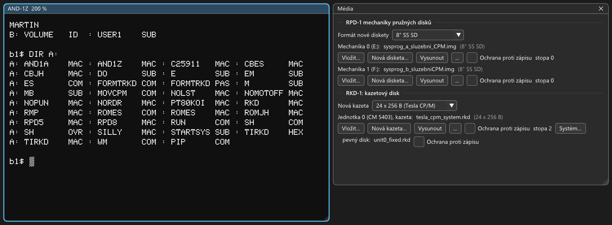

# RKD-1: návod k obsluze kazetového disku

Řadič RKD-1 připojuje k SAPI-1 **kazetový disk CM 5403** ze Zbrojovky Brno. Mechanika má dva disky na jedné ose:
**výměnnou kazetu** a **pevný disk** uvnitř mechaniky. Každý disk
má dva povrchy a každý povrch je v CP/M jeden logický disk o 1,2 MB, dohromady 4,8 MB. Na svou dobu (1987) to bylo
obrovské místo: osmipalcová disketa RPD-1 má 243 KB.

Sestava v emulátoru běží s původním systémem **CP/M 2.2 Tesla Elstroj & JaMeSoft 1987**: boot EPROM v JPR-1Z
nahraje systém z kazety a spustí shell, který se ptá na číslo uživatele.

Všechny kroky jsou vyzkoušené v emulátoru (2026-10-09), výpisy obrazovky jsou opsané z něj nebo z testu
`test_rkd1`. Jak řadič funguje
a co je v emulaci odhad, je v `docs/desky/RKD-1.md`.



## Co je potřeba

1. Soubor → Otevřít sestavu → `rkd1_tesla_cpm.sapi`.
2. Zobrazení → **Média**. Dole je část „RKD-1: kazetový disk“ s kazetou a pevným diskem.

V sestavě je vložená systémová kazeta (pracovní kopie `work\rkd-1\tesla_cpm_system.rkd` vyrobená z originálu
`media\rkd-1\tesla_cpm_system.rkd`) a pevný disk `work\rkd-1\unit0_fixed.rkd`. Pevný disk je na začátku
**nenaformátovaný** (jako nový z výroby), naformátuje se podle kapitoly 3.

## Disky

| Disk | Co to je | Velikost |
|---|---|---|
| A: | kazeta, první povrch; na stopách 0 a 1 je systém CP/M | 1,2 MB (volno 944 KB) |
| B: | kazeta, druhý povrch; tady má každý uživatel své soubory | 1,2 MB |
| C: | pevný disk, první povrch | 1,2 MB |
| D: | pevný disk, druhý povrch | 1,2 MB |
| E:, F: | osmipalcové diskety na řadiči RPD-1 (služební programy J. Bíby: PIP, STAT, M80, ED…) | 243 KB |

## 1. Start

Po zapnutí se nejdřív ozve boot EPROM a nahraje systém z kazety:

```
Boot ROM pro RKD-1 2x2x203x24x256 87-02-10
62k RAM, 5k Cbios, 59k CP/M v2.2
(c) 1987 Tesla ELSTROJ & JaMeSoft
```

Pak se ohlásí CBIOS (ovladače systému) a vypíše, co v sestavě našel:

```
Cbios 87-02-13 (c) 1987 Tesla ELSTROJ & JaMeSoft
A:..D: 1.2 Mbyte RKD-1 2x2x203x24x256 kazetový disk
E:,F:  243 kbyte RPD-1 2x1x77x26x128  standardní 8"
crt: AND-1Z Koi-8čs-2
kbd: Klávesnice Consul 259.11
lst: Siemens PT80 Koi-8čs-2, DSM-1 200 Bd
pun: nic
rdr: nic
```

Hned potom se spustí shell SH a smaže obrazovku.

## 2. Přihlášení do shellu SH

Shell je **MicroShell 2.0** (New Generation Systems 1982), rozšíření CP/M ve stylu Unixu. Tesla k němu
napsala přihlašovací dávku `STARTSYS.SUB`, která každému uživateli dá vlastní oblast na disku B:
(uživatelské oblasti CP/M 1 až 15).

```
Vítám tě, zadej prosím své číslo uživatele (1-15) 1
Název uživatelské oblasti: MARTIN
```

Číslo se potvrdí Enterem. **Nový uživatel** zadá ještě název své oblasti. Dávka ho uloží do souboru `VOLUME.ID`
a připraví `USER1.SUB`, který se spustí při každém dalším přihlášení. Pak se vypíše název oblasti a obsah B:

```
MARTIN
B: VOLUME   ID  : USER1    SUB

b1$
```

Výzva `b1$` znamená disk B:, uživatel 1. Při dalším přihlášení stejným číslem se na název už neptá.
Enter bez čísla přihlášení přeskočí a skončí ve výzvě `b0$` (uživatel 0, disk B: je tam prázdný).

**Jak se v SH pracuje:**

- Píšou se obyčejné příkazy CP/M: `DIR A:`, `TYPE`, `ERA`, `REN`, `SAVE`, programy jménem. Malá písmena SH
  převede na velká.
- SH hledá programy na B: a pak na A: (`%path ba`). Proto stačí napsat `FORMTRKD` nebo `PIP` bez disku.
  Programy z disket se pouštějí s diskem: `E:STAT`.
- Uživatel se přepne příkazem `USER 2` (výzva `b2$`), zpět `USER 1`. Dávka `USER1` (název oblasti a adresář) jde
  spustit jen v oblasti 1, kde leží.
- Ctrl-C na výzvě jen odřádkuje, shell běží dál.

Obsah systémové kazety:

```
b1$ DIR A:
A: AND1A    MAC : AND1Z    MAC : C25911   MAC : CBES     MAC
A: CBJH     MAC : DO       SUB : E        SUB : EM       SUB
A: ES       COM : FORMTRKD COM : FORMTRKD PAS : M        SUB
A: MB       SUB : MOVCPM   COM : NOLST    MAC : NOMOTOFF MAC
A: NOPUN    MAC : NORDR    MAC : PT80KOI  MAC : RKD      MAC
A: RMP      MAC : ROMES    COM : ROMES    MAC : ROMJH    MAC
A: RPD5     MAC : RPD8     MAC : RUN      COM : SH       COM
A: SH       OVR : SILLY    MAC : STARTSYS SUB : TIRKD    HEX
A: TIRKD    MAC : WM       COM : PIP      COM
```

| Soubor | Co to je |
|---|---|
| `SH.COM`, `SH.OVR`, `STARTSYS.SUB` | shell a přihlašovací dávka |
| `FORMTRKD.COM` (`.PAS` zdroják v Turbo Pascalu) | formátování kazety a pevného disku |
| `PIP.COM` | kopírování souborů |
| `WM.COM` | textový editor MicroPro WordMaster 1.07A |
| `ES.COM`, `MOVCPM.COM` | generátor systému (přestěhuje CP/M pro jinou velikost paměti) |
| `ROMES.COM` | zavaděč systému z kazety, spustitelný z CP/M |
| `*.MAC` | zdrojáky systému v assembleru: CBIOS `CBES`, ovladač kazetového disku `RKD`, boot ROM `ROMES`, displej `AND1Z`, klávesnice `C25911`… |
| `M.SUB`, `E.SUB`, `EM.SUB`, `MB.SUB`, `DO.SUB` | dávky pro překlad (`M80`) a úpravy zdrojáků |

## 3. Formátování pevného disku: `FORMTRKD`

Nový pevný disk je nenaformátovaný. CP/M na něm hlásí chybu:

```
b1$ DIR C:

Bdos Err On C: Bad Sector
```

(Libovolná klávesa chybu přejde, Ctrl-C ukončí příkaz.) Disk se naformátuje programem `FORMTRKD`:

```
b1$ FORMTRKD
Formátování RKD-1 2x2x204x24x256  87-02-12 15:31
(c) Tesla ELSTROJ & JaMeSoft

Logický disk | Formátovat | Test čtení
    A:       |     0      |     4
    B:       |     1      |     5
    C:       |     2      |     6
    D:       |     3      |     7

Výběr/rušení volby klávesami 0 až 7, ukončení volby <CR>.
             << Ctrl-C ukončí program. >>
```

1. Stiskněte **`2`** (C:) a **`3`** (D:), **bez Enteru**. Každá klávesa volbu zapne nebo vypne a řádek
   `Příkaz :` ukazuje, co se bude dělat. Formátování zapne i test čtení. Klávesy 4 až 7 zapínají a vypínají
   samotný test (bez testu je formátování dvakrát rychlejší).

   ```
   Příkaz : formátovat C:,D:, test čtení na C:,D:
   ```

2. **Enter** ukončí výběr. Program se zeptá:

   ```
   Jseš si jistý, že chceš opravdu formátovat? (a/n)
   ```

3. **`a`** (ano). Na řádku `stopa:` běží čísla stop 0 až 203:

   ```
   Jseš si jistý, že chceš opravdu formátovat? (a/n) Ano

                << Ctrl-C ukončí příkaz. >>
   Formátujeme disk C:
   stopa:203
   Testujeme čtení disku C:
   stopa:203
   Formátujeme disk D:
   stopa:203
   Testujeme čtení disku D:
   stopa:203
   Příkaz dokončen
   ```

4. Program znovu ukáže nabídku. **Ctrl-C** ho ukončí (`program ukončen ^C`).

Mechanika jede skutečnou rychlostí: ovladač stihne jeden sektor na otáčku, takže **jeden povrch se formátuje asi
dvě minuty a stejně dlouho se testuje**. Oba povrchy s testem trvají asi osm minut. Na čekání pomůže F8 (Stroj →
Rychlost emulace → Maximum), pak je to otázka několika sekund.

Při chybě program vypíše stopu, sektor a druh chyby (`jednotka není připravena`, `chybí data`, `chyba kontrolního
součtu`…) a nabídne `(I)gnorovat, (Z)kus znova, (^C) ukonči příkaz`. Při testu čtení místo opakování nabízí
`(F)ormátuj sektor`.

**Pozor na A: a B:.** Formátování A: smaže z kazety i systém a SYSGEN pro RKD-1 se nedochoval (kapitola 5).
Soubory na kazetě se mažou příkazem `ERA`, ne formátováním.

## 4. Práce se soubory

Naformátovaný disk je prázdný:

```
b1$ DIR C:
NO FILE
b1$ SAVE 1 C:POKUS.COM

b1$ DIR C:
C: POKUS    COM
```

Kopírování přes PIP: odkud se kopíruje je vpravo, kam vlevo.

```
b1$ PIP C:=A:FORMTRKD.PAS

b1$ PIP C:=E:STAT.COM

b1$ C:STAT C:*.*

 RECS  BYTES  EXT ACC
   55     8K    1 R/W C:FORMTRKD.PAS
    2     2K    1 R/W C:POKUS.COM
   41     6K    1 R/W C:STAT.COM
BYTES REMAINING ON C: 1200K
```

`PIP C:=E:*.*` zkopíruje celou disketu. `E:STAT` bez parametrů ukáže volné místo na všech discích.

**Programy z jiných disket:** v okně Média u RPD-1 **Vložit…** do mechaniky 0 (E:) nebo 1 (F:) jinou disketu, třeba
z `media\sapiman\knihovna\` (editory, překladače Turbo Pascal, BASIC, Forth, Ada, C, dBASE II…). Pak `DIR E:` a
`PIP C:=E:*.*`. Z vyměněné diskety CP/M čte hned, zapsat na ni ale odmítne (`Bdos Err On E: R/O`), dokud se systém
nespustí znovu: Reset (F12) a nové přihlášení. Tak se CP/M chrání před zápisem starého adresáře na jinou disketu.

## 5. Kazety

### Okno Média

| Prvek | Význam |
|---|---|
| Nová kazeta | Formát nové kazety: **24 × 256 B** pro CP/M Tesly (výchozí), 12 × 512 B pro systém SMEP a formátovač FORMRKD J. Bíby. Počet sektorů je daný kazetou (sektorové značky), formátovací program ho změnit nemůže. |
| Jednotka 0 (CM 5403), kazeta | Mechanika, soubor s kazetou a její formát. |
| Vložit… | Vloží jinou kazetu (soubor `.rkd`). |
| Nová kazeta… | Založí novou **nenaformátovanou** kazetu pod zvoleným jménem a vloží ji. |
| Vysunout | Kazetu vysune a uloží. Mechanika bez kazety není připravená (stojí, i pevný disk). |
| Ochrana proti zápisu | Přepínač ochrany na mechanice (níže). |
| stopa | Kde stojí hlavy, „změněno“ = kazeta má neuložené změny. |
| Systém… | **Pomoc emulátoru:** zapíše na kazetu systém CP/M, volitelně ji předtím naformátuje (níže). |
| pevný disk | Soubor s pevným diskem a jeho ochrana proti zápisu. |

Kazeta i pevný disk jsou obyčejné soubory `.rkd` (asi 3 MB). Emulátor je zapíše při vysunutí kazety, při ukončení
a při přepnutí na jinou sestavu.

### Výměna kazety: jen s Resetem a jen systémová

CP/M Tesly počítá s tím, že v jednotce 0 je pořád **systémová kazeta**: boot EPROM z ní po Resetu nahrává systém
(stopy 0 a 1 disku A:) a shell SH z ní čte své soubory (`SH.OVR`, programy na A:). Proto platí dvě pravidla:

1. **Každá kazeta, se kterou se pracuje, musí být systémová** (postup níže).
2. **Po výměně kazety hned Reset (F12).** CBIOS si pamatuje poslední přečtený sektor a výměnu kazety nepozná: po
   výměně za běhu ukazuje `DIR` ještě adresář staré kazety a další zápis ho přepíše na novou. Na skutečném počítači
   by to dopadlo stejně. Po Resetu se systém nahraje z nové kazety a začne načisto.

Kazeta bez systému v jednotce 0 se po Resetu ohlásí:

```
Chyba čtení disku A: při boot
Libovolná klávesa -> opakovat
```

Stačí v okně Média vložit systémovou kazetu a stisknout libovolnou klávesu. Shell SH s kazetou bez svých souborů
hlásí při každém příkazu `Bdos Err On A: Bad Sector`.

Pro data je nejpohodlnější **pevný disk C:, D:**, který se nevyměňuje, a pro přenos diskety E:, F:.

### Nová systémová kazeta

Originální program, který zapisoval systém na kazetu (SYSGEN pro RKD-1), se nedochoval. Emulátor ho nahrazuje
tlačítkem **Systém…** v okně Média: zapíše na stopy 0 a 1 disku A: systém ze systémové kazety
`media\rkd-1\tesla_cpm_system.rkd`, bajt po bajtu, a na přání kazetu předtím naformátuje stejně jako FORMTRKD.
Je to přiznaná pomoc emulátoru, ne program Tesly. Soubory shellu se pak zkopírují přes pevný disk:

1. **Soubory shellu na pevný disk.** Při přihlášení do SH stiskněte jen Enter (uživatel 0, výzva `b0$`; po Resetu
   bez shellu bude CP/M také uživatel 0). Pevný disk musí být naformátovaný (kapitola 3).

   ```
   b0$ PIP C:=A:SH.*
   b0$ PIP C:=A:STARTSYS.SUB
   b0$ PIP C:=A:PIP.COM
   ```

   Podle potřeby i další, třeba `PIP C:=A:FORMTRKD.COM`.
2. **Nová kazeta:** okno Média, **Nová kazeta…**, jméno souboru (třeba `moje.rkd`).
3. **Systém…:** zaškrtávátko „Nejdřív naformátovat celou kazetu“ je u nové kazety zapnuté, **Zapsat systém**.
4. **Reset (F12).** Systém naběhne z nové kazety, shell na ní ještě není (`SH?`) a A: je prázdné:

   ```
   SH?

   P0A>DIR A:
   NO FILE
   ```
5. **Soubory zpět na kazetu** programem PIP z pevného disku:

   ```
   P0A>C:PIP A:=C:*.*

   COPYING -
   SH.COM
   SH.OVR
   STARTSYS.SUB
   PIP.COM
   ```
6. **Reset (F12):** nová kazeta se ohlásí shellem a otázkou na číslo uživatele, jako systémová.

Totéž jde i bez tlačítka: ve Windows zkopírovat `media\rkd-1\tesla_cpm_system.rkd` pod jiným jménem, vložit ji
a nepotřebné soubory smazat (`ERA A:*.MAC`). Tlačítko **Systém…** zapíše systém i na kazetu, které chybí nebo se
poškodil; soubory na ní nechá, pokud se nezaškrtne formátování.

### Ochrana proti zápisu

Se zaškrtnutou ochranou mechanika nezapisuje, **ale nikdo to nehlásí**: ovladač Tesly stav ochrany nečte, takže
CP/M zápis považuje za hotový. Uložený soubor v adresáři nezůstane a obsah kazety
zůstane beze změny. Ochrana se proto hodí na kazetu, kterou nechcete nechtěně změnit, ne na hlášení chyb. Jak se
mechanika CM 5403 ve skutečnosti chovala, nevíme; podrobnosti v `docs/desky/RKD-1.md`.

### Původní kazeta

Pracovní kopie systémové kazety je `work\rkd-1\tesla_cpm_system.rkd`. Když ji smažete (při vypnutém emulátoru),
vznikne při dalším startu znovu z originálu v `media\rkd-1\`. Stejně tak smazaný `work\rkd-1\unit0_fixed.rkd`
vznikne jako nový nenaformátovaný pevný disk.

## 6. Bulharská mechanika CM 5400 a FORMRKD J. Bíby

Řadič RKD-1 uměl i bulharskou mechaniku **CM 5400** (IZOT) s kabelem podle dokumentace RKD-1. Sestava
`rkd1_jb_cm5400.sapi` ji má s CP/M J. Bíby z 8" diskety a jeho programem **FORMRKD** v1.1 (1987, „Formátování
a kontrola disku SM 5400 (203*12*512)“). CP/M, které by z CM 5400 pracovalo se soubory, se nenašlo; FORMRKD umí
disky naformátovat a zkontrolovat.

- Disk má formát SMEP 12 × 512 B. U CM 5400 je DISK obráceně než u CM 5403: FORMRKD má **pevný disk D: (dolní
  plocha) a E: (horní)**, **výměnnou kazetu F: (dolní) a G: (horní)**.
- Kazeta i pevný disk jsou na začátku nenaformátované (`work\rkd-1\cm5400_kazeta.rkd`, `cm5400_fixed.rkd`).

```
A>B:FORMRKD
***************************************************************
     FORMÁTOVÁNÍ A KONTROLA DISKU SM 5400  (203*12*512)
***************************************************************
   DISK   |  PLOCHA  | MECH |     |        DRUH PRÁCE
----------|----------|------|     |----------------------------
          |  horní   |  G:  |     |    formátovat      = F
  výměnný |----------|------|     |
          |  dolní   |  F:  |     |    kontr. čtení    = C
----------|----------|------|     |
          |  horní   |  E:  |     |    form. a čti     = O
  pevný   |----------|------|     |
          |  dolní   |  D:  |     |    ukončit program = K
```

1. Mechanika: písmeno **D** až **G** (bez Enteru).
2. Druh práce: **F** formátovat, **C** kontrolní čtení, **O** obojí, **K** konec programu.
3. Na otázku `Bude se formátovat mechanika F: Opravdu?` klávesa **A**. Dole běží `Stopa:` a `Sektor:` (šestnáctkově,
   stopy 00–CB, sektory 00–0B), na konci „Formátování skončilo“, po kontrole „Čtení skončilo“.

Jeden povrch se formátuje asi minutu, kontrola trvá stejně (F8 zrychlí). Chyby FORMRKD hlásí jako „Chyba při
WRITE“, „Chyba při READ“ s popisem a nabídne `ignorovat = CR, formátovat = F, ukončit = E`.

Pozor: FORMRKD.COM píše do hlaviček sektorů jen číslo stopy (starší verze ovladače než CP/M Tesly). Kazetu
naformátovanou FORMRKD proto CP/M Tesly nepřečte, ani kdyby měla stejný počet sektorů. Podrobnosti a co se
o CM 5400 neví: `docs/desky/RKD-1.md`.

## 7. Co dál

- **Úpravy systému:** zdrojáky jsou na A: (`CBES.MAC` je CBIOS, `RKD.MAC` ovladač kazetového disku). Překládají se
  M80 a L80 z diskety E: (`E:M80`, `E:L80`). Dávka `M.SUB` (překlad s hlášením chyb) volá `m80` bez disku, SH ho
  proto hledá na B: a A:: nejdřív `PIP A:=E:M80.COM`. Generátor `ES` postaví systém pro
  jinou velikost paměti (`ES 59`); na kazetu ho ale nezapíše (originální SYSGEN chybí, tlačítko Systém… zapisuje
  systém ze systémové kazety). Jak vznikla systémová kazeta v emulátoru, je v `docs/desky/RKD-1.md` (Sestava
  a systémová kazeta).
- **Další jednotky:** řadič umí čtyři mechaniky (v konfigurátoru jednotky 1 až 3). Software Tesly ale používá
  jen jednotku 0.
