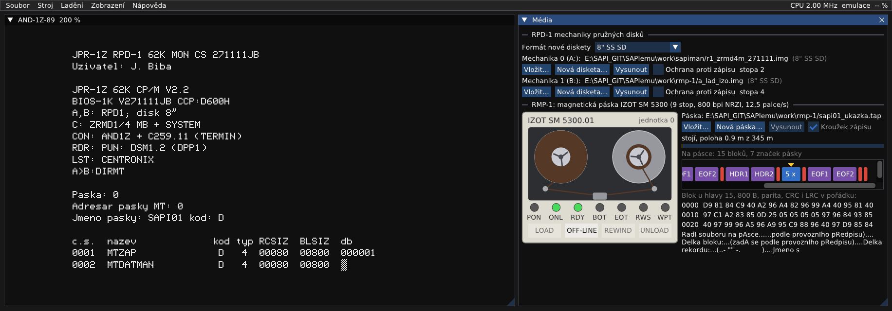

# RMP-1: návod k obsluze magnetické pásky

Řadič RMP-1 připojuje k SAPI-1 **magnetopáskovou jednotku IZOT SM 5300**: devítistopou půlpalcovou pásku na
cívkách o průměru 216 mm, asi 350 m pásky a 10 MB dat, 800 bpi, 12,5 palce za sekundu. Páska sloužila hlavně
k **výměně dat s velkými počítači** JSEP a SMEP (soubory s návěštími podle normy, kód EBCDIC) a k zálohám.
Převinutí celé pásky trvá skoro pět minut.

Sestava v emulátoru běží s CP/M J. Bíby a jeho programy pro pásku: **MTDAT** (kopírování mezi páskou a disketou),
**DIRMT** (obsah pásky), **MTCOPY**, **MTZAP** a **MTCTE** (zkouška). Všechny používají původní ovladač
`RMP.MAC` Tesly Elstroj z roku 1985.

Všechny kroky jsou vyzkoušené v emulátoru (2026-10-10), výpisy obrazovky jsou opsané z něj nebo z testu
`test_rmp1`. Jak řadič funguje a co je v emulaci odhad, je v `docs/desky/RMP-1.md`.



## Co je potřeba

1. Soubor → Otevřít sestavu → `rmp1_jb_izot.sapi`.
2. Zobrazení → **Média**. Dole je část „RMP-1: magnetická páska IZOT SM 5300“.

Na jednotce 0 je **ukázková páska SAPI01** (pracovní kopie `work\rmp-1\sapi01_ukazka.tap` z originálu
`media\rmp-1\sapi01_ukazka.tap`). Jsou na ní dva soubory:

| č. | jméno | obsah |
|---|---|---|
| 1 | MTZAP | zdrojový text `MTZAP.MAC` (zkušební program) |
| 2 | MTDATMAN | návod `MTDAT.MAN` |

| Disk | Co to je |
|---|---|
| A: | bootovací disketa CP/M J. Bíby (MON 271111) |
| B: | disketa J. Bíby s programy pro pásku: MTDAT, DIRMT, MTCOPY, MTZAP, MTCTE, zdroje a návody `MTDAT.MAN`, `MTKAN.MAN` |
| C: | RAM disk ZRMD-1 |

Jednotka 1 je v sestavě připravená, ale bez pásky. Hodí se pro kopírování z pásky na pásku (kapitola 6).

## Mechanika v okně Média

Vlevo je nakreslená mechanika. Levá cívka je zásobní, pravá navíjecí (pevná, pásku z ní nejde sundat). Cívky se
točí podle polohy pásky. Pod nimi jsou kontrolky:

| kontrolka | význam |
|---|---|
| PON | řadič po resetu ještě nepovolil pohyb pásky (svítí jen u vybrané jednotky) |
| ONL | jednotka je ON-LINE, řídí ji počítač |
| RDY | páska je zavedená a připravená |
| BOT | páska je na začátku (odrazná značka) |
| EOT | konec pásky, dál se nezapisuje |
| RWS | páska se převíjí |
| WPT | cívka nemá kroužek zápisu, zápis nejde |

Tlačítka:

- **LOAD** zavede pásku a navine ji na značku BOT (rozsvítí RDY).
- **ON-LINE / OFF-LINE** předá jednotku počítači a zpět. Program MTDAT tomu říká „Dej paskovou mechaniku do
  "DISTANC"“.
- **REWIND** převine pásku na začátek (jen OFF-LINE).
- **UNLOAD** převine pásku a vyvlékne ji (jen OFF-LINE). Pak jde páska vysunout.

Vpravo jsou tlačítka:
- **Vložit…**;
- **Nová páska…** (prázdná páska, nový soubor `.tap`);
- **Vysunout** (jen OFF-LINE);
- **…** s položkami:
  - **Vysunout bez uložení**: co se na pásku od vložení zapsalo, se zahodí;
  - **Obnovit z originálu**: pracovní kopie pásky z `media\` se přepíše originálem.

Zaškrtávátko **Kroužek zápisu** povoluje zápis. Bez kroužku jednotka hlásí WPT a nezapíše. Kroužek jde změnit,
jen když páska není zavedená.

**OFF-LINE neznamená vysunout.** Páska zůstane na mechanice a změny jsou dál jen v paměti. Do souboru se zapíšou
až při vysunutí, výměně pásky, vypnutí stroje nebo ukončení emulátoru. Kdo si omylem přepíše ukázkovou pásku,
vrátí ji položkou **Obnovit z originálu**. Ukázkovou pásku chrání před zápisem i odškrtnutý kroužek (před
LOAD).

Výměna pásky v okně Média se zapíše do sestavy: konfigurátor (Zobrazení → Sestava…) ukáže novou pásku
a sestavu označí jako neuloženou. Tamtéž jde pásku vybrat nebo založit (**Nová…**) a za chodu se hned vloží.
V nabídce obrazů jsou i všechny pásky ze složek `work\rmp-1` a `media\rmp-1`.

Pod polohou pásky je **jméno pásky** z návěští VOL1 s kódem (D = EBCDIC) a **seznam souborů** z návěští HDR1
a HDR2: pořadí, jméno, blok a věta. Přesně tyto údaje chtějí MTDAT a řetězce MTCOPY. Páska bez VOL1 (nová,
neinicializovaná) to napíše.

Pod nimi je **mapa pásky**: fialová návěští (VOL1, HDR1…), modré bloky dat,
červené značky pásky (TM). Mapa není v měřítku, mezery by všechno schovaly. Žlutá šipka ukazuje hlavu. Úplně dole
je blok, který naposledy prošel pod hlavou: hexadecimálně a jako text v EBCDIC.

**Pohodlí emulátoru:** po zapnutí je páska už zavedená a ON-LINE (volba „Pásky založené a ON-LINE po zapnutí“
v konfigurátoru). Na skutečné mechanice to dělá obsluha. Pásku vloženou za chodu je potřeba zavést tlačítkem
LOAD a pak stisknout ON-LINE.

## 1. Co je na pásce: DIRMT

```
A>B:DIRMT
Paska: 0
Adresar pasky MT: 0
Jmeno pasky: SAPI01 kod: D
c.s.  nazev             kod typ RCSIZ  BLSIZ  db
0001  MTZAP              D   4  00080  00800  000001
0002  MTDATMAN           D   4  00080  00800  000005
Konec pasky
```

Na otázku `Paska:` se odpovídá číslem jednotky (0 až 2), lze ho napsat i hned za příkaz: `B:DIRMT 0`. Výpis
ukazuje jméno pásky z návěští VOL1, kód D (EBCDIC), pořadí souborů, délku záznamu (RCSIZ) a bloku (BLSIZ)
a počet bloků (db). DIRMT pásku celou přečte, takže zároveň zkontroluje, jestli je čitelná. Na konci ji převine
na začátek.

## 2. Program MTDAT

```
===  F U N K C E   M T D A T U  ===
           V070588JB
1 - COPY paska => disketa
2 - COPY disketa  => paska
3 - INIC pasky
4 - konec COPY
5 - Vypis obsahu pasky
Dej paskovou mechaniku do "DISTANC"
Zadej funkci:
```

Spustí se `B:MTDAT`. Funkce 5 vypíše pásku stejně jako DIRMT a po výpisu čeká na klávesu. Funkce 4 vrátí do
CP/M. Podrobný návod J. Bíby je v `B:MTDAT.MAN` (`TYPE B:MTDAT.MAN`).

**MTDAT pracuje jen s jednotkou 0.** Číslo mechaniky má v programu pevně (řetězce pro MTKAN `6.0.D.`
a `0.0.4.D.`). Jednotky 1 a 2 obsluhuje MTCOPY (kapitoly 5 a 6) a DIRMT.

## 3. Soubor z pásky na disketu

Funkce 1. Program se ptá na jméno pásky (musí souhlasit s VOL1), pořadí souboru, délku bloku a záznamu
a jméno souboru (musí souhlasit s HDR1). Nakonec se zeptá na soubor na disketě:

```
=== Vstupni paska ===
 Jmeno pasky: SAPI01
=== Vstupni soubor ===
 Poradi souboru na pasce: 2
 Delka bloku: 800
 Delka rekordu: 80
 Jmeno souboru: MTDATMAN
 Zadej vystupni diskovy soubor:A:MTDAT.MAN
```

Po skončení se vrátí menu. Soubor se převádí z EBCDIC zpět do ASCII a je stejný jako ten, který se na pásku
nahrál (zkoušeno na `MTZAP.MAC`, bajt po bajtu). Převodní tabulka MTDAT je ale **7bitová**: česká písmena
v KOI8 přijdou cestou na pásku o háčky a čárky (`MTDAT.MAN` z pásky má místo „pásce“ „pAsce“).

## 4. Soubor z diskety na pásku

Funkce 2. Nejdřív se zadá soubor na disketě, pak páska a údaje o souboru na pásce:

```
 Zadej vstupni diskovy soubor:B:MTZAP.MAC
=== Vystupni paska ===
 Jmeno pasky: SAPI01
=== Vystupni soubor ===
 Poradi souboru na pasce: 3
 Delka bloku: 800
 Delka rekordu: 80
 Jmeno souboru: MTZAP2
Prihrat dalsi vstupni soubor (A/N):
```

- **Pořadí souboru** je číslo za posledním souborem na pásce (podle DIRMT). Zápis na pásku vždy smaže všechno
  za místem zápisu, proto se nové soubory přidávají na konec.
- Délka bloku a záznamu: běžně 800 a 80, JSEP bere bloky do 2048 B.
- Jméno souboru do 17 znaků jde do návěští HDR1.
- `A` na poslední otázku připojí do stejného souboru další soubor z diskety.

MTDAT zapíše HDR1, HDR2, značku pásky, bloky dat, značku, EOF1, EOF2 a dvě značky (konec pásky). Mapu pásky
v okně Média je při tom vidět růst.

## 5. Nová páska

1. V okně Média přepněte mechaniku tlačítkem **OFF-LINE**, pak **Nová páska…** a zadejte jméno souboru (třeba
   `paska2`, uloží se do `work\rmp-1\paska2.tap`). Totéž umí konfigurátor tlačítkem **Nová…** u obrazu pásky.
2. Stiskněte **LOAD** a **ON-LINE**.
3. Páska dostane jméno (návěští VOL1, do 6 znaků):
   - **jednotka 0:** `B:MTDAT`, funkce 3:

     ```
     === INICIALIZACE pasky ===
      Jmeno pasky: SAPI02
     ```
   - **jednotka 1 nebo 2:** `B:MTCOPY`, počkat na menu (inicializace řadiče trvá pár sekund), funkce 4.
     MTCOPY chce řetězec služby INIT knihovny MTKAN `6.CM.KP.JP.` (6 = inicializace, CM = mechanika, KP = kód
     pásky D = EBCDIC, JP = jméno):

     ```
     Zadej retezec:6.1.D.SAPI02.
     ```

Zapíše se návěští VOL1 a dvě značky pásky. Pak už jde páska plnit, prvním souborem je číslo 1.

## 6. Kopie z pásky na pásku: MTCOPY

V sestavě je na jednotce 0 ukázková páska SAPI01 a na jednotce 1 nová páska, třeba SAPI02 z kapitoly 5.
`B:MTCOPY`, funkce **0** (COPY paska => paska). Program se ptá na čtyři řetězce pro MTKAN. První dva popisují
vstup, druhé dva výstup:

| otázka | formát | soubor 1 (MTZAP) | soubor 2 (MTDATMAN) |
|---|---|---|---|
| vstupní páska | `0.CM.TP.KP.JP.` | `0.0.4.D.SAPI01.` | `0.0.4.D.SAPI01.` |
| vstupní soubor | `1.CM.TS.KS.CS.TP.BS.RS.JS.DV.` | `1.0.4.D.1.R.800.80.MTZAP.` | `1.0.4.D.2.R.800.80.MTDATMAN.` |
| výstupní páska | `0.CM.TP.KP.JP.` | `0.1.4.D.SAPI02.` | `0.1.4.D.SAPI02.` |
| výstupní soubor | `1.CM.TS.KS.CS.TP.BS.RS.JS.DV.` | `1.1.4.D.1.W.800.80.MTZAP.88001.` | `1.1.4.D.2.W.800.80.MTDATMAN.88001.` |

- `0.` otevři pásku, `1.` otevři soubor;
- CM = mechanika, TP a TS = typ (4 = návěští VOL1, HDR1, HDR2), KP a KS = kód (D = EBCDIC);
- CS = pořadí souboru, TP = přístup (R = čtení, W = zápis);
- BS a RS = blok a věta (podle DIRMT), JS = jméno souboru, DV = datum vytvoření RRDDD (jen při zápisu).

Výstupní soubor 2 se připíše za soubor 1. Kdyby měl výstup pořadí 1, přepsal by MTZAP a smazal všechno za ním.
Výsledek ukáže `B:DIRMT 1`.

Kopie má stejná data bajt po bajtu. Návěští se od pásky zapsané programem MTDAT liší dvěma věcmi:
- **počet bloků v EOF1 je o jeden menší.** MTCOPY nezapočítá poslední, zkrácený blok souboru, takže DIRMT
  u kopie ukáže v „db“ 000000 a 000004 místo 000001 a 000005;
- **v HDR2 a EOF2 je ve sloupci 37 `A`** (řídicí znaky ASA), MTDAT tam píše mezeru.

Je to chyba programu MTCOPY, emulace na to vliv nemá. MTCOPY je slinkovaný se starší verzí knihovny MTKAN, která
poslední blok souboru zapíše, ale nezapočítá. Novější MTDAT ji už má opravenou. Data jsou celá a MTDAT i DIRMT
kopii přečtou. Velký počítač, který počet bloků v EOF1 kontroluje, by ale nejspíš ohlásil nesouhlas. Pro výměnu
dat s ním použijte opravenou kopii MTCOPYO (níže), nebo kopírujte přes disketu programem MTDAT (jen jednotka 0).

**Opravená kopie MTCOPYO** (není originál): v okně Média u RPD-1 **Vložit…** do mechaniky 1 (B:) disketu
`media\rmp-1\a_lad_izo_opraveny.img`. Je to stejná disketa, jen je na ní MTCOPYO místo MTCOPY. Pak `B:MTCOPYO`.
Menu má nadpis `===  FUNKCE  MTCOPY (OPRAVENY)  ===`, funkce i řetězce jsou stejné jako výše. Kopie pak má
v EOF1 správné počty bloků (000001 a 000005) a v HDR2 mezeru, stejně jako páska zapsaná programem MTDAT.
MTCOPYO je původní MTCOPY slinkovaný s novější knihovnou MTKAN z téže diskety. Podrobnosti jsou
v `docs/desky/RMP-1.md`.

## 7. Zkouška pásky: MTZAP a MTCTE

`B:MTZAP` zapíše od začátku pásky (přepíše ji!) 255 bloků s větou „Toto je prvni zapsany a precteny blok dat
pocitacem SAPI-1/CPM na magneticke pasce IZOT CM 5300.01“ a značku pásky. `B:MTCTE` je přečte a vypíše. Tak
J. Bíba zkoušel první pásku. Zkoušejte to na nové pásce, ne na ukázkové.

## Chyby

| hlášení | příčina |
|---|---|
| `Chyba vyberu` | DIRMT dostal neplatné číslo jednotky (třeba písmeno) |
| `Chyba cteni` | blok se nepřečetl (parita, CRC, LRC) |
| `***** Chyba pri previnu o bloky *****` | MTDAT hledá soubor, který na pásce není (třeba na pásce jen s VOL1) |
| `***** Soubor neni na disku *****` | soubor na disketě neexistuje |

Na **skutečné** pásce se chyby čtení stávaly a pásku bylo potřeba vyměnit. V emulátoru vzniknou jen tak, že se
zápis přeruší (reset uprostřed zápisu) nebo že je obraz pásky poškozený.

## Obraz pásky

Páska je soubor ve formátu **SIMH `.tap`** (záznamy s délkou, 0 = značka pásky), stejný jako v emulátorech velkých
počítačů. Jde ho prohlížet a vyrábět jejich nástroji. Zapíše se při vysunutí, výměně, uložení stavu, vypnutí stroje
a ukončení emulátoru, ne při OFF-LINE. Páska z `media\` se používá přes pracovní kopii ve `work\`. Originál
zůstává nedotčený a položka **Obnovit z originálu** ho vrátí.
