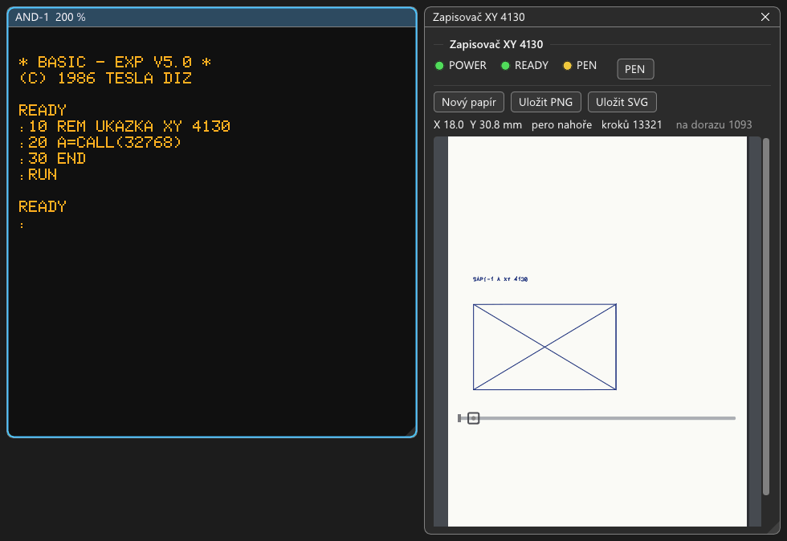

# XY 4130: návod k obsluze

Grafická jednotka XY 4130 (Laboratorní přístroje Praha) je malý souřadnicový zapisovač na papír A4. Kreslí perem po
krocích 0,1 mm na ploše 255 × 180 mm. V sestavě je připojená na konektor X3 desky JPR-1 a ovládá ji ovladač TESLA
DIZ v EPROM za MIKOSem V5 (od 1800h). Ovladač se po startu sám zavede a zapisovač je od té chvíle systémová
tiskárna L:. Výpisy na tiskárnu se tedy kreslí písmem.

Všechny kroky jsou vyzkoušené v emulátoru (2026-10-17). Zapojení, ovladač, KRES a podrobnosti o emulaci jsou
v `docs/desky/XY4130.md`.



## Co je potřeba

1. Soubor → Vybrat sestavu… → `zps\ZPS-2_MIKOS_V5_XY4130.sapi`.
2. Vpravo se samo otevře okno **Zapisovač XY 4130** (jinak Zobrazení → Zapisovač (Minigraf, XY 4130)).
3. Na obrazovce naběhne:

   ```
   MIKOS V5.0 (C) TESLA DIZ 1987
   L=XY4130
   ```

   Ovladač právě nastavuje počátek: vozík dojede na levý doraz a rozsvítí se kontrolka **READY**. Asi po 5
   sekundách přibude `MONITOR V5.0` a tečka.
4. V okně zapisovače stiskněte tlačítko **PEN**, rozsvítí se žlutá kontrolka PEN. **Bez toho pero nekreslí**:
   po zapnutí zapisovač čeká na obsluhu a vedle tlačítka svítí „stiskněte PEN“. Skutečný zapisovač se chová
   stejně (návod XY 4140: připravenost k zápisu se zapíná tlačítkem PEN).

## Okno zapisovače

- **Kontrolky:**
  - POWER svítí pořád;
  - **READY** se rozsvítí, když vozík dojede na levý doraz (udělá to ovladač); zhasne po zapnutí a po Novém papíru;
  - **PEN** ukazuje připravenost k zápisu.

  Pero se spustí jen při READY i PEN. Tlačítko **PEN** připravenost zapíná a vypíná. Vypnutím se dá kreslení
  zastavit, pero pak jezdí nahoře.
- **Papír** je pás široký jako A4 a dlouhý, jak kresba potřebuje. Ovladač při každém novém nastavení počátku posune
  papír asi o 126 mm. Kolejnice s vozíkem a doraz vlevo jsou jako u Minigrafu, pero dole je červené.
- **Řádek pod tlačítky:** poloha pera X a Y v milimetrech, pero nahoře nebo dole, počet kroků a kroky na dorazu
  (tak ovladač hledá počátek, je to normální).
- **Nový papír** založí čistý papír pod pero. Zapisovač přitom zhasne READY jako po stisku tlačítek posuvu papíru.
  Pero pak nekreslí, dokud ovladač znovu nenastaví počátek (oddíl 4).
- **Uložit PNG** a **Uložit SVG** uloží kresbu do `work\minigraf\kresba_<datum-čas>`.

Zapisovač kreslí skutečnou rychlostí, nejvýš 100 mm/s, písmo pomaleji. Delší kresbu zrychlí F8 (Stroj → Rychlost
emulace → Maximum).

## 1. Zkouška: `.G=181E`

Za tečku napište `G181E` a Enter. Ovladač začne novou stránkou a napíše:

```
.G=181E
ZALOZ PAPIR A STISKNI KLAVESU
```

Stiskněte libovolnou klávesu (Ctrl+C vrátí do monitoru bez kreslení). Vozík znovu najede na doraz, papír popojede
a zapisovač nakreslí celou znakovou sadu ovladače, znaky 10H až FFH v 15 řádcích, asi 93 × 58 mm. Trvá to necelé
3 minuty.

Po skončení se MIKOS spustí znovu: obrazovka se smaže a znovu se objeví `L=XY4130` a nastavení počátku. Tak MIKOS V5
končí každý program spuštěný povelem `.G`.

Znaky s českou diakritikou (C0H až FFH) kreslí ovladač se značkou vedle písmene. Je to vlastnost ovladače,
v `docs/desky/XY4130.md` je mezi nejasnostmi.

## 2. Výpis programu v BASICu

Zapisovač je po startu systémová tiskárna, takže `LLIST` kreslí výpis programu.

1. Soubor → Nahrát program do paměti (Intel HEX)… → `media\mikos\BASIC_EXP_V5.0.hex`, za tečku `B`. Naběhne
   `* BASIC - EXP V5.0 *` a výzva `:`.
2. Napište program, třeba:

   ```
   10 PRINT "SAPI-1"
   20 FOR I=1 TO 3:PRINT I:NEXT I
   ```

3. `LLIST`. Zapisovač napíše oba řádky, trvá to asi 20 sekund.

BASIC EXP nemá `LPRINT`. Na tiskárnu jde jen `LLIST`.

## 3. Vlastní kresba: ukázka `XY4130_DEMO`

Funkce ovladače se volají ze strojového kódu. Souřadnice jsou v krocích 0,1 mm: **X v registrech DE, Y v BC**.
X roste doprava od počátku 8 mm za levým dorazem, Y nahoru. Po nastavení počátku stojí pero na Y = 2460 (nahoře,
tam začíná text).

| Adresa | Co dělá |
|---|---|
| `1800` | Znak z registru C na místo, kde skončil předchozí text (jako tiskárna). |
| `1803` | Zavedení: tiskárna L:, `L=XY4130`, nastavení počátku (doraz, papír o 126 mm dál). |
| `1806` | Počátek po založení papíru a pak pero na X (DE), Y (BC). |
| `1809` | Přesun zvednutého pera na X (DE), Y (BC). |
| `180C` | Čára z místa, kde pero stojí, na X (DE), Y (BC). |
| `180F` | Bod na X (DE), Y (BC). |
| `1812`, `1815`, `1818` | Totéž (přesun, čára, bod) o DE, BC od místa, kde pero stojí. |
| `181B` | Velikost písma: HL ukazuje na čtyři slova SIXX, SIXY, SIYX, SIYY (po startu 4, 0, 0, 4). |
| `181E` | Zkouška (znaky 10H až FFH). |

Ukázka `media\mikos\XY4130_DEMO.hex` (zdroj `XY4130_DEMO.asm` vedle) napíše `SAPI-1 A XY 4130` a pod to nakreslí
rámeček 100 × 60 mm s úhlopříčkami (obrázek nahoře). Je na 8000h.

**Z BASICu** (jako na obrázku):

1. Nahrajte `BASIC_EXP_V5.0.hex` a `XY4130_DEMO.hex` (Soubor → Nahrát program, dvakrát), za tečku `B`.
2. `A=CALL(32768)`, nebo v programu:

   ```
   10 REM UKAZKA XY 4130
   20 A=CALL(32768)
   30 END
   ```

   a `RUN`. Kreslí asi 20 sekund, pak se vrátí `READY`.

**Z monitoru:** nahrát `XY4130_DEMO.hex` a `G8000`. Po skončení se MIKOS spustí znovu jako po zkoušce.

Pozor na pořadí: když po přesunu nebo čáře přijde znak (`1800`), ovladač začne text novou stránkou. Vozík znovu
najede na doraz, papír popojede o 126 mm a text začne nahoře. Ukázka proto píše nápis jako první.

## 4. Nový papír

Na skutečném zapisovači se papír zakládá tlačítky posuvu, která zhasnou READY. V emulátoru to dělá **Nový papír**.
Potom musí ovladač znovu nastavit počátek, jinak pero nekreslí:

- **z BASICu:** `A=CALL(6147)` (zavedení ovladače 1803h): na obrazovce `L=XY4130`, vozík na doraz, READY svítí,
  asi 8 sekund;
- **z monitoru:** `G1803`;
- nebo zkouška `.G=181E`, ta nastavuje počátek sama.

## Pro vývojáře

- **Kabel a polarity:** X3 desky JPR-1, P2-OUT 2C00h: D0 pero (1 = dolů), D1 osa (0 = vozík, 1 = papír), D6 směr,
  D7 krok na náběžné hraně. Popis je v `docs/desky/XY4130.md`.
- **KRES:** XY 4130 jde zapojit i na DPP-1 s kabelem KRESu (BASIC EXP V5.0/G+SZ, konfigurační bajt 7D1Ch = 0Dh).
  V konfigurátoru: DPP-1, zapisovač XY 4130. Postup je v `docs/desky/XY4130.md`.
- **MCP:** nástroj `plotter` (`docs/mcp.md`) vrátí polohu pera, kontrolky `ready` a `pen_lamp`, rozsah kresby a
  počty kroků. `pen_button` stiskne PEN, `new_sheet` založí nový papír, `png` a `svg` uloží kresbu.
- **Odchylka:** `xy4130.pen_on` v konfigurátoru (JPR-1, X3: zapisovač XY 4130) stiskne PEN už při zapnutí, třeba pro
  automatické zkoušky.
