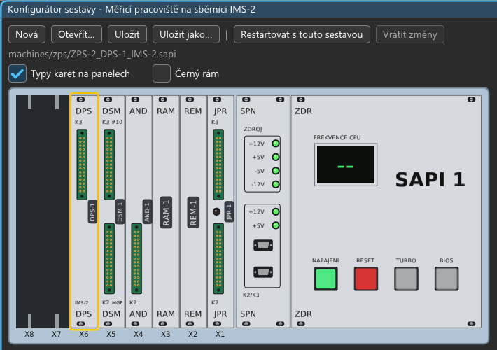
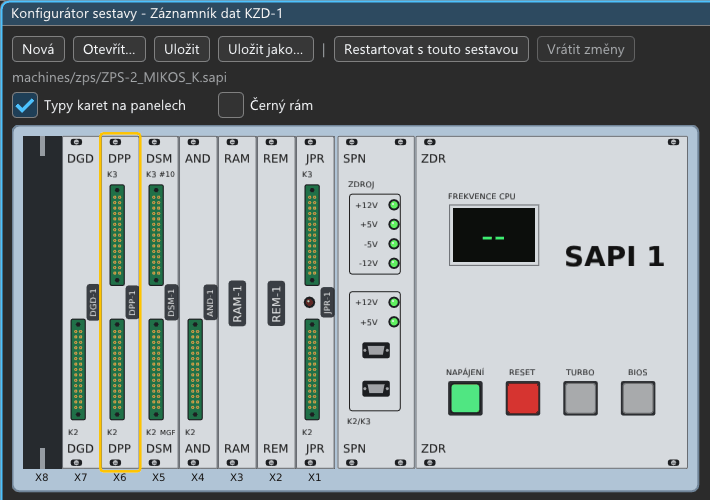

# Sestavy a konfigurátor

Sestava je popis počítače: sběrnice, karty ve slotech a jejich jumpery. Je uložená v souboru `.sapi`
(JSON s komentáři). Emulátor sestavy hledá ve složce `machines/` vedle sebe (i v podsložkách), ale soubor může
ležet kdekoli: spustí se přes Soubor → Spustit sestavu ze souboru…, k úpravám se otevře v konfigurátoru.

## Výběr sestav (Soubor → Vybrat sestavu…)

Okno nabízí sestavy po skupinách s náhledem, krátkým textem, kartami a příslušenstvím a technickým popisem (pole
`description` sestavy). Karty a příslušenství čte ze sestavy `machine_cfg_parts()` (`src/core/machine_cfg.cpp`):
karty podle slotů s názvem z katalogu, pod nimi klávesnice, joystick nebo myš, zařízení z oddílů karty (tiskárna,
zapisovače, KZD-1, PMD32-SD, IDE disk, mechaniky a jednotky s obrazem média), magnetofon DSM-1, co je v K2/K3,
a technologie mimo počítač (APS-5, IMS-2). Nové zařízení karty se do seznamu dostane přes `k_device_sections`.
Výpis všech sestav: `test_machine_cfg --parts` (`--parts en` anglicky).
Při prvním spuštění (bez souboru nastavení) se otevře samo a běží v něm ZPS-1 s MIKROBASICem
(`GUI_FIRST_MACHINE_FILE` v `src/frontend/app.h`), která je proto vybraná. `sapiemu-cli` bez `--machine` dál
spouští `mikromon.sapi` (`DEFAULT_MACHINE_FILE`). Podklady (2026-10-17, `docs/vydani/sestavy.md`):

- **`machines/_vyber.json`** (JSON s komentáři; soubory začínající `_` nejsou sestavy):
  - `intro`, `intro_en`: úvod nad seznamem přes celou šířku okna (co byl SAPI-1, kde začít);
  - kategorie v pořadí (`id`, `name`, `name_en`, `text`, `text_en` pod otevřeným nadpisem, `group` pro kategorie
    pod společným nadpisem „Ostatní“, `guides` = průvodce se otevře sám) a seznamy sestav;
  - `titles` v kategorii: titulek sestavy jen v ní (`{"jpr1s_bgp1s.sapi": {"title": …, "title_en": …}}`, Manic
    Miner v Hrách a demech), jinde má sestava svůj titulek;
  - k sestavám krátký titulek a text (`title`, `title_en`, `summary`, `summary_en`). Sestavy, které rejstřík nezná
    (vlastní), jsou na konci v „Nezařazené a vlastní sestavy“. Titulek (`title`, v angličtině `title_en`, jinak
    jméno ze `.sapi`) je i v titulku okna, v Soubor → Poslední sestavy a v konfigurátoru (`machine_title()`, od
    etapy 7 plánu vzhledu). `title_en` proto potřebuje každá sestava, jejíž jméno má česká slova; sestava s čistě
    technickým jménem ne.
- **Náhledy** `machines/previews/<id>.png`, kde `<id>` je cesta v `machines/` bez `.sapi` a s `_` místo `/`
  (`zps_ZPS-1`). Vyrábí je `python tools/make_previews.py [--debug] [--instruments] [filtr…]`: sestavu spustí
  scénářem z `tools/check_machines.py` (nebo z `PREVIEWS` ve skriptu) nad čistou kopií dat a obrazovku zmenší na
  nejvýš 480 bodů. Filtrů může být víc (stačí jeden), `--instruments` vezme jen sestavy s přístrojem, `--debug`
  sestavení debug (když je release starší).
  - **Přístroje** (`INSTRUMENTS`): náhledem je nakreslený přístroj z jeho okna. Akce proběhnou v `sapiemu-cli`, ten
    uloží stav, a `sapiemu --ui-state … --ui-crop KLÍČ --ui-picture` vyfotí z okna s ID `###KLÍČ` jen to, co okno
    označí jako obraz přístroje (`picture_mark()`), bez ovládacích prvků emulátoru kolem: náhled je stejný v češtině
    i angličtině (etapa 7 plánu vzhledu, „náhledy oříznout jen na obraz“). Okna jsou vždy v **tmavém vzhledu
    Windows 11** (`--ui-theme dark`, měřítko 100 % nebo `UI_SCALE`): obrázek nezávisí na PC ani jeho nastavení
    a sedí do tmavého rámečku jako monitor v okně Vybrat sestavu. Jsou to APS-5 (panel, pece a graf bez přepínačů
    simulace), IMS-2 (voltmetr a zdroj s kabely), KZD-1 (kazeta) a RMP-1 (první mechanika bez „jednotka 0“, to je
    text emulátoru) z okna Média a u zapisovačů kresba s okrajem 10 mm, nejméně tak široká jako vysoká, na
    viditelném papíře: Minigraf (celá znaková sada), **XY 4130** (vozík na levém dorazu, PEN, zkouška `G181E`
    z návodu: celá znaková sada) a **plotter z AR 1990** (READY, počátek,
    tlačítko Ukázka `media/ar1990/ukazka.txt` asi 155 s; pak zvednuté pero nad střed kresby, protože okno jede za
    perem a na konci ukázky by uřízlo horní okraj rámečku).
  - Kde výchozí velikost okna obsah ořízne (RMP-1 pod mechanikami RPD-1), je obraz moc široký na ostré
    zmenšení (APS-5 a IMS-2: těsně pod 960 bodů = 2× zmenšení) nebo malý (kresba XY 4130: okno 1000 bodů, kresba
    těsně pod 480), dá skript velikost okna do `imgui.ini` běhu (`WINDOW_SIZE`). Malý obraz (kazeta KZD-1,
    mechanika RMP-1) kreslí ve větším měřítku (`UI_SCALE`), aby byl těsně pod 480 bodů. `shrink()` zmenšuje jen
    celými násobky: obraz o kousek širší než 480 nebo 960 bodů by skončil na třetině. Každý nový náhled je potřeba
    prohlédnout.
- **Průvodci** `machines/guides/<id>.md` a `<id>.en.md`: krátký Markdown (nadpisy, odrážky, bloky kódu s
  tlačítkem Napsat do SAPI, odkazy na `docs/` a web). Okno Průvodce sestavou se otevře samo u kategorií s
  `guides`, dokud ho uživatel u sestavy nebo celkově nevypne (nastavení `guides`).
- Naposledy spuštěné sestavy (z okna) jsou nahoře, ukládají se v nastavení (`browser.recent`). Běžící
  sestava je zelená a má za jménem „(běží)“, hlavní tlačítko u ní je Restartovat (jen myší: Enter spustí sestavu,
  která neběží, aby jedna klávesa nezahodila paměť běžící).
- Hledání nedbá na diakritiku a velikost písmen (`machine_index_matches`, „zaznamnik“ najde „Záznamník“).
- Svítí jen řádek, na který uživatel klikl (sestava může být ve dvou kategoriích); u titulku podle kategorie je
  v podrobnostech tento titulek a pod ním vlastní titulek sestavy.
- Při prvním spuštění: když uživatel výběr zavře bez spuštění sestavy, otevře se průvodce ZPS-1 (pokud se průvodci
  otevírají sami a jiný průvodce už neběží).
- Test `test_machine_index` hlídá, že rejstřík zná jen existující sestavy a sestavy s průvodcem ho mají.

## Konfigurátor (Zobrazení → Konfigurátor sestavy…)

- **Čelní pohled na rám:** sloty X1…Xn zprava doleva, vpravo panely SPN a ZDR.
  - Panely jsou kreslené podle tiskových podkladů hliníkových štítků z rámu Libora Lasoty
    (`H:\SAPI-1\LiborLasota\Chassis\Potisk_ARTAX`, rozměry v bodech přímo z PDF): úzký panel 57 × 491,8 bodu,
    SPN dvě pozice, ZDR sedm pozic, otvory, konektory K2/K3 (D-sub), LED ZAM/DSK, popisky.
  - **Konektory:** desky původní konstrukce mají konektory FRB v hranatých otvorech, desky V většinou D-sub
    (autor). Rozměry jsou ze štítků: otvor FRB 22,7 × 150,2 bodu vlevo od středu (první sada, DSM/FDC/JPR), D-sub
    podle druhé sady. FRB je nakreslený jako zelený obdélník se zlatými piny ve dvou řadách.
    - všechny JPR (i JPR-1V) a FDC: K3 nahoře, K2 dole, JPR mezi nimi kulatý otvor pro LED. **LED svítí podle
      emulace** (u běžící sestavy): JPR-1ZI, JPR-1Z, JPR-1V a JPR-1A = BOOT (od resetu do `OUT 00h`), JPR-1 = LED
      na P1-OUT D7 (zápis na 2800h);
    - DSM-1: K3 terminál (X2), K2 magnetofon (X3, „MGF“); DMR-1: jen K3 terminál (X2) na stejném místě;
    - AND-1, AND-1A, AND-1Z, AND-1Z-89 a DGD-1: jeden FRB dole (K2), jako na deskách;
    - RPD-1: horní FRB obou desek (RPD-1A vpravo, RPD-1B vlevo) propojuje kabel KB-17, dolní FRB na RPD-1B
      („K2 FDD“) vede k mechanikám; svislé typy „RPD-1A“ a „RPD-1B“;
    - FDC-1: stejně, horní FRB obou desek (FDC-1A vpravo, FDC-1B vlevo) propojuje stejný kabel, k mechanikám vede
      dolní FRB na FDC-1A („K2 FDD“), dolní FRB na FDC-1B má vlastní signály SEL, HL a MOT;
    - RKD-1: obě desky stejně, horní FRB (X3) propojuje plochý kabel (název v podkladech není, kreslí se bez
      popisu), dolní FRB (X2, „K2 DISK“) obou desek vede ke kazetovému disku, signály mechaniky jsou rozdělené mezi
      RKD-1A a RKD-1B;
    - RMP-1: dva FRB 30 k magnetopáskové jednotce, K3 = X2 (data), K2 = X3 (povely a stav);
    - DPS-1: jeden FRB 30 nahoře (K3 = X2), kabel k přístrojům, dole popisek „IMS-2“; DPP-1: dva FRB 30, K3 = X2
      kanál 1, K2 = X3 kanál 2 (podle fotografií desek `..\SAPI_DOKU\FOTO_poklady_petr\SAPI\DPS-1_soucastky.jpg`
      a `DPP-1_soucastky.jpg`, autor 2026-10-10);

      
      

    - IDE-1: nahoře IDC 40 pro disk („HDD“, SV1), LED, dole D-sub 15 dvouřadý pro PMD32-SD („PMD32“, X2). LED na
      skutečné desce není, emulátor ji přidává: svítí 50 ms po přístupu na disk nebo PMD32-SD;
    - DSM-1V: K3 „A“, K2 „B“ (D-sub); AND-1V, AND-1B, DGD-1V a CGA: K2 VGA uprostřed; BGP-1S: FRB K2 (TV);
      MPH (K4 OVL, K3 ZVUK, K2 MYŠ);
      ZRD-1V (LED podle rev 2.1: ZAM červená = zámek zápisu nastavený programem, odemkne reset; DSK zelená svítí
      20 ms po přístupu na 60h–63h; rev 1.1 LED nemá);
    - bez konektoru (autor): ZRMD-1, RAM-1, RAM-1A, RAM-1Z, RAM-1V, REM-1. Ostatní karty se projdou postupně.
  - Volba „Typy karet na panelech“ ukáže přesný typ karty ve volném místě panelu.
  - Sériové karty (DMR-1, DSM-1, DSM-1V) bývají v sestavě víckrát, proto je **port u každého sériového
    konektoru** („K3 #10“, u DSM-1V „#10“ nad K3 „A“ a „#14“ pod K2 „B“). Typ karty na panelu je bez portu.
    V seznamech, bublinách a v okně Sériový terminál zůstává jméno s portem („DMR-1 #10“).
  - Dvě karty na stejném portu jsou chyba (sestava se nezapne). Dvě DMR-1 se zapnutou RAM nebo se stejným
    souborem baterie jsou varování. Druhá DMR-1 se obvykle používá jen jako sériový port: RAM vypnout
    (parametr „RAM 128 KB“) a JP2 nastavit na jiný port.
  - X1 je procesorová karta (výjimkou je ARB-1C s JP3 = 1-2 pro PKT-1).
  - Počet slotů určuje typ sběrnice.
  - Karty, které zatím nejsou emulované, jsou šedé. Červená tečka znamená chybu (např. karta mimo X1).
- **Klik na slot** vybere kartu a pod rámem se ukáže její nastavení: výběr karty, jumpery a soubory ROM nebo
  obrazů s nabídkou známých souborů a tlačítkem `…`. Pravé tlačítko otevře rovnou seznam karet. Klik na rám
  mimo karty ukáže název a popis sestavy a nastavení sběrnice.
  - Rám se zmenšuje podle šířky i výšky okna, zabere nejvýš asi polovinu místa pod lištou, aby nastavení zůstalo
    vidět (od 2026-10-29). Klik na slot přepne na záložku Nastavení karty a posune ji do pohledu.
  - Cesta k souboru a textová pole se použijí až po Enteru nebo opuštění pole, Esc vrátí původní text. Médium se
    tak nenačítá při každém napsaném znaku.
- **Přetažení karty myší** na jiný slot (od 2026-10-07): karta se zvedne a jede za myší. Zelený cíl = přesun na
  volné místo nebo prohození se stejně širokou kartou, která tam začíná; červený = nejde (procesorová karta
  patří do X1, nevejde se do rámu, jiná šířka), důvod je v bublině. Esc tažení zruší. Sloty sběrnice jsou
  rovnocenné, proto se přesun provede rovnou i v běžícím stroji: sestava je jen neuložená, restart netřeba.
  Oranžový (až po restartu) je přesun jen tam, kde běžící stroj v dotčených slotech ještě nemá to, co editor.
  „Vrátit změny“ vrátí karty na uložená místa i v běžícím stroji. Snímek: `--ui-drag Z:DO` (karta ještě
  v ruce), `--ui-drag Z:DO:drop`.
- **Panel ZDR:**
  - NAPÁJENÍ je vypínač s aretací. Za chodu počítač vypne: obrazovka a LED zhasnou, RAM se ztratí. SRAM
    DMR-1 s baterií (JP7), CRM-1 a RTC-1 s bateriemi a RAM disky se uloží, spojení TCP a COM se zavřou. Další stisk počítač zapne se
    sestavou z konfigurátoru, včetně neuložených změn. Totéž je v menu Stroj → Vypnout/Zapnout a v MCP
    (`power`). Tlačítko „Zapnout s touto sestavou“ (za chodu „Restartovat s touto sestavou“) dělá vypnutí
    a zapnutí jedním krokem;
  - RESET funguje jako F12;
  - TURBO a BIOS patří kartě CPU jako na Liborově rámu: u JPR-1V TURBO přepíná CPU 2/4 MHz (svítí = 4 MHz) a BIOS
    propojku BIOS, tedy banku EEPROM (svítí = banka 1, čte se po RESETu). Ostatní karty CPU je nemají, tlačítka jsou
    šedá. Rychlost emulace je zvlášť (F8, menu Stroj → Rychlost emulace);
  - displej FREKVENCE CPU ukazuje efektivní takt CPU: takt karty × naměřená rychlost emulace (od 100 bez desetin).
- **Změny se projeví až po vypnutí a zapnutí** (rozhodnutí autora). Obsah RAM se ztratí, RAM disky se před
  vypnutím uloží, pracovní kopie médií ve `work/` zůstávají.
- **Co běžící stroj ještě nemá, je oranžové** (od 2026-10-06): tlačítko „Restartovat s touto sestavou“, pruh pod
  ním, označení slotu (X5 s tečkou) a pole parametru s tečkou před názvem; bublina u parametru ukáže hodnotu
  běžícího stroje. I se zavřeným konfigurátorem je vpravo nahoře „● Sestava změněna: restartovat“ (kliknutí
  otevře konfigurátor). Porovnává se s popisem, se kterým stroj běží; název a popis sestavy ani hodnota
  zapsaná stejná jako výchozí se nepočítají, parametry „(platí hned)“ se neoznačují.
- **Vrátit změny:** když jsou oranžové změny, vrátí konfigurátor na sestavu běžícího stroje (i třeba smazanou
  kartu po uložení nebo u neuložené nové sestavy), jinak na naposledy uloženou sestavu.
- Parametr „(platí hned)“ změněný jinde než v konfigurátoru (MCP `turbo`) se do konfigurátoru převezme, změna
  v konfigurátoru jde do stroje.
- **Výjimka: parametry označené „(platí hned)“** se u běžící sestavy použijí okamžitě, jako přepínač na skutečné
  desce: barva obrazu, režim zápisu RAM disku ZRMD-1/ZRD-1V (`mode`), přepínače S1–S4 ZRMD-1, TURBO a BIOS
  JPR-1V, co vrací prázdná sběrnice (`open_bus` u JPR-1V, JPR-1ZI, JPR-1Z), STSTB JPR-1V (`ststb`, zamrzání při
  INTA, nebo záplata IC15) a věrný režim klávesnice („Klávesnice: věrně jako hardware“, `keyboard.strict`).
- **První spuštění** (ještě bez `sapiemu-settings.json`) otevře konfigurátor za oknem obrazovky. Poloha z `imgui.ini`
  má přednost, jinak stojí vpravo nahoře (od 2026-10-14).
- **Výměnná média platí hned** (od 2026-10-10):
  - patří sem diskety řadičů RPD-1, FDC-1 a MFC-1A (`drive_x.image`), pásky RMP-1 (`unitN.tape`), kazety RKD-1
    (`unitN.cartridge`), kazeta KZD-1 (`kzd1.cassette`) a kazeta v magnetofonu DSM-1 (`tape`);
  - obraz vybraný v konfigurátoru se za chodu hned vloží;
  - výměna, nové médium i vysunutí v okně Média se zapíšou do sestavy, takže konfigurátor je ukáže a sestavu
    označí jako neuloženou;
  - u pásky, kazety RKD-1 a kazety KZD-1 je vedle „…“ tlačítko **Nová…** (nový soubor = prázdné médium) a nabídka
    obrazů ukazuje i soubory, které leží ve složkách navržených obrazů (třeba `work/rmp-1`);
  - v okně Média je u každého média tlačítko „…“ s položkami **Vysunout bez uložení** a **Obnovit
    z originálu** (pracovní kopii ve `work/` přepíše originál z `media/`, s potvrzením). Uložit je potřeba
  jako každou změnu sestavy. Při přepnutí z `rw` se RAM disk nejdřív uloží, po přepnutí na `rw` se uloží jeho
  aktuální obsah.
- **Nová:** prázdná sestava, nebo kopie šablony či jiné sestavy (uloží se přes „Uložit jako…“).
- **Uložit** zapíše soubor s komentáři z katalogu: u každého jumperu je jeho označení a význam zvolené
  hodnoty. Ruční komentáře z původního souboru se při uložení z konfigurátoru ztratí.
- **Konfigurátor ukazuje běžící sestavu.** Když má neuložené změny a má se nahradit jinou sestavou (menu
  Soubor → Vybrat sestavu…, Spustit sestavu ze souboru…, v konfigurátoru Nová a Otevřít…, i ukončení emulátoru), nejdřív
  se zeptá. Dotaz vyjmenuje skutečné změny proti souboru (nejvýš 9 řádků a „a další změny (N)“), třeba
  „X1 JPR-1V: TURBO: CPU 4 MHz, sběrnice vždy 2 MHz → vypnuto“, „X4 DSM-1 #10: Kazeta v magnetofonu → hra.wav“,
  „X2 DMR-1: přesunuta do X4“, „X6 IDE-1: odebrána“. Hodnota zapsaná jinak, ale stejná (výchozí hodnota vypsaná,
  `10h` a 16), změnou není. Tlačítka: **Uložit / Uložit jako… / Ponechat pro příští spuštění / Zahodit změny /
  Zrušit** (Enter i Esc = Zrušit). Zrušit akci nechá být. Když sestavu přepne MCP nebo načtený stav, dotaz přijde
  hned potom a Zrušit ponechá rozpracované změny v konfigurátoru. Vypnutí a zapnutí stejné sestavy (NAPÁJENÍ,
  „Zapnout s touto sestavou“) se neptá a změny zachová. Seznam změn ukáže i bublina nad řádkem „neuložené změny“
  v konfigurátoru.
- **Ponechat pro příští spuštění** (jen sestava se souborem a bez chyb v sestavě, s chybou je tlačítko šedé, start by
  selhal a změny by se zapomněly): soubor zůstane, jak je, a popis se změnami si program uloží do nastavení
  (`kept_machines`: soubor → jeho obsah na disku v tu chvíli a upravený popis). **Každé** další spuštění téhož
  souboru z GUI (výběr sestav i Restartovat, Poslední sestavy, Spustit ze souboru, sestava minulé relace při startu
  programu) a jeho otevření v konfigurátoru změny použije, dokud je někdo neuloží nebo nevrátí. Každý takový start
  ohlásí stavový řádek („Běží se změnami ponechanými z konfigurátoru…“), výběr sestav ji označí hvězdičkou
  a větou pod popisem, Nahlásit chybu to napíše u sestavy. Konfigurátor je dál ukazuje jako neuložené („neuložené
  změny, ponechané pro příští spuštění“), ale znovu se na ně neptá, dokud se nepřidá další změna. **Uložit**,
  **Vrátit změny** a **Zahodit změny** je zapomenou. Když se soubor mezitím změnil (nová verze dodané sestavy), změny
  se zapomenou a řekne to okno Chyba; když se popis se změnami nedá postavit (chybí médium), sestava se spustí podle
  souboru a okno Chyba to řekne. MCP a `sapiemu-cli` ponechané změny nepoužívají.

## Okna obrazovek a barva obrazu

- **Každý videovýstup má své okno pojmenované podle karty:** „AND-1V“, „AND-1Z-89“, „CGA-1V“, „DGD-1“… Konzole
  (první textový displej) je hlavní okno, grafické karty mají další. Při vypnutém stroji se hlavní okno jmenuje
  „Obrazovka“. Za jménem je aktuální zvětšení v celých procentech („CGA-1V  200 %“): body obrazovky PC na bod
  emulovaného obrazu, svisle (s poměrem TV se vodorovně liší).
- **Rychlé zvětšení:** pravé tlačítko na obraz nabídne „Přizpůsobit oknu“ (zaškrtnuté, když není zvolené pevné
  zvětšení) a 100 %, 200 %, 300 % a 400 %, okno se pak nastaví kolem obrazu s malým okrajem. Totéž je v menu
  Zobrazení → Zvětšení obrazovky pro displej použitý naposledy (jeho jméno je v menu nahoře; po startu sestavy
  hlavní výstup). Změna velikosti okna rukou vrátí přizpůsobení oknu (a celočíselné zvětšení, je-li zapnuté).
- **Celá obrazovka (Alt+Enter):** displej použitý naposledy sám přes celý monitor (`SDL_SetWindowFullscreen`, okno
  bez rámu), bez menu a ostatních oken, obraz podle celočíselného zvětšení a poměru TV. Ostatní okna se dál kreslí,
  jen skrytá, takže jejich místa i dok zůstanou a dialogy (chyba, otázka) se ukážou přes obraz. Ukončí ji Alt+Enter,
  menu pravého tlačítka (přepne i na jiný displej) nebo Zobrazení → Celá obrazovka; Esc jde do SAPI, F11 zůstává
  krokem debuggeru. Neukládá se, každé spuštění začne v okně.
- **Okna displejů nejdou sbalit** a okna se posouvají jen za titulek (`io.ConfigWindowsMoveFromTitleBarOnly`):
  tažení po obrazu okno nehne, klik do obrazu dál zachytí myš SAPI.
- **Displej menší než 1:1** (obraz zmenšený do malého okna) se kreslí hladce, aby písmena neztrácela řádky bodů. Od
  1:1 jsou body ostré, pokud není zapnuté Vyhlazování.
- **Barva jednobarevného obrazu je parametr karty v sestavě:**
  - AND-1V: propojky S1 (`color`: white, green, amber, red, blue, cyan, yellow, magenta), jako na desce;
  - AND-1, AND-1A, AND-1Z, AND-1Z-89 a DGD-1 barvu nemají, ta je dána luminoforem monitoru: parametr `monitor`
    (white, green, amber), v konfigurátoru „Monitor: barva luminoforu (není na kartě)“;
  - CGA-1V je barevná a barvu nemá.
  - AND-1B: propojky S1 (`color`) jako AND-1V, výchozí zelená (autorova deska);
  - BGP-1S: barvy dávají atributy (Colorace / RGBM); v menu Barva se volí výstup K2: `rgb` (barevná TV, SCART) nebo
    `mono` (černobílá TV, kompozit).
- **Menu Zobrazení → Barva** mění tentýž parametr jako konfigurátor. Změna se projeví hned, bez vypnutí, a
  v konfigurátoru se objeví jako neuložená změna sestavy (Uložit). Totéž platí obráceně: barva změněná
  v konfigurátoru se na běžící sestavě ukáže hned.
- Snímky přes MCP `screenshot` a `sapiemu-cli --screenshot` jsou ve stejné barvě.

## Mapa portů a paměti

Záložka „Mapa portů a paměti“ pod rámem (a MCP nástroj `machine_map`) ukazuje, která karta odpovídá na
který port a paměťovou adresu.

- **Zdroj je dekódování samotných karet:** tytéž PROM dumpy a jumpery, podle kterých karta odpovídá za běhu
  (JPR-1ZI D3C/D6B, DMR-1 D2C a JP3, AND-1Z D1 a S1, ZRMD-1 GAL, IDE-1 JP1–JP5). Karty se pro výpočet postaví ve
  zkušebním režimu, takže se neotevírají ani nekopírují obrazy disků.
- **Paměť:** pruh 64 KB, v němž má každá karta svou barvu. EPROM procesorové karty (jen po resetu, BOOT = 1)
  je proužek nahoře, protože se čte na kartě a zápis jde na sběrnici. Pod pruhem je tabulka rozsahů s funkcí
  a přístupem (R = čtení, W = zápis).
- **Porty:** tabulka rozsahů. Neemulované sériové karty (DSM-1) jsou v mapě s porty z konfigurátoru, ostatní
  neemulované karty jsou vypsané jako „dekódování neznámé“.
- **MAP1/MAP2:** když na nich mapa závisí (AND-1Z se S1, DMR-1 s A6/A7 z MAP, RAM-1V, CGA-1V…), jsou pod sebou
  pruhy všech čtyř stavů, vždy ve stejném pořadí. Vybraný stav je tlustý (žlutý popisek) a tabulka je pro něj,
  ostatní jsou tenké: jejich mapa je ztlumená tam, kde je stejná jako ve vybraném stavu, a výrazná tam, kde se
  liší (šedá = tam nikdo neodpovídá). Alternativní mapování je tak vidět hned. Kliknutím na pruh nebo popisek se
  stav vybere.
- **Kolize:** dvě karty, které na čtení budí sběrnici na stejné adrese, jsou chyba a sestava se nezapne. Jsou
  červeně v pruhu i v tabulce. Zápis do dvou karet je varování. Nikým neobsazené adresy čtou FFh.

## Šablony ZPS

`machines/zps/ZPS-1.sapi` až `ZPS-4.sapi` podle https://sapi.cz/sapi/doku2/zps.php:

| Sestava | Karty | Klávesnice |
|---|---|---|
| ZPS-1 | JPR-1, REM-1, AND-1, DSM-1, BDK-1 | ANK-1 |
| ZPS-2 | JPR-1, REM-1, RAM-1, AND-1, DSM-1, BDK-1 | ANK-1 |
| ZPS-3 | JPR-1A, RAM-1A, AND-1A, DSM-1, RPD-1 (2 sloty) | Consul 259.11 |
| ZPS-4 | JPR-1Z, RAM-1Z, AND-1Z, DSM-1, RPD-1, RMD-1 | Consul 259.11 |

Pořadí karet ve slotech je odhad (viz Nejasnosti v `docs/SOUHRN.md`). **ZPS-1 běží** s MIKROBASICem 2.4,
**ZPS-2** s Monitorem V4.0 a MIKOSem 4.0F (RAM-1/48K, programy z kazety, `docs/software/MIKOS.md`).
`ZPS-2_MIKOS_V5.sapi` je ZPS-2 s Monitorem V5.0F, MIKOSem V5.0, klávesnicí Consul 262.3 a grafickým displejem
DGD-1 (C000–FFFF, RAM-1 proto jen 4000–BFFF). Grafika má vlastní okno „DGD-1“. `ZPS-2_MIKOS_V5_DGD-1V.sapi` je
totéž s Liborovou DGD-1V (VGA, jantarová) místo DGD-1 (`docs/desky/DGD-1V.md`).
`ZPS-2_MIKOS_V5_Minigraf.sapi` je ZPS-2 s MIKOSem V5.0 a zapisovačem ARITMA Minigraf 0507 na DPP-1 (31h), ovladač
V.1-MGF v EPROM od 1800h, RAM-1 přes 4000–FFFF, bez DGD-1 (`docs/desky/Minigraf.md`).
`ZPS-2_MIKOS_V5_XY4130.sapi` je ZPS-2 s MIKOSem V5.0 a grafickou jednotkou XY 4130 na X3 desky JPR-1 (P2-OUT 2C00h,
parametr JPR-1 `xy4130`), ovladač TESLA DIZ v EPROM od 1800h (`MIKOS5.BIN`), který Monitor spustí sám; pero se
spustí až po stisku PEN v okně zapisovače. XY 4130 jde zapojit i na DPP-1 (`xy4130_channel`, sekce `xy4130`, kabel
KRESu) (`docs/desky/XY4130.md`).
`ZPS-2_MIKOS_K.sapi` je ZPS-2 s MIKOSem/K V5.0 a kazetopáskovým záznamníkem dat KZD-1 na DPP-1 (30h, X2), kazeta
v okně Média, poprvé ji připravit `.K_I` (`docs/desky/KZD-1.md`).
`ZPS-2_MIKOS_D.sapi` je ZPS-2 s disketovým MIKOSem/D V5.0, řadičem RPD-1 (dva sloty) a 8" mechanikou se
systémovou disketou (`docs/desky/RPD-1.md`). BDK-1
(bastldeska) je prázdná deska pro vlastní zapojení uživatele, na sběrnici nic nedělá a jen zabírá slot.
**ZPS-3 běží** s originálním monitorem 48K MON V1.0-C1 a CP/M 2.2/P z diskety (`docs/software/CPM_ZPS-3.md`).
`ZPS-3_CPM48K.sapi` a `ZPS-3_CPM62K.sapi` jsou ZPS-3 s Peřinovými monitory MOR48A a MOR62A a řadičem RPD-1,
`ZPS-3_CPM48K_FDC-1.sapi` a `ZPS-3_CPM62K_FDC-1.sapi` totéž s řadičem FDC-1 (8272 + DMA, dva sloty,
`docs/desky/FDC-1.md`). Sestavy 62K mají druhou RAM-1A na C000–F7FF a AND-1A na F800.
`ZPS-3_CPM48K_IMA.sapi` je originální CP/M 46K od Tesly IMA s monitorem MON V1.0-C1 (systémové stopy vyrobené
originálním MOVCPM48, disketa se nedochovala). `ZPS-3_CPM64K_IMA.sapi` je originální CP/M 64K od Tesly IMA (monitor MON64C3 v RAM na F800, druhá RAM-1A na
C000–EFFF a F800–FFFF, AND-1A na F000; obě PROM jsou předpoklad).
`cpm_zrmd_fdc1.sapi` a `cpm_zrmd_mfc1a.sapi` jsou `cpm_zrmd.sapi` s řadičem FDC-1 nebo MFC-1A (`docs/desky/MFC-1A.md`)
a 8" mechanikami. Při prvním zapnutí zvolit 0 (FDC8) nebo 2 (MFC8), B: je disketa CP/M 2.2/P, C: druhá mechanika.
`cpm_boot_mfc1a.sapi`, `cpm_boot_fdc1.sapi` a `cpm_boot_rpd1.sapi` bootují CP/M J. Bíby (2011) z 8" diskety A:
přes MFC-1A, FDC-1 nebo RPD-1 (EPROM `JPR-1ZI_MON*_JB_*`), C: je vlastní RAM disk ZRMD-1, B: disketa CP/M 2.2/P
jako data (`docs/software/CPM_SAPIMAN.md`). Ze systémových disket J. Bíby (`SAPI_SYS`): `cpm_boot_rpd1_ss256.sapi` a `cpm_boot_fdc1_ss256.sapi` (C: je RAM
disk ZRMD-1 sestavy `cpm_zrmd`, stejné rozložení), `cpm_boot_mfc1a_rmd.sapi` (C: RMD-1, inicializace `IRMD40`) a
`cpm_term64k_fdc1.sapi` (CP/M 64K jen s terminálem: okno Terminál nebo TCP 2323) `cpm_boot_dlouhe_rpd1_fdc1.sapi` (`_35` pro 3,5") a `cpm_pmd_rpd1.sapi` (CP/M 170212 s PMD32-SD přes DPP-1).
`cpm_boot_fdc1_rmd.sapi` a `cpm_boot_rpd1_rmd.sapi` jsou bootovací diskety J. Bíby s RAM diskem RMD-1 (inicializace
`B:IRMD40` z diskety Z6), `cpm_pmd_fdc1.sapi` je FDC-1 s PMD32-SD přes DPP-1 (C:, D:). `cpm_boot_rpd1_mfc256.sapi`,
`cpm_boot_rpd1_mfc512.sapi` a `cpm_boot_rpd1_fdc1_rmd.sapi` bootují z RPD-1 a mají druhý řadič pro D:, E: (MFC-1A
s 8" disketami FM 14 × 256 nebo 8 × 512, FDC-1 8"). V `cpm_boot_fdc1_irmd.sapi` si RAM disk RMD-1 připraví
BIOS sám (zjistí i velikost 256 KB / 1 MB). Sestavy s ECMONem a monitory
J. Bíby mají tiskárnu na X3 (`docs/tiskarna.md`).
`cpm_zrmd_dpp1.sapi` je `cpm_zrmd` s deskou DPP-1 a PMD32-SD (ECMON: D:, E:).
`cpm_zrmd_rtc_dsp.sapi` k ní přidává RTC-1 (A0h) a DSP-1 (48h, 4Ah, 4Ch, kanál X2 i na TCP 2324) na adresách
z programů J. Bíby; E: je disketa `b_rtc_zdp_zrmd.8sd` s `RTCZ.COM`, na RAM disku A: jsou `RTC421`, `DOPCP`
a `DOCPMP` (`docs/desky/RTC-1.md`, `DSP-1.md`)
(„dlouhé“ CP/M s 3K BIOSem: RPD-1 8" a FDC-1 5,25" HD v jedné sestavě). `cpm_ec1045.sapi` je systém EC1045 s menu FDC8/FDC3/FDC5/HDD
a disketami PC 3,5" a 5,25" HD na FDC-1 (volba 1 nebo 2), mechaniky zapojené jako u EC1045 (MOTOR ON z /HL,
`motor_hl`).
**Desky Libora Lasoty k původním sestavám** (2026-10-06): `machines/jpr1s_bgp1s.sapi` je JPR-1S s MIKROBIOSem 1.02,
grafikou BGP-1S (PMD-85, Colorace) a klávesnicí ANK-1M2; hry z `media/jpr-1s` se nahrají přes Soubor → Nahrát
program (Intel HEX) a spustí `JUMP 4400`, nebo příkazem BOOT po sériové lince redukce Redukce34KB01 (TCP 2325, raw,
19200 Bd). Na K3 má desku diagnostiky (od 2026-10-07, čítač `media/jpr-1x/diag_poll.hex`).
`machines/zps/ZPS-1_JPR-1S_AND-1B.sapi` je ekvivalent ZPS-1: JPR-1S s MIKROBASICem 2.4 v EEPROM, AND-1B
(VGA) a ANK-1M2. `docs/desky/JPR-1S.md`, `BGP-1S.md`, `AND-1B.md`.

**JPR-1X** (2026-10-06, 80C85): `machines/jpr1x_bgp1s.sapi` je JPR-1X s MIKROBIOSem 1.02 z dolní banky ROM, RAM-1/48K,
BGP-1S (přerušení vypnuté) a ANK-1M2 s redukcí (hry jako u `jpr1s_bgp1s`), na K3 deska diagnostiky (čítač
`media/jpr-1x/diag_int.hex`). `machines/zps/ZPS-1_JPR-1X.sapi` je ekvivalent ZPS-1
s MIKROBASICem 2.4 z horní banky (propojka BIOS rozpojená), REM-1 jen s RAM, AND-1, DSM-1 a ANK-1. TURBO (CPU 4 MHz)
jde přepnout za chodu. `docs/desky/JPR-1X.md`, procesor `docs/8085.md`.

**SAPI-1.5, ZPS-6** (2026-10-07): `machines/zps/ZPS-6.sapi` je procesorová deska PKT-1 (Z80, klávesnice Consul 262.3
na 8255, tiskárna), RSW-1 (64 KB RAM, 8251, watchdog), řadič MFC-1A s jednou mechanikou 5,25" DS DD a barevná
semigrafika DBS-1A (64x20, znakový generátor z dumpu EPROM „59“). Místo sběrnice SBI-1 je ARB-1C s JP3 = 1-2
(AEN vypnutý, X1 volný). ROM MON-V100690 nabootuje CP/M 2.2 62K z diskety Melsoft (`media/sapi15/*.sp2`).
`docs/software/SAPI-1.5.md`, `docs/desky/PKT-1.md`, `RSW-1.md`, `DBS-1A.md`. ZPS-5 (dvojitá vana, dlouhá sběrnice,
bez MFC-1A a DBS-1) nemá dochovaný firmware.

**Sestava V** (`machines/sapi1v.sapi`): Liborovy desky JPR-1V, RAM-1V, AND-1V, DSM-1V, ZRD-1V, IDE-1, CGA-1V
a MPH-1V s ECMON a CP/M z RAM disku. Propojky jsou jako na autorových deskách. CGA-1V (C000h při MAP1 = MAP2 = H) má
vlastní okno „CGA-1V“. Zvuková karta MPH-1V (50h) hraje přes zvuk PC při rychlosti 100 % (Stroj → Zvuk, joystick a myš,
`docs/desky/MPH-1V.md`).
**Hry a dema na sestavě V** (2026-10-17): `sapi1v_hry.sapi` má grafiku CGA-1V i DGD-1V (střídají se podle MAP2 jako
u `libor_doma`), bez IDE. RAM disk `media/zrmd-1/hry-a-dema.bin` vyrábí `tools/make_hry_disk.py` z obrazu Bad Apple!!
(`ba-ramdisk.bin`) a her a dem z repozitářů vedle SAPIemu: Bad Apple!!, FXS4, Flappy (CGA-1V i DGD-1V), Bomberman,
BKP, dema, přehrávače a hudba L. Lasoty (`docs/vydani/sestavy.md`). Po startu volba 3, pak jméno programu.
`sapi1v_PoP.sapi` (Prince of Persia s grafikou a hudbou DOS verze, `media/zrmd-1/pop-ramdisk.bin`) je od 2026-10-28
v Hrách a demech i ve vydání. Sestavy
`sapi1v_BadApple` a `sapi1v_DGD_Flapy` nahradila 2026-10-17 `sapi1v_hry`.
**Síťová hra na sestavě V** (`machines/sapi1v_BomberNet.sapi`, od 2026-10-28 herní sestava): ARB-1C-8 bez IDE-1, karta
DPI-1L v X6 s Repository API na B0h/B1h (NET A0–A9h přes relay `ws://api.mzpico.com/net`, SD karta nad složkou
`work/dpi-1l/sdcard`, `docs/desky/DPI-1L.md`) a RAM disk `media/zrmd-1/bombernet.bin` s BomberNetem 0.3.0 z repa
SAPI-BomberNet (neukládá se). Do 2026-10-28 to byla vývojová sestava V s IDE-1 na ARB-1C se 14 pozicemi a bez hry;
taková sestava se dá kdykoli složit v konfigurátoru.
**Libor doma** (`machines/libor_doma.sapi`, 2026-10-08): sestava Libora Lasoty na sběrnici ImBUS12 s jeho deskami V
(JPR-1V, RAM-1V, AND-1V, DSM-1V 10h, ZRD-1V 60h, DGD-1V, CGA-1V, MPH-1V 50h, bez IDE-1). Displeje se střídají podle MAP:
MAP1 = L AND-1V na F800h (díra 2 KB v RAM-1V), MAP1 = H grafika na C000h (díra 16 KB), MAP2 = L DGD-1V, MAP2 = H
CGA-1V. JPR-1V a klávesnice jako v sestavě V.
**RKD-1** (`machines/rkd1_tesla_cpm.sapi`, 2026-10-09): CP/M 2.2 Tesla Elstroj & JaMeSoft 1987 z kazetového disku
CM 5403. JPR-1Z s boot EPROM ROMES (přeložená ze zdrojáků), RAM-1Z 62 KB, AND-1Z, Consul 259.11, RPD-1 (E:, F:
služební diskety J. Bíby), RKD-1 (A:, B: kazeta `media/rkd-1/tesla_cpm_system.rkd`, C:, D: pevný disk
`work/rkd-1/unit0_fixed.rkd`, nový je nenaformátovaný). Po startu shell SH chce číslo uživatele. RAM disk RMD-1 má
stejné porty 40h, do sestavy s RKD-1 nepatří. Nová systémová kazeta: okno Média, Systém… (pomoc emulátoru).
`docs/desky/RKD-1.md`, `docs/navod-rkd1.md`.

**RKD-1 s CM 5400** (`machines/rkd1_jb_cm5400.sapi`, 2026-10-09): CP/M J. Bíby z 8" diskety (JPR-1ZI s MON 271111,
DMR-1, AND-1Z-89, ZRMD-1 jako C:, RPD-1 s A: systémem a B: služební disketou s FORMRKD), RKD-1 s bulharskou mechanikou
CM 5400 (`unit0.drive`): pevný disk D:, E:, kazeta F:, G:, 12 × 512 B, na začátku nenaformátované. A: je bootovací
disketa `media/rkd-1/jb_cm5400_boot.img` s BIOSem-3K, který D: až G: zpřístupní v CP/M (vznikl v emulátoru, není
dobový; `docs/desky/RKD-1.md`).

**RMP-1** (`machines/rmp1_jb_izot.sapi`, 2026-10-10): CP/M J. Bíby z 8" diskety (JPR-1ZI s MON 271111, DMR-1,
AND-1Z-89, ZRMD-1 jako C:, RPD-1 s A: systémem a B: disketou s programy pro pásku `media/rmp-1/a_lad_izo.img`),
RMP-1 s mechanikou IZOT SM 5300 na jednotce 0 a ukázkovou páskou `media/rmp-1/sapi01_ukazka.tap`. Karta má až tři
jednotky (`unit0`–`unit2`: `tape`, `write_ring`), `ready_at_start` (pohodlí: páska zavedená a ON-LINE po zapnutí).
`docs/desky/RMP-1.md`, `docs/navod-rmp1.md`.

**Plotter z AR 1990** (`machines/plotter_ar1990.sapi`, 2026-10-10): samotná JPR-1 (EPROM 2× 2716 s programem
`roms/ar1990/PLOTTER_AR1990.bin`, RAM 2114, propojka INT rozpojená). Na K2 a K3 je zařízení `AR 1990`, zapsané jako
klávesnice: Minigraf 0507 na P0-OUT, tlačítka, přepínače (`paper` roll/a4, `color`, `code` ascii/mz800, `cr_lf`,
`lf_cr`) a kabel od řídicího počítače. Ten nahrazuje okno Minigraf. `docs/desky/AR1990.md`, `docs/navod-ar1990.md`.

**DPS-1 a měřicí pracoviště IMS-2** (`machines/zps/ZPS-2_DPS-1_IMS-2.sapi`, 2026-10-10): ZPS-2 s MIKOSem V4.0F
a deskou přístrojové sběrnice DPS-1 (porty 30h–37h, propojky `jp1` IFC od RESET, `jp2` paralelní hlášení, `prom`
PROM D3D). V magnetofonu kazeta s BASIMS V4.0 (`media/dps-1/BASIMS.hex`). Oddíl `"plant"` typu `IMS-2` je měřicí
pracoviště na kabelu X2: voltmetr Metra M1T 330 a zdroj Tesla BS 525.
- `"plant": { "type": "IMS-2", "m1t330": { "address": 3 }, "bs525": { "u1": 12.564, "i1": 0.5, "u2": 5, "i2": 0.5 },
  "input": "I" }`: adresa voltmetru (přepínače vzadu, 0–30), napětí a omezení proudu výstupů zdroje, výstup na
  svorkách voltmetru (I, II, none).
- Konfigurátor oddíl nezobrazuje (je mimo sběrnici), upravuje se v souboru a za chodu v okně Měřicí pracoviště IMS-2.
`docs/desky/DPS-1.md`, `docs/navod-dps1.md`.

**APS-5** (`machines/aps5.sapi`, 2026-10-08): měřicí jednotka Tesla Liberec s původním firmwarem (7 × 2716
na REM-1). Desky: JPR-1, RTC-1 (F0h, kabel XC2), DRV-1A (77h), REM-1, AND-1, ADP-1 (00h), CRM-1, DMT-1 (80h).
- Na X2/X3 JPR-1 je panel HRK-1, zapsaný jako klávesnice `HRK-1`.
- Sestava má navíc oddíl `"plant"`: technologii s osmi pecemi, termočlánky a svorkovnicí. Je mimo sběrnici,
  takže ji konfigurátor nezobrazuje. Upravuje se v souboru a za chodu v okně APS-5.
- Vypnutí sestavy je výpadek sítě s varováním. Firmware si uloží stav, příště naběhne teplým startem.
Podrobnosti v `docs/desky/APS-5.md`.
**ZPS-4 běží** s CP/M 2.2/P od Peřiny (`ZPS-4.sapi`, s řadičem FDC-1 `ZPS-4_FDC-1.sapi`) i se systémem ELIS
(`ZPS-4_ELIS.sapi`), včetně RAM disku RMD-1
(`docs/software/CPM_ZPS-4.md`).
Navíc je tu `machines/zps/MIKROBASIC_AR1983.sapi`: nejmenší sestava z AR/B 1983 (JPR-1 s EPROM a 1 KB RAM,
AND-1, ANK-1). Popis v `docs/software/MIKROBASIC.md`.

## Formát souboru

```jsonc
{
    "name": "…",                      // název v titulku a v menu
    "description": "…",               // volitelný popis
    "windows": [ "minigraf" ],        // volitelné: okna nahoře po spuštění
    "main_display": "CGA-1V",         // volitelné: displej s velkým místem vlevo nahoře (výchozí konzole)
    "power_on_memory": "random",      // volitelné: náhodný obsah pamětí po zapnutí (výchozí "zero")
    "bus": { "type": "ARB-1C-8", "jp3": "2-3" },
    "cards": [
        { "slot": 1, "type": "JPR-1ZI", "rom": "roms/…", "keyboard": { "type": "EKL-1" } },
        …
    ]
}
```

- **Obsah pamětí po zapnutí** (`power_on_memory`, v konfigurátoru zaškrtávátko „Náhodný obsah pamětí po
  zapnutí“): skutečné SRAM, DRAM, videopaměti i paleta Bt476 mají po zapnutí náhodný obsah. Emulátor je
  výchozí nuluje (textové displeje plní mezerami), s `"random"` je naplní náhodně (při každém zapnutí jinak).
  Hodí se na programy, které spoléhají na vymazanou paměť (podnět z portu Prince of Persia). Paměti se
  zálohou z baterie (DMR-1, CRM-1) a RAM disky mají dál obsah ze souboru.
- **Okna nahoře po spuštění** (`windows`, v konfigurátoru řádek zaškrtávátek „Okna nahoře po spuštění“): okna,
  která sestava potřebuje, se při spuštění otevřou a dají nad ostatní okna, i nad konfigurátor. Klávesnice
  zůstane obrazovce. Jména: `media` (Média), `minigraf` (zapisovač: Minigraf, XY 4130), `aps5` (panel APS-5), `diag`
  (deska diagnostiky), `printer` (tiskárna), `terminal` (sériový terminál), `ims2` (měřicí pracoviště IMS-2). Okno v doku dostane vybranou
  záložku. Sestavy v repu: `plotter_ar1990` Minigraf (tlačítko READY), `aps5` panel, `zps/ZPS-2_DPS-1_IMS-2`
  měřicí pracoviště, `rmp1_jb_izot`,
  `rkd1_tesla_cpm` a `rkd1_jb_cm5400` Média (mechaniky).
- **Hlavní výstup** (`main_display`, jméno nebo typ karty displeje): okno tohoto displeje dostane při prvním
  použití (a po Zobrazení → Výchozí rozložení oken) velké místo vlevo nahoře, v největším celočíselném zvětšení do
  asi 65 % šířky. Bez klíče je hlavním výstupem konzole (obrazovka sestavy). Ostatní displeje, přístroje a průvodce
  jdou do volného místa vpravo (`src/frontend/layout.cpp`). Se zadokovanými okny (Zobrazení → Nastavení → Okna) je
  hlavní výstup uprostřed a ostatní displeje nahoře ve sloupci vpravo; po spuštění jiné sestavy jde doprostřed její
  hlavní výstup. Sestavy v repu: `sapi1v_hry`, `sapi1v_PoP`,
  `sapi1v_BomberNet` (CGA-1V) a `jpr1s_bgp1s` (BGP-1S). Konfigurátor klíč zachová, ale needituje ho.
- **Sběrnice:**

  | Typ | Pozic | JP3 |
  |---|---|---|
  | `ARB-1` | 8 | ne |
  | `ARB-1A`, `ARB-1Au` | 13 | ne |
  | `ARB-1B` | 14 | ne |
  | `ARB-1C` | 14 | ano |
  | `ARB-1C-8` (8slotová deska ZPC) | 8 | ano |
  | `ImBUS9`, `ImBUS12` (Libor Lasota, `docs/desky/ImBUS.md`) | 9, 12 | ne |

  Klíč `slots` počet pozic přepíše.
- **Cesty** (ROM, obrazy) jsou relativně k datové složce emulátoru.
- **Parametry karet** popisuje katalog `src/cards/catalog.cpp`. V MCP ho vrací nástroj `card_catalog`.
- **Karta přes dva sloty** (RPD-1 = desky RPD-1A a RPD-1B) má v souboru první slot. Druhá deska je ve slotu
  vlevo od něj (o jedna vyšší číslo).

## Pro vývoj: nová karta

1. Třída karty v `src/cards/`, registrace v `src/cards/registry.cpp` (`card_create`, `card_types`).
2. V `src/cards/catalog.cpp` u karty nastavit `emulated = true` a popsat parametry (`CardParam`). Výchozí hodnota
   v katalogu musí odpovídat výchozí hodnotě v `configure()`.
3. `test_machine_cfg` ověří, že karta s výchozím nastavením naběhne a že sestavy projdou zápisem beze změny.

## Ověření vzhledu bez snímku plochy

`sapiemu --ui-snapshot soubor.png [--machine …] [--ui-open sestava.sapi] [--ui-rack SLOT] [--ui-map] [--ui-media] [--ui-printer]`
vykreslí GUI do skrytého okna, uloží obrázek a skončí. `--ui-media` otevře okno Média, `--ui-printer` okno Tiskárna,
`--ui-aps5` okno APS-5 (panel a pece; s `--ui-state` i se žhavými pecemi a grafem), `--ui-aps5-demo` totéž
se spuštěným DEMEM, `--ui-plotter` okno Minigraf (s `--ui-state` i s kresbou),
`--ui-browser` okno Vybrat sestavu, `--ui-guide` Průvodce sestavou, `--ui-about`, `--ui-settings`, `--ui-shortcuts`
okna O programu, Nastavení a Klávesové zkratky, `--ui-crop KLÍČ` uloží jen okno s ID `###KLÍČ` (náhledy přístrojů),
s `--ui-picture` jen nakreslený přístroj v něm (bez ovládacích prvků emulátoru, okno ho označí `picture_mark()`),
`--ui-screen-menu` otevře menu pravého tlačítka obrazovky, `--ui-shot` uloží snímek (Ctrl+F5) do `work/snimky`,
`--ui-copy` zkopíruje snímek do schránky (Zobrazení → Kopírovat snímek; přepíše schránku),
`--ui-zoom 200` zvolí zoom jako Zobrazení → Zvětšení obrazovky (displej použitý naposledy),
`--ui-fullscreen` stiskne Alt+Enter (celá obrazovka v okně velikosti `--ui-size`; s `--ui-screen-menu` i její menu,
dvakrát zapne a zase vypne), `--ui-reset-layout` Zobrazení → Výchozí rozložení oken,
`--ui-layout docked` (nebo `floating`) okna zadokovaná či plovoucí jen pro toto spuštění, `--ui-layout-switch`
přepne rozložení jako volba v Zobrazení → Nastavení → Okna (se stejným `--settings` mezi spuštěními ukáže, že se
vrátí místa oken druhého rozložení),
`--ui-pause` těsně před obrázkem pozastaví stroj (F5: nápis přes obraz), `--ui-log` otevře okno Log (chyby
červeně, varování žlutě; „Chyby: N“ ve stavovém řádku je vidět jen bez něj), `--ui-reset` těsně před obrázkem
stiskne F12 (u APS-5 ukáže otázku „Resetovat jednotku APS-5?“), `--ui-rack SLOT` vybere slot jako kliknutím
(záložka Nastavení karty, posunutá do pohledu),
`--ui-report` okno Nápověda → Nahlásit chybu, `--ui-debugger` okno Debugger, `--ui-menu JMÉNO` nechá otevřené menu
(anglicky: `File`, `Machine`, `Debug`, `View`, `Help`), `--ui-key KLÁVESA` stiskne klávesu přes frontu událostí jako
z klávesnice (`F9`, `Ctrl+Shift+C`, `Enter`, `Esc`…; víc `--ui-key` jedna po druhé, např. `--ui-reset --ui-key Esc`
zavře otázku APS-5), `--ui-mouse X,Y` postaví myš (body okna; s `--ui-debugger --ui-pause --ui-key F9` breakpoint
na řádku pod myší). Ctrl+Shift+C přepíše schránku jako `--ui-copy`,
`--ui-video SEKUNDY` nahraje video (Ctrl+Alt+F5) do `work/videa` a obrázek uloží až po jeho dokončení,
`--ui-drag 3:7` táhne kartu z X3 na X7 (s `:drop` ji pustí), `--ui-terminal` okno Sériový terminál (`--ui-term-text 'řádek\nřádek'` do něj vloží text, `--ui-term-sel 0,7-4,12`
v něm vybere od řádku 0, hranice 7 po řádek 4, hranici 12),
`--ui-set SLOT:KLÍČ=HODNOTA` změní kartu v konfigurátoru bez restartu (třeba `--ui-set 5:baud=1200`, ukáže
oranžové značení), `--ui-set SLOT:remove` kartu vyjme, `--ui-exit` dá před obrázkem Soubor → Konec (s `--ui-set`
ukáže dotaz Neuložené změny se seznamem změn; bez změn program skončí bez obrázku), `--ui-state` se stavem, který
nejde načíst, ukáže okno Chyba jako Soubor → Načíst stav…,
`--lang en` (nebo `cs`) vybere jazyk. Rozložení oken uživatele
(`imgui.ini`) se nemění. Se `--settings X.json` se ale rozložení ukládá do `X.json.imgui.ini` a při dalším snímku se
použije, proto ho před snímkem smazat.
